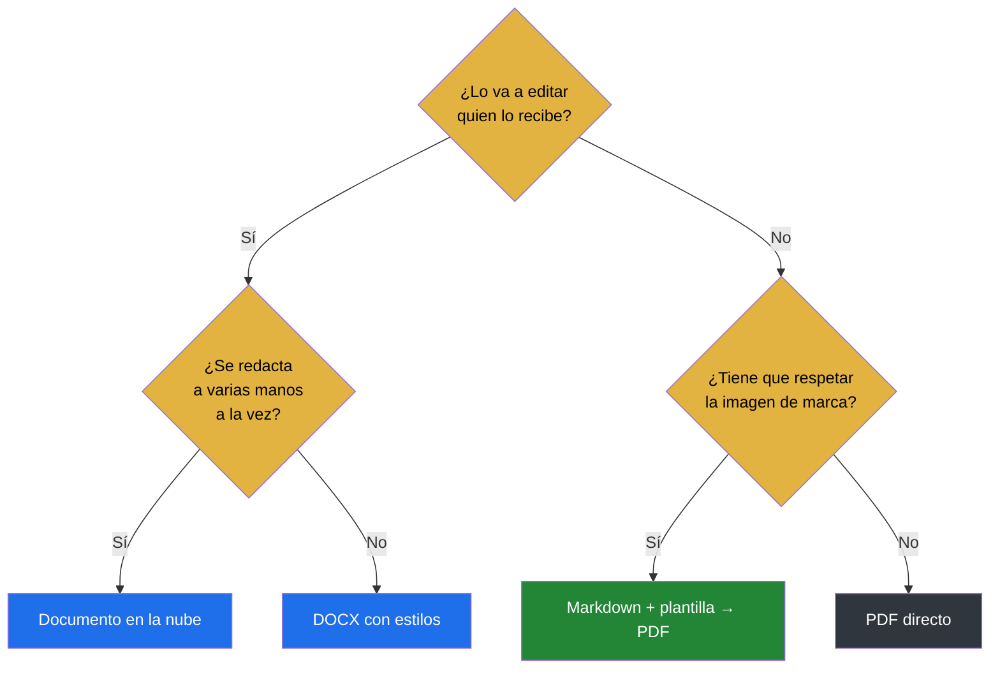
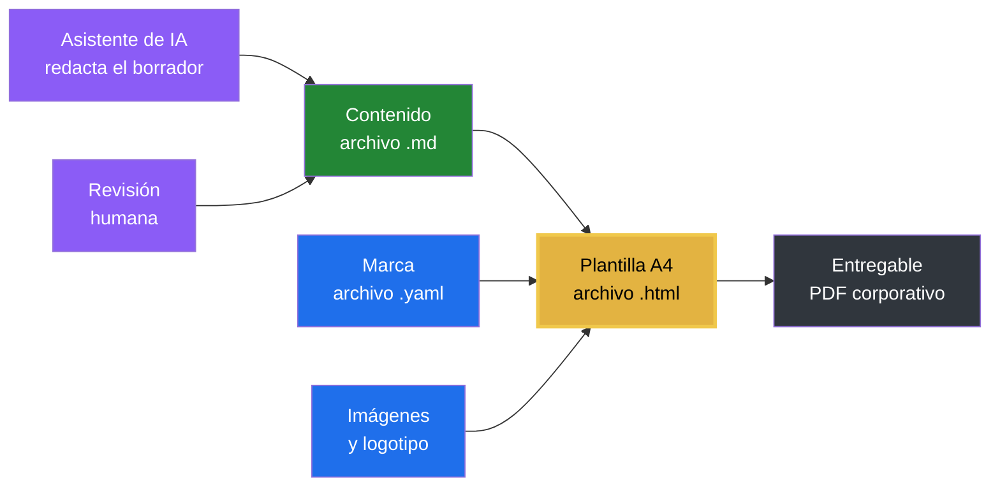

> La pregunta correcta no es cuál es el mejor formato, sino qué le va a pasar a este documento después de que lo entregues.

# Cómo decidir

Casi todas las discusiones sobre formatos se resuelven con seis preguntas. Contéstalas antes de abrir ninguna herramienta.

En la práctica, las tres primeras ya deciden casi siempre:

**¿Quién lo recibe?** Alguien de dentro que va a editarlo, o alguien de fuera que solo va a leerlo. Es la pregunta que más decisiones cierra.

**¿Tiene que poder modificarlo?** Si la respuesta es no, gana la fidelidad visual. Si es sí, gana la editabilidad, y hay que asumir que el aspecto se degradará con el uso.

**¿Por dónde viaja?** Correo con límite de tamaño, repositorio, intranet, impresión o proyección. Cada canal descarta algo.

**¿Tiene que respetar una marca?** Si hay guía de estilo, el formato debe permitir aplicarla de forma sistemática, no a mano cada vez.

**¿Es un documento vivo o congelado?** Un entregable firmado no vuelve a tocarse. Un manual se revisa cada trimestre y necesita historial.

**¿Quién lo va a mantener?** Un formato que solo una persona sabe editar es una dependencia, por muy bueno que sea el resultado.

# Los formatos, uno a uno

## Para lectura final

**PDF.** Fidelidad garantizada: se ve igual en cualquier equipo y se imprime como se diseñó. Es el destino natural de cualquier entregable externo. Su límite es que no se edita: si hay que cambiar una cifra, se regenera desde la fuente, y si la fuente se ha perdido, se rehace entero. Ese es el fallo más caro y el más frecuente.

**PDF generado desde código.** Typst o LaTeX producen PDF de calidad tipográfica alta y, sobre todo, reproducible: el mismo código da el mismo documento dentro de dos años. A cambio exige aprender un lenguaje, lo que lo convierte en dependencia de quien lo domina. Compensa en colecciones grandes con formato uniforme —tesis, manuales, series de informes— y rara vez en un documento suelto.

**HTML.** Se publica, se navega y se busca. Bien para documentación viva en una intranet. Exige alojamiento y no controla la impresión, salvo que esté preparado para ello. Esta plantilla es un caso particular: un HTML pensado exactamente para imprimirse.

## Para trabajo compartido

**DOCX.** Es el formato en el que la mayoría sabe trabajar, y eso pesa. Admite comentarios y control de cambios, que siguen siendo la mejor herramienta de revisión que existe. El problema no es el formato sino el uso: se aplica formato a mano en vez de con estilos, y a las tres revisiones el documento es un mosaico de tipografías. Si se usa con disciplina de estilos, aguanta bien.

**Documentos en la nube.** La edición simultánea es su ventaja real y no la tiene ningún otro formato. A cambio, la fidelidad visual es pobre y el documento vive dentro de una plataforma. Bien para redactar entre varios, mal como entregable.

**Markdown.** Texto plano con marcas mínimas. No tiene aspecto propio, y esa es justamente su virtud: el aspecto se lo pone otra pieza. Se compara línea a línea, se versiona y lo entiende cualquier herramienta. Necesita algo que lo componga, y ahí entra esta plantilla.

Conviene añadir que hoy es el formato que mejor se lleva con los asistentes de IA: cualquiera de ellos lo devuelve bien formado si se le pide, mientras que producir un DOCX o un PDF correcto exige un paso intermedio. Eso ha cambiado el cálculo respecto a hace unos años.

## Para casos concretos

**PPTX.** Para exponer en vivo. El error habitual es usarlo como documento: se acaba con diapositivas llenas de texto que ni se exponen bien ni se leen bien. Si el destinatario lo va a leer solo, no es una presentación, es un informe.

**XLSX.** Para calcular y modelar. Como documento tiene el problema de que la lógica se esconde en las celdas y nadie sabe de dónde sale un número seis meses después.

**JSON y YAML.** Para que los lea una máquina, o para configurar. El YAML de esta plantilla es exactamente ese caso: no es un documento, es la definición de la marca.

<!-- horizontal -->

# Comparativa de formatos

| Formato | Editable | Fidelidad visual | Versionable | Regenerable | Uso principal | Riesgo típico |
| --- | --- | --- | --- | --- | --- | --- |
| PDF | No | Alta | No | No | Entregable externo | Se edita a mano y se pierde la fuente |
| Typst o LaTeX → PDF | Vía fuente | Alta | Sí | Sí | Colecciones de marca | Dependencia de quien domina el lenguaje |
| DOCX | Sí | Media | Parcial | Sí | Revisión con control de cambios | Formato manual en vez de estilos |
| Documentos en la nube | Sí | Baja | Automático | No | Redacción simultánea | Dependencia de plataforma |
| Markdown | Sí | Nula | Sí | Sí | Fuente única de verdad | Requiere una plantilla que lo componga |
| HTML | Sí | Media-alta | Sí | Sí | Publicación navegable | Exige alojamiento |
| PPTX | Sí | Alta | No | Sí | Exposición en vivo | Se usa como documento y no lo es |
| XLSX | Sí | Media | No | No | Cálculo y modelos | Lógica escondida en celdas |
| JSON o YAML | Sí | Nula | Sí | Sí | Configuración y automatización | Ilegible para perfiles no técnicos |

<!-- vertical -->

# Dónde encaja esta plantilla

La plantilla no es un formato más: es el puente entre dos columnas de esa tabla. Toma la fuente que mejor se versiona —Markdown— y produce la salida que mejor se entrega —PDF—, aplicando por el camino una guía de marca que vive en un tercer archivo.

Por el camino cubre lo que en un procesador de textos exige oficio: numeración de secciones e índice automáticos, tablas que se parten repitiendo cabecera, páginas giradas para los anexos anchos, diagramas que siguen siendo texto editable y fórmulas matemáticas compuestas de verdad.

Eso resuelve el compromiso que normalmente hay que aceptar. Con DOCX ganas editabilidad y pierdes uniformidad. Con PDF ganas fidelidad y pierdes la posibilidad de corregir. Aquí no eliges: el contenido sigue siendo editable y comparable, y el resultado sigue siendo fiel, porque son dos artefactos distintos y uno se genera del otro.

## El recorrido de un documento

El flujo completo, desde el encargo hasta el entregable, pasa por tres archivos que nadie comparte con nadie más.

La flecha que importa es la de la revisión humana: el asistente redacta, pero lo que entra en el `.md` es lo que alguien ha leído y aprobado.

## Cuándo compensa el coste de cambiar

Cambiar de formato tiene un coste de aprendizaje que solo se amortiza si el documento se repite. Una regla aproximada: si el tiempo de maquetación manual es $t_m$ y el número de ediciones previstas es $n$, la plantilla compensa cuando

$$
n \cdot t_m > t_a + n \cdot t_p
$$

donde $t_a$ es el tiempo de aprendizaje y $t_p$ el de pegar y exportar, que en la práctica son minutos. Con maquetación manual de media hora y cinco ediciones al año, el cálculo sale a favor desde el primer trimestre.

Despejando el número de ediciones a partir del cual compensa:

$$
n^{*} = \frac{t_a}{t_m - t_p}
$$

Y el ahorro acumulado tras $n$ ediciones, que es el número que interesa a quien aprueba el cambio:

$$
A(n) = n \cdot (t_m - t_p) - t_a
$$

La conclusión importa más que la fórmula: ==el coste de aprender se paga una vez y el de maquetar a mano se paga siempre==, así que la decisión depende sobre todo de cuántas veces se va a repetir el documento.

## Cuándo usarla

Encaja bien cuando el documento cumple tres condiciones: se va a entregar en PDF, tiene que respetar una imagen corporativa, y va a revisarse más de una vez.

Informes periódicos, actas, manuales de proceso, propuestas, fichas técnicas, documentación docente. Todo lo que se repite con la misma forma y distinto contenido.

## Cuándo no

No compensa para un correo largo, para una nota interna de media página o para algo que se va a escribir una vez y no volverá a tocarse. Tampoco para documentos que se redactan a varias manos en tiempo real: para eso, un documento en la nube y, cuando el texto esté cerrado, se pasa aquí para la maquetación final.

Y hay un requisito de entorno: la exportación con páginas de distinta orientación necesita un navegador basado en Chromium. Si el equipo trabaja con Firefox o Safari y los documentos mezclan orientaciones, hay que preverlo.

Y no sustituye a Word donde Word es mejor: si el valor del proceso está en el control de cambios y los comentarios de cinco revisores, ese es su terreno.

# El reparto de responsabilidades

Lo que hace sostenible este flujo no es la herramienta, es que cada pieza tiene un dueño distinto.

| Pieza | Quién la mantiene | Cada cuánto cambia |
| --- | --- | --- |
| Contenido .md | Quien redacta el documento | Con cada versión |
| Guía de estilo .yaml | Responsable de marca | Rara vez |
| Plantilla .html | Se distribuye, no se edita | Al actualizar la herramienta |
| PDF final | Nadie: se regenera | Cada vez que cambia el contenido |

Quien redacta no decide colores. Quien mantiene la marca no toca el texto. Y el PDF no se edita nunca: si hay que cambiarlo, se cambia la fuente y se vuelve a generar.

Esa última regla es la que más cuesta sostener y la que más problemas evita. Un PDF corregido a mano es un documento sin fuente, y a partir de ahí toda la cadena deja de funcionar.
