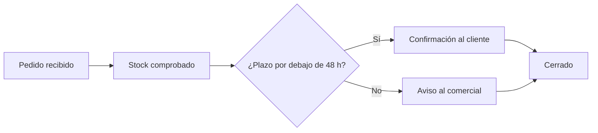
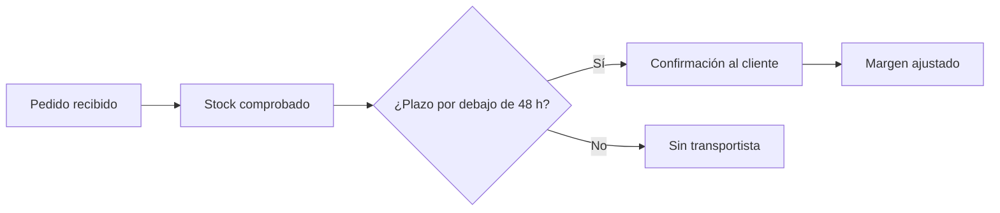
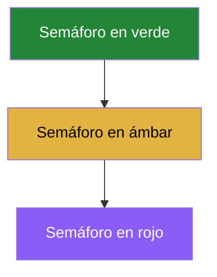

# Para qué sirve este documento

Carga este archivo y ve cambiando la guía de estilo. Todo lo que hay aquí
debería adoptar los colores y la tipografía de la marca que cargues, sin
tocar una línea del Markdown.

Los tres diagramas de más abajo prueban las tres reglas de color, de menos
a más fuerte: la marca, lo que escribas dentro del diagrama, y el semáforo.

# Un diagrama corriente

No lleva ningún color escrito: toma entero el de la guía de estilo. El
principio y el final van llenos del color primario, el rombo en el tono de
aviso, y los pasos intermedios en el tono suave.



# El mismo, con el semáforo

Aquí hay tres cajas marcadas. La marca del semáforo gana siempre: ni la
guía de estilo ni un color escrito a mano la desplazan, porque marcar una
caja como riesgo es una decisión sobre esa caja, no sobre el diagrama.

En el editor se marcan con la barra que aparece al entrar en el diagrama,
o escribiendo `:::ok`, `:::warning` o `:::risk` al final de la línea.



# Un diagrama que va por libre

Este lleva `%% a4: custom` en la primera línea, así que conserva sus
propios colores aunque el resto del documento sea de la marca. Se pone
desde la barra del editor, con el botón `custom`.

Fíjate en que las esquinas siguen redondeadas: la forma de la caja es del
documento, el color es del diagrama.



# Una tabla

| Delegación | Facturación | Variación | Margen |
|---|---|---|---|
| Levante | 4.180.000 | +18,2 % | 22,4 % |
| Cataluña | 3.910.000 | +11,7 % | 21,0 % |
| Centro | 2.640.000 | +4,1 % | 19,8 % |
| Norte | 1.870.000 | −2,3 % | 18,1 % |

La cabecera toma el color de banda de la guía de estilo, y las filas
alternas el tono suave.

# Una fórmula

El margen ponderado del semestre sale de:

$$ M = \frac{\sum_{i=1}^{n} f_i \cdot m_i}{\sum_{i=1}^{n} f_i} $$

# Una cita y un bloque de código

> Si julio repite el comportamiento de junio, el objetivo anual se alcanza
> en la primera quincena de noviembre.

```python
def margen_ponderado(filas):
    total = sum(f["facturacion"] for f in filas)
    return sum(f["facturacion"] * f["margen"] for f in filas) / total
```

# Una imagen

Carga la carpeta `imagenes` y esta referencia se resuelve sola.


# Datos estructurados

Carga `datos-estructurados/sample-data.xlsx` (o el .json, o el .md) en la
casilla de datos y comprueba que la hoja se compone con el estilo de la
marca.
