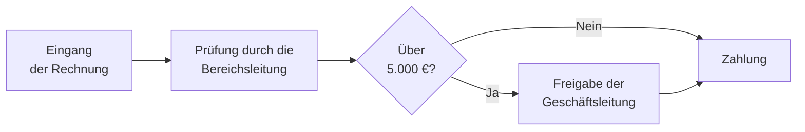
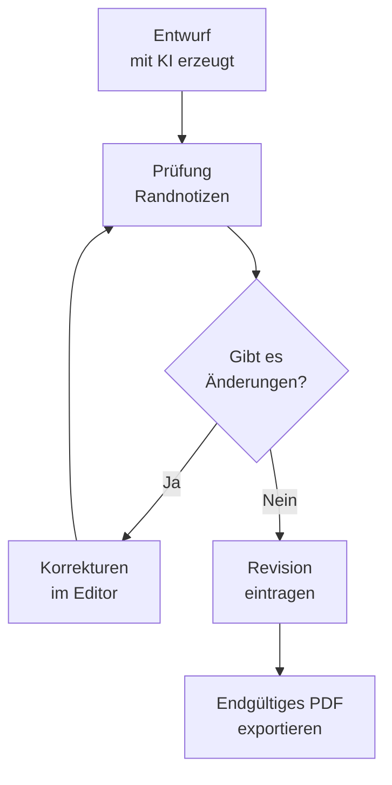

<!-- justify -->
> Sie müssen weder programmieren können noch irgendetwas installieren. Wenn Sie eine E-Mail schreiben und Copilot um etwas bitten können, können Sie **MinervA4** bedienen.

<!-- justify -->
Das Werkzeug heißt **MinervA4**, nach der Minerva-Presse, die in jeder kleinen Druckerei stand: Man legte Papier ein, und es kam bedruckt heraus. In diesem Leitfaden wird es auch „die Vorlage“ genannt, denn das ist es.

<!-- justify -->
# Welches Problem es löst

<!-- justify -->
Einen Bericht zu schreiben, der etwas hermacht, kostet Zeit, und der größte Teil davon geht nicht ins Denken: Er geht ins Anordnen. Ränder anpassen, dafür sorgen, dass die Tabelle nicht auseinanderbricht, dass die Überschriften gleich groß sind, dass das Logo dort steht, wo es hingehört, dass die Fußzeile die richtige Nummer trägt.

<!-- justify -->
Diesen Teil übernimmt die Vorlage. Sie schreiben den Inhalt als normalen Text, sie setzt ihn im Erscheinungsbild Ihres Unternehmens und legt ihn Ihnen fertig zum Speichern als PDF hin.

<!-- justify -->
Es ist eine einzige Datei, die sich mit einem Doppelklick im Browser öffnet, wie eine Webseite. Nichts wird installiert, es ist keine Verbindung nötig, und es wird nichts irgendwohin geschickt.

<!-- justify -->
## Satz kostet keine Tokens

<!-- justify -->
Es lohnt sich, zwei Dinge zu trennen, die oft verwechselt werden. Die KI bitten Sie um **den Inhalt**, ein einziges Mal. Den **Satz** —Titelseite, Inhaltsverzeichnis, Nummerierung, Aufteilung auf Seiten, Tabellen in den Farben Ihrer Marke, Diagramme, Fußzeilen— macht diese Datei in Ihrem Browser, sofort und ohne irgendetwas zu verbrauchen.

<!-- justify -->
Der Unterschied zeigt sich in der Wiederholung. Eine Zahl zu korrigieren und neu zu exportieren kostet nichts: Sie ändern den Text, und das PDF baut sich von selbst neu auf. Die ganze Marke eines vierzigseitigen Dokuments zu wechseln kostet nichts: Sie laden eine andere Stildatei. Denselben Bericht in sechs Sprachen herauszugeben kostet, was die Übersetzung des Inhalts kostet, und keinen Token mehr für den Satz.

<!-- justify -->
Würden Sie stattdessen einen Assistenten bitten, Ihnen das Dokument fertig gesetzt zurückzugeben, wäre jede Nachbesserung —ein Rand, eine Farbe, eine Tabelle, die auseinanderbricht— eine weitere Anfrage, mit eigenen Kosten und eigener Wartezeit. Hier ist der Zyklus des Nachbesserns lokal und sofort, und genau das ist der Teil der Arbeit, der sich am häufigsten wiederholt.

<!-- justify -->
## Die drei Bausteine

<!-- justify -->
Drei Namen begegnen Ihnen in diesem Leitfaden. Ich erkläre sie jetzt in je einem Satz und später in Ruhe.

<!-- justify -->
**Markdown** ist der Inhalt: Ihr Text, mit ein paar wenigen Marken, die anzeigen, was eine Überschrift und was eine Tabelle ist.

<!-- justify -->
**YAML** ist der Stil: die Farben und die Schriften Ihres Unternehmens, ein einziges Mal aufgeschrieben.

<!-- justify -->
**Mermaid** ist für die Diagramme: Man beschreibt sie schreibend, statt sie zu zeichnen.

<!-- justify -->
Alle drei sind gewöhnlicher Text. Es sind keine Programme und keine seltsamen Formate: Es sind Dateien, die sich mit dem Windows-Editor öffnen lassen. Und das Wichtige für Sie ist, dass **Sie keines davon lernen müssen**: Copilot schreibt sie für Sie, wenn Sie richtig danach fragen. In diesem Leitfaden gebe ich Ihnen die genauen Texte, die Sie ihm einfügen müssen.

<!-- justify -->
## Ohne etwas zu installieren

<!-- justify -->
Die Vorlage ist **eine einzige Datei**, die sich mit einem Doppelklick öffnet, wie eine Webseite. Nichts wird installiert, sie verlangt keine Administratorrechte, es ist kein Konto anzulegen, und sie hängt nicht davon ab, dass die IT irgendetwas freigibt. Wenn Sie auf Ihrem Rechner ein PDF öffnen können, können Sie das hier benutzen.

<!-- justify -->
Eine Verbindung braucht sie auch nicht. Alles Nötige steckt in der Datei, die Schriften eingeschlossen, also funktioniert sie genauso auf einem Laptop ohne Netz, im Zug oder in einem Raum ohne WLAN.

<!-- justify -->
## Ihre Dokumente verlassen das Unternehmen nicht

<!-- justify -->
Das ist es, was gewöhnlich Sorgen macht, und es lohnt sich, es genau zu sagen.

<!-- justify -->
**Die Vorlage schickt nichts irgendwohin.** Es steht kein Server dahinter. Wenn Sie Ihr Markdown, Ihre Bilder oder Ihr Logo laden, werden die Dateien auf Ihrem eigenen Rechner gelesen, um sie am Bildschirm zu zeigen; hochgeladen wird nichts. Sie können es auf die denkbar einfachste Weise prüfen: Trennen Sie das Netz, und Sie werden sehen, dass sie vollständig weiterarbeitet.

<!-- justify -->
**Was sie sich merkt, bleibt in Ihrem Browser.** Beim erneuten Öffnen finden Sie Ihr letztes Dokument, den Stil und das Logo vor. Das wird im lokalen Speicher des Browsers abgelegt, auf Ihrer Festplatte, und es wandert in keine Cloud und wird mit keinem anderen Rechner abgeglichen.

<!-- justify -->
**Das PDF erzeugt Ihr eigener Browser.** Die Schaltfläche zum Speichern öffnet den Druckdialog des Systems; es läuft über keinen externen Dienst.

<!-- justify -->
Jetzt der ehrliche Teil: **der KI-Assistent ist eine andere Sache**. Wenn Sie Copilot bitten, Ihnen den Inhalt zu verfassen, verlässt dieser Text sehr wohl Ihren Rechner und geht an die Dienste von Microsoft, zu den Bedingungen, die Ihr Unternehmen vertraglich vereinbart hat. Daran ändert die Vorlage nichts, weder zum Guten noch zum Schlechten. Ist ein Dokument besonders heikel, gilt dieselbe Regel wie bei jedem KI-Werkzeug: Schreiben Sie den Inhalt selbst und benutzen Sie die Vorlage nur, um ihn zu setzen, denn das ist der Teil, der Ihren Rechner nicht verlässt.

<!-- justify -->
# Markdown: schreiben, ohne zu formatieren

<!-- justify -->
In Word markieren Sie eine Überschrift, indem Sie sie auswählen und eine Formatvorlage wählen. In Markdown markieren Sie sie, indem Sie ein Zeichen davorschreiben. Das ist alles.

<!-- justify -->
```text
# Das ist eine Abschnittsüberschrift
## Das ist eine Unterüberschrift
Das ist ein normaler Absatz.
**Das erscheint fett** und *das kursiv*.
- Das ist ein Punkt einer Liste
```

<!-- justify -->
Der Vorteil ist nicht die Bequemlichkeit, es ist ein anderer: Weil der Inhalt keine Formatierung in sich trägt, kann die Vorlage ihm die Ihres Unternehmens geben, ohne sich mit irgendetwas zu streiten. Deshalb kann derselbe Text heute im Erscheinungsbild der einen Marke und morgen in dem einer anderen erscheinen, ohne dass man ihn anfasst.

<!-- justify -->
Der Nachteil ist, dass man diese Zeichen lernen muss. Und hier kommt Copilot ins Spiel: Lernen Sie sie nicht, fragen Sie danach.

<!-- justify -->
## Wenn Sie es schon in Word geschrieben haben

<!-- justify -->
Sie müssen es nicht noch einmal schreiben. Das Feld **Dokument** nimmt auch eine `.docx` an: Sie legen sie genauso ab wie eine `.md`, und die Vorlage wandelt sie um.

<!-- justify -->
Aus Word kommen **Inhalt und Struktur**: die Überschriften, Fett und Kursiv, Aufzählungen und nummerierte Listen, die Tabellen, die Links und die eingebetteten Bilder. Aus der `.docx` kommen außerdem der Titel, der Autor und das Datum, die Word in der Datei speichert, und damit füllt sich die Titelseite von selbst.

<!-- justify -->
Was **nicht** mitkommt, ist das Design: Farben, Schriften, Ränder und Textfelder werden verworfen. Das ist kein Mangel, es ist die übliche Abmachung: Das Dokument liefert, was es sagt, und der Styleguide liefert, wie es aussieht. Würden wir den Satz aus Word übernehmen, hätte das YAML nichts zu melden, und das Ergebnis trüge weiterhin das Erscheinungsbild dessen, der es geschrieben hat.

<!-- justify -->
Am Ende wird Ihnen gesagt, was hereingekommen ist und was draußen geblieben ist —„12 Absätze, 1 Tabelle, 1 Bild · Farben, Textfelder und Ränder verworfen“—, damit sich der veränderte Anblick als das liest, was er ist, und nicht als Fehler.

<!-- justify -->
Eine PowerPoint-Folie geht nicht hinein: Eine Folie ist eine Fläche mit von Hand platzierten Kästen, kein Dokument mit Struktur, und sie zu rekonstruieren, indem man rät, welcher Kasten die Überschrift ist, gibt ein schlechteres Ergebnis, als den Text zu kopieren.

<!-- justify -->
## Der Anweisungsgenerator

<!-- justify -->
Sie müssen den Prompt nicht schreiben. Die Vorlage verfasst ihn für Sie: Drücken Sie **Dokument von einer KI anfordern**, auf der Startseite oder über dem Editor.

<!-- justify -->
Sie beschreiben das Dokument in vier Feldern —Art, worum es geht, **Ausgabesprache** und Umfang—, kreuzen an, ob Sie Tabellen, Diagramme, Formeln oder Zahlen aus Ihrem Datenblatt wollen, und die Anweisungen schreiben sich von selbst im Panel daneben. Sie werden mit einer Schaltfläche kopiert, in Copilot eingefügt, und die Antwort kommt in Schritt 3 desselben Fensters zurück, das sie von selbst säubert: Es entfernt den Codeblock, der sie umschließt, und die Höflichkeitsfloskeln.

<!-- justify -->
Ist eine Datenquelle geladen, wird die Übersichtstabelle nicht von Hand verlangt: Die Anweisungen fordern einen `datos`-Block, der auf Ihr Blatt zeigt, sodass die Tabelle bereits verknüpft ankommt und sich neu aufbaut, wenn sich die Zahlen ändern. Beim Setzen der Antwort wird außerdem jede Tabelle, deren Kopfzeile zu einem Ihrer Blätter passt, in diesen Block verwandelt; das erledigt das Kästchen **Die Tabellen mit meinen Daten verknüpfen** unter dem Einfügefeld. Und bei einer schon geschriebenen Tabelle setzen Sie den Cursor hinein und öffnen die Datenauswahl: Oben erscheint die Schaltfläche zum Verknüpfen.

<!-- justify -->
Das Sprachfeld ist unabhängig von der Sprache der Oberfläche: Sie können auf Spanisch arbeiten und das Dokument auf Deutsch anfordern. Und die Anweisungen tragen nie die Angaben Ihrer Titelseite mit, damit keine Namen und keine Zahlen in einen fremden Chat gelangen.

<!-- justify -->
## Der Basis-Prompt, falls Sie ihn lieber von Hand schreiben

<!-- justify -->
Das ist der Text, den Sie Copilot einfügen können, wenn Sie etwas zurückbekommen wollen, das für die Vorlage bereit ist. Ändern Sie nur die letzte Zeile.

<!-- justify -->
```text
Gib mir die Antwort im Markdown-Format, mit diesen Regeln:
- Verwende # für die Hauptabschnitte und ## für die Unterabschnitte darin.
- Nummeriere die Überschriften nicht: Die Nummerierung wird von selbst gesetzt.
- Verwende Markdown-Tabellen, wenn du Dinge vergleichst.
- Verwende keine Emojis und keine Schmuckzeichen.
- Gib mir nur das Markdown, ohne Erklärungen davor oder danach.

Das Dokument ist: ein Ergebnisbericht zum ersten Quartal für die Geschäftsleitung.
```

<!-- justify -->
Wenn Copilot antwortet, kopieren Sie das Ergebnis und fügen es in den Editor der Vorlage ein. Fertig: Das ist der ganze Ablauf.

<!-- justify -->
# Ein Beispiel aus der Praxis, Schritt für Schritt

<!-- justify -->
Wir machen jetzt einen vollständigen Bericht von Grund auf. Wenn Sie diesen sechs Schritten folgen, haben Sie in wenigen Minuten ein PDF im Erscheinungsbild Ihres Unternehmens.

<!-- justify -->
## Schritt 1 · Bitten Sie Copilot um den Inhalt

<!-- justify -->
Öffnen Sie Copilot und fügen Sie ihm den Basis-Prompt von oben ein, wobei Sie die letzte Zeile durch das ersetzen, was Sie brauchen. Zum Beispiel:

<!-- justify -->
```text
Das Dokument ist: ein Bericht für die Geschäftsleitung über die Einführung
des neuen Systems zur Störungsverwaltung. Er soll eine Einleitung haben, einen
Ergebnisteil mit einer Vergleichstabelle vorher/nachher, einen Abschnitt zu
Risiken und einen zu den nächsten Schritten. Ungefährer Umfang: zwei Seiten.
```

<!-- justify -->
Copilot gibt Ihnen etwas in dieser Art zurück, und genau so muss es aussehen:

<!-- justify -->
```text
# Einleitung
Das neue System ging im Januar in Betrieb...

# Ergebnisse
## Reaktionszeiten
Die Tabelle vergleicht die drei Monate davor mit den drei danach.

| Kennzahl | Vorher | Nachher |
|---|---|---|
| Mittlere Zeit | 4,2 h | 1,8 h |
```

<!-- justify -->
## Schritt 2 · Fügen Sie die Titelseite hinzu

<!-- justify -->
Die Angaben der Titelseite lassen sich im Abschnitt „Das Dokument beschreiben“ des Panels von Hand eintragen, bequemer ist es aber, auch sie von Copilot zu verlangen. Hängen Sie das ans Ende Ihres Prompts:

<!-- justify -->
```text
Beginne die Antwort mit einem Front-Matter-Block, oben und unten von drei
Bindestrichen begrenzt, mit diesen Schlüsseln auf Englisch: company, department,
document_type, reference, title, subtitle, author, role, email, phone, date, tagline.
```

<!-- justify -->
Es gibt Ihnen etwas in dieser Art zurück, das die Vorlage benutzt, um die Titelseite zu setzen:

<!-- justify -->
```text
company: Name Ihres Unternehmens
document_type: Bericht
reference: OPS-2026-014
title: Einführung des Störungssystems
subtitle: Ergebnisse des ersten Quartals
author: Betriebsleitung
role: Projektverantwortlicher
date: 26. August 2026
```

<!-- justify -->
Die Bezeichnungen sind mit Absicht auf Englisch, auch wenn der Inhalt in einer beliebigen Sprache steht. Sie sind überall dieselben, also kann ein Kollege aus jedem Land die Datei öffnen und wissen, was was ist. Die Vorlage versteht die Bezeichnungen auch auf Spanisch, falls Sie eine alte Datei bekommen.

<!-- justify -->
Wenn Sie nicht danach fragen, ist das kein Problem: Sie füllen diese Felder im Abschnitt „Das Dokument beschreiben“ des Panels aus.

<!-- justify -->
## Schritt 3 · Öffnen Sie die Vorlage und fügen Sie ein

<!-- justify -->
Machen Sie einen Doppelklick auf die Datei der Vorlage. Sie öffnet sich im Browser mit einer Startseite, die drei Wege anbietet: eine Datei öffnen —eine `.md` oder eine `.docx`—, ein Beispiel ansehen oder das Dokument von einer KI anfordern.

<!-- justify -->
Links steht eine Spalte mit den Arbeitsbereichen, in zwei Phasen gruppiert. **Vorbereiten** versammelt, was Sie von außen mitbringen: *Dateien* (die .md, den Bildordner und die Datenquelle) und *Marke* (den Stil, das Logo und die Schriften). **Arbeiten** versammelt, was man mit dem Dokument vor Augen tut: *Eigenschaften* (welche Seiten gesetzt werden und was die Titelseite sagt), *Erscheinungsbild* und *Editor*.

<!-- justify -->
Öffnen Sie einen Bereich, und die übrigen klappen zu: Nie verdecken sich zwei Dinge gegenseitig. Das gesetzte Dokument nimmt immer ein, was übrig bleibt, rechts.

<!-- justify -->
Drücken Sie **Editor**, um zu schreiben. Links öffnet sich ein Panel: Fügen Sie dort den Text ein, den Copilot Ihnen gegeben hat.

<!-- justify -->
Das Dokument erscheint rechts gesetzt, während Sie schreiben. Wenn Sie sich vertun, korrigieren Sie, und es baut sich von selbst neu auf.

<!-- justify -->
## Schritt 4 · Geben Sie ihm das Erscheinungsbild Ihres Unternehmens

<!-- justify -->
Hier kommt das YAML ins Spiel. Es ist eine kleine Datei, in der die Farben und die Schriften Ihrer Marke stehen. Normalerweise hat es jemand aus Ihrem Team schon vorbereitet, und Sie müssen es nur in das Feld **Stil .yaml** im Bereich **Marke** laden.

<!-- justify -->
Hat es noch niemand, können Sie Copilot mit den Angaben aus Ihrem Corporate-Handbuch darum bitten:

<!-- justify -->
```text
Erzeuge eine YAML-Datei als Styleguide für Dokumente, mit dieser Struktur:
brand mit name und tagline; palette mit primary, accent, surface, on_surface,
band_bg, band_fg und muted; typography mit display, heading, subheading, body,
caption und mono, jeweils mit family, weight und size_pt; layout mit page_size A4
und margin_mm; components mit table, band und divider.

Die Farben meines Unternehmens sind: Firmenblau #003366 als Primärfarbe und
Orange #FF6B00 als Akzentfarbe. Die Schrift ist Arial.
Gib mir nur das YAML, ohne Erklärungen.
```

<!-- justify -->
Kopieren Sie, was es Ihnen zurückgibt, und fügen Sie es unter „Styleguide einfügen“ im Bereich **Marke** ein. Drücken Sie *Stil anwenden*, und das Dokument ändert augenblicklich sein Aussehen.

<!-- justify -->
Der Styleguide entscheidet mehr als die Farben: auch **die Form des Blatts**. Mit `layout: orientation: horizontal` öffnet sich das Dokument gleich im Querformat, und mit `mode: presentation` gleich als Folien, sodass sich derjenige, der ihn lädt, nicht daran erinnern muss, etwas zu drücken. Beim Wechsel auf einen anderen Styleguide kehrt das Blatt zu Hochformat und Dokument zurück, sofern der neue nichts anderes sagt; denselben Styleguide erneut anzuwenden rührt nichts an, und genau das braucht man, wenn man eine Farbe nachbessert und das Blatt schon von Hand gedreht ist.

<!-- justify -->
Und den **Hintergrund des Papiers**. `layout: page_background` nimmt jeden Hintergrund an, vom flachen Farbton bis zum Verlauf, und `page_texture` legt darüber eine sehr zarte Schicht: `hatch`, `vignette`, `grain` oder `none`. Sie werden mit Verläufen gezeichnet, also gibt es nichts herunterzuladen, und sie kommen im PDF genauso heraus.

<!-- justify -->
Eine Warnung, die Ärger erspart: **ein dunkler Hintergrund ändert nicht die Farbe des Textes**. Die ändern `palette: on_surface` und die Farben von `components`, und die müssen gleichzeitig mit angehoben werden. Fällt der Kontrast zu gering aus, warnt die Vorlage Sie, bevor Sie es im PDF entdecken. Und beim Drucken muss man im Dialog des Browsers „Hintergrundgrafiken“ aktivieren, sonst kommt das Blatt weiß heraus.


<!-- justify -->
## Schritt 5 · Fügen Sie das Logo hinzu

<!-- justify -->
Im Feld **Logo**, ebenfalls unter **Marke**, wählen Sie die Bilddatei Ihrer Marke. Es erscheint unten links auf der Titelseite und bleibt im Dokument eingebettet, sodass das PDF es behält.

<!-- justify -->
## Schritt 6 · Speichern Sie das PDF

<!-- justify -->
Wenn das Dokument im Querformat läuft, wählen Sie vorher die Ausrichtung unter **Erscheinungsbild · Seite**. Drücken Sie danach oben rechts **Als PDF sichern**. Der Druckdialog des Browsers öffnet sich. Dort gibt es drei Einstellungen, auf die es ankommt:

<!-- justify -->
- Ränder: **Keine**. Die Vorlage hält ihre eigenen schon frei.
- Skalierung: **100 %**.
- Hintergrundgrafiken: **aktiviert**, damit die Farben herauskommen.

<!-- justify -->
Speichern, und Sie haben Ihr Dokument.

<!-- justify -->
<!-- pagebreak -->

<!-- justify -->
# Die Werkzeugleiste

<!-- justify -->
Über dem Kasten, in dem Sie schreiben, steht eine Reihe von Schaltflächen. Sie dienen demselben wie in Word: Sie wählen einen Text aus und drücken die Schaltfläche. Wählen Sie nichts aus, schreibt die Schaltfläche ein Beispiel und lässt es markiert, damit Sie darüberschreiben.

<!-- justify -->
Sie stehen in sieben Gruppen, durch einen senkrechten Strich getrennt, und gehen vom Kleinen zum Großen:

- **Text** — fett, kursiv, Textmarker und Code im Fließtext: was mit ein paar Wörtern geschieht.
- **Absatz** — Abschnittsüberschrift, Unterüberschrift, Liste, nummerierte Liste und hervorgehobenes Zitat: was mit einer ganzen Zeile geschieht.
- **Ausrichtung** — links, zentriert, rechts, Blocksatz und das Kreuz, das sie entfernt.
- **Einfügen** — Link, Bild, Tabelle, **Daten**, Formel, Codeblock und Emojis: was Neues hereinbringt.
- **Kästen** — der Spaltenblock und die drei der Ampel: Kästen, die Text umschließen.
- **Seite** — Umbruch und Drehung ins Querformat.
- **Werkzeuge** — Randnotiz und Suche: zum Arbeiten, sie hinterlassen nichts Gedrucktes.

<!-- justify -->
Passt die Leiste nicht in die Breite, bricht sie zwischen den Gruppen um und nie innerhalb einer.

<!-- justify -->
Die vier zur Ausrichtung schreiben eine Marke über den Absatz. Die fünfte, die mit dem Kreuz, entfernt sie: mit ausgewähltem Text räumt sie das Ausgewählte auf, und **ohne jede Auswahl räumt sie das ganze Dokument auf** und sagt Ihnen, wie viele Marken sie entfernt hat. Sie wird mit `Strg+Z` rückgängig gemacht wie jede andere Bearbeitung.

<!-- justify -->
Damit müssen Sie sich keine einzige Marke merken. Und wenn etwas nicht in der Leiste steht, führt die Schaltfläche „Wie schreibt man das? Hilfe öffnen“, direkt darüber, zu dem Panel, in dem es erklärt wird.

<!-- justify -->
## Hinweiskästen

<!-- justify -->
Drei farbige Schaltflächen —grün, bernsteinfarben und rot— hüllen das, was Sie ausgewählt haben, in einen Hinweiskasten. Ohne jede Auswahl lassen sie den Kasten offen, mit dem Cursor darin.

<!-- justify -->
```text
:::risk Vertrag nicht unterschrieben
Der Lieferant hat den Anhang **nicht** zurückgeschickt.
:::
```

<!-- justify -->
Die Überschrift in der ersten Zeile ist freiwillig. Es sind dieselben drei Stufen, die für die Kästen eines Diagramms gelten, damit Grün im ganzen Dokument dasselbe bedeutet; deshalb kommt ihre Farbe nicht aus dem Styleguide, und deshalb tragen sie immer dunklen Text, auch auf einer Seite mit dunklem Hintergrund, wo sich der Kasten abheben muss.

<!-- justify -->
## Spalten

<!-- justify -->
Manchmal läuft der Text nicht durch: Er steht in Karten, wie auf einer Merkmalsseite oder in einer Gegenüberstellung. Dafür gibt es den Spaltenblock.

<!-- justify -->
```text
:::columns
### Laden Sie Ihr Dokument
Eine .md oder ein Word-Dokument.

### Fügen Sie das Datenblatt hinzu
Eine .xlsx, .csv oder .json mit den Zahlen.
:::
```

<!-- justify -->
Und so sieht derselbe Block gesetzt aus:

:::columns
### Dokument laden
Eine `.md`-Datei oder ein Word-Dokument. Die Vorlage liest es, setzt es
und lässt den Text im Editor stehen, damit Sie weiterarbeiten können.

### Datenblatt hinzufügen
Eine `.xlsx`, `.csv` oder `.json` mit den Zahlen. Von da an füllen sich
die Felder im Dokument bei jedem Dateiwechsel von selbst.
:::

<!-- justify -->
Ohne Überschriften und mit Bindestrichzeilen wird aus demselben Block ein
Vergleich. Hier in drei Zellen, mit `:::columns 3`:

:::columns 3
**Vorher.** Jeder Bericht wurde von Hand gesetzt. Kopieren, einfügen,
Ränder ausrichten und im nächsten Monat von vorn.

---

**Jetzt.** Der Text wird einmal geschrieben. Die Zahlen kommen aus dem
Blatt, die Gestaltung aus dem Markenhandbuch.

---

**Danach.** Datenquelle wechseln, und dasselbe Dokument kommt wieder
heraus, mit den Zahlen des neuen Quartals.
:::

<!-- justify -->
Jedes `###` öffnet eine Zelle und gibt ihr eine Überschrift. In der Zelle gilt dasselbe Markdown wie außerhalb —fett, Listen, Links, Bilder—, weil sie mit derselben Maschine gesetzt wird. Mit `:::columns 3` werden es drei, und es sind bis zu vier möglich. Wenn Sie keine Überschriften setzen, trennt auch eine Zeile aus drei Bindestrichen die Zellen.

<!-- justify -->
Geschrieben wird er von der Schaltfläche mit den zwei Balken in der Werkzeugleiste, es gibt also keine Syntax zu merken.

<!-- justify -->
Und eine Warnung zur Gestaltung: **ein Spaltenblock wird nicht auf zwei Seiten geteilt**. Er ist eine visuelle Einheit, und ihn zu teilen zerstört sie; passt er also nicht, wird mit der Zeilennummer gewarnt, damit Sie ihn in zwei Blöcke aufteilen. Das ist der Unterschied dazu, es mit einer rahmenlosen Tabelle zu machen: Eine Tabelle wird ohne Warnung mittendurch geschnitten, und obendrein zwingt sie Sie zu einer Kopfzeile, die nichts zu suchen hat, und dazu, allen Tabellen des Dokuments die Linien zu nehmen.

<!-- justify -->
## Suchen und ersetzen

<!-- justify -->
Die Lupe in der Leiste, oder `Strg+F`, öffnet eine Suche, die auf dem Text arbeitet, den Sie gerade schreiben. Das `Strg+F` des Browsers nützt hier nichts: Es sieht nicht in den Bearbeitungskasten hinein.

<!-- justify -->
Sie hebt alle Treffer hervor, zeigt an, bei welchem Sie stehen —„3 / 12“— und erlaubt, einen oder alle auf einmal zu ersetzen. Beim Sprung zu einem Treffer bewegt sich die Vorschau rechts an dieselbe Stelle, sie dient also auch dazu, in langen Dokumenten zu navigieren.

<!-- justify -->
## Emojis

<!-- justify -->
Die letzte Schaltfläche der Leiste öffnet eine Galerie von etwa zweihundertfünfzig Emojis, nach Thema gruppiert: Status, Pfeile, Büro, Daten, Arbeit, Personen, Stimmung und Gegenstände.

<!-- justify -->
Nützlich sind sie vor allem in Nachverfolgungstabellen, wo sich eine Statusmarke auf einen Blick besser liest als das Wort „erledigt“. Sie werden mit der Schrift des Systems gezeichnet, also kommen sie unter Windows und macOS auch im PDF farbig heraus.

<!-- justify -->
Zwei Warnungen zu den Überschriften. Die Nummerierung setzt die Vorlage: Schreiben Sie kein „1.“ davor, denn es käme doppelt heraus. Und die Abschnittsüberschriften sind das, was das Inhaltsverzeichnis bildet, es lohnt sich also, dass sie etwas Konkretes sagen.

<!-- justify -->
# Anwendungsfälle aus dem Alltag

<!-- justify -->
Das sind die Verwendungen, bei denen die Vorlage die meiste Zeit spart. Bei allen ist der Ablauf derselbe: Sie verlangen es von Copilot, Sie fügen es ein, Sie exportieren es.

<!-- justify -->
## Der Bericht, der jeden Monat wiederkehrt

<!-- justify -->
Das ist der Fall, der sich am meisten lohnt. Sie schreiben den Prompt einmal und verwenden ihn wieder, indem Sie die Daten austauschen.

<!-- justify -->
```text
Verfasse den monatlichen Tätigkeitsbericht der Abteilung in Markdown, mit
diesen Abschnitten: Zusammenfassung, Kennzahlen des Monats in einer Tabelle,
besondere Vorfälle und Prognose für den Folgemonat. Die Daten sind: [hier Ihre Daten einfügen].
Nummeriere die Überschriften nicht. Gib mir nur das Markdown.
```

<!-- justify -->
Speichern Sie die Datei mit „.md herunterladen“. Im Folgemonat laden Sie sie wieder, ändern die Zahlen und exportieren. Titelseite, Inhaltsverzeichnis und Format sind schon fertig.

<!-- justify -->
## Das Sitzungsprotokoll

<!-- justify -->
Copilot fasst gut zusammen, wenn Sie ihm die rohen Notizen geben. Verlangen Sie eine feste Struktur, damit alle Protokolle einander ähneln.

<!-- justify -->
```text
Verwandle diese Notizen in ein Protokoll in Markdown mit: Teilnehmende, Tagesordnung,
Beschlüsse in einer nummerierten Liste und offene Aufgaben in einer Tabelle mit den
Spalten Aufgabe, Verantwortlicher und Datum. Notizen: [hier Ihre Notizen einfügen].
```

<!-- justify -->
Die Emojis sind hier nützlich: Eine Statusmarke in der Aufgabenspalte liest sich auf einen Blick.

<!-- justify -->
## Das Handbuch eines Prozesses

<!-- justify -->
Hier kommt das Diagramm ins Spiel. Einem Prozess, der nur mit Text beschrieben ist, folgt man mühsam; mit einem Diagramm daneben versteht man ihn auf Anhieb.

<!-- justify -->
Verlangen Sie zuerst den Text und danach das Diagramm, in zwei getrennten Nachrichten. Fügen Sie das Diagramm direkt hinter dem Abschnitt ein, der es erklärt, und drehen Sie diese Seite, wenn es zu eng wird.

<!-- justify -->
## Das Angebot an einen Kunden

<!-- justify -->
Worauf es hier ankommt, ist die Wirkung. Laden Sie das Logo, schalten Sie Titelseite und Inhaltsverzeichnis ein, und prüfen Sie mit „Reine Ansicht“, bevor Sie exportieren.

<!-- justify -->
Hat Ihr Unternehmen ein Markenhandbuch, verlangen Sie das YAML einmal mit den offiziellen Farben von Copilot und heben Sie es auf: Von da an kommen alle Angebote gleich heraus.

<!-- justify -->
## Das Datenblatt oder der Datenanhang

<!-- justify -->
Wenn die Tabelle viele Spalten hat, drehen Sie die Seite ins Querformat, statt sie zu schrumpfen, bis sie unleserlich ist. Das ist eines der Dinge, die in Word Mühe machen und hier eine Schaltfläche sind.

<!-- justify -->
## Das Dokument mit Formeln

<!-- justify -->
Wenn Sie mit Berechnungen, Budgets oder Kennzahlen arbeiten, können Sie echte Formeln schreiben, keine Bildschirmfotos. Verlangen Sie sie so von Copilot:

<!-- justify -->
```text
Schreibe die Formel des Kapitalwerts in LaTeX, um sie zwischen
Dollarzeichen in ein Dokument einzufügen. Gib mir nur die Formel.
```

<!-- justify -->
Und Sie fügen sie zwischen Dollarzeichen ein, wo sie erscheinen soll. Mit einem Dollarzeichen auf jeder Seite erscheint sie im Satz; mit zweien zentriert auf einer eigenen Zeile.

<!-- justify -->
So sieht es in der Praxis aus. Innerhalb des Textes: Die Gewinnschwelle ist erreicht, wenn $I \cdot t = C_f + C_v \cdot t$, das heißt, wenn die aufgelaufenen Erlöse den Kosten entsprechen. Und zentriert die Formel des Kapitalwerts:

<!-- justify -->
$$
KW = \sum_{t=0}^{n} \frac{F_t}{(1 + k)^t} - I_0
$$

<!-- justify -->
Die Zeichen werden wirklich gesetzt: Der Bruch, die Summe und die Indizes sind kein eingefügtes Bild, das PDF hält sie also in jeder Größe scharf, und sie lassen sich schreibend korrigieren.

<!-- justify -->
Sie taugen für das, was einem in einem Managementbericht begegnet. Die Abweichung vom Budget, mit ihrem Prozentsatz:

<!-- justify -->
$$
\Delta\% = \frac{R_{ist} - R_{plan}}{R_{plan}} \times 100
$$

<!-- justify -->
Oder die durchschnittliche jährliche Wachstumsrate, die alle zitieren und fast niemand aufschreibt:

<!-- justify -->
$$
CAGR = \left( \frac{V_f}{V_i} \right)^{\frac{1}{n}} - 1
$$

<!-- justify -->
Und innerhalb eines Satzes, ohne den Absatz zu brechen: Wenn die Marge $m = \frac{G}{U}$ ist und der Umsatz um $10\%$ fällt, fällt der Gewinn überproportional, sobald die Fixkosten schwer wiegen.

<!-- justify -->
# Zahlen, die sich von selbst aktualisieren

Es gibt eine Art von Dokument, die jeden Monat in derselben Form mit anderen Zahlen wiederkehrt: der Umsatzbericht, die Störungsmeldung, die Projektübersicht. Zahlen von Hand aus einer Tabellenkalkulation in ein Dokument zu übertragen ist die Stelle, an der sich fast alle Fehler einschleichen, und obendrein muss man es jedes Mal neu machen.

Das Feld **Datenquelle** nimmt `.xlsx`, `.csv` und `.json` an. Von da an trägt das Dokument keine geschriebenen Zahlen: Es zitiert sie. Sie legen das Blatt des nächsten Monats ab, und der ganze Bericht baut sich von selbst neu auf.

<!-- justify -->
Quellen summieren sich wie Ordner: die Budget-Arbeitsmappe, das JSON des CRM und eine Kosten-CSV können zugleich geladen sein, jede mit Etikett und Kreuz. Bringen zwei Dateien einen gleichnamigen Satz, heißt der zweite `satz_datei`, und ein Hinweis sagt es, damit nichts unbemerkt überschrieben wird.

## Wie ein Datenfeld benannt wird

Das erste Wort ist die Menge: in Excel der Name des Blatts; in CSV der der Datei; in JSON der Schlüssel. Ist es eine Tabelle, folgt danach die Zeilennummer, **beginnend bei null**, und am Ende der Name der Spalte.

```text
Die Region {{ventas.0.region}} setzte {{ventas.0.importe | thousands}} Euro um.
```

Im Front-Matter funktioniert es genauso, die Referenz des Projekts kann also auf die Titelseite gelangen, ohne dass Sie sie schreiben.

Ein Datenfeld, das es nicht gibt, verschwindet nicht: Es bleibt sichtbar und taucht in den Hinweisen des Editors auf. Eine stille Lücke in einem Bericht ist schlimmer als eine sichtbare.

<!-- justify -->
## Sie einsetzen, ohne sie zu schreiben

<!-- justify -->
Alles Vorherige lässt sich von Hand schreiben, nötig ist es aber nicht. Mit geladenem Blatt wird die **Schaltfläche mit dem Zylinder** in der Leiste des Editors grün: Sie ist die einzige mit Farbe, man findet sie also, ohne sie zu suchen.

<!-- justify -->
Beim Öffnen sehen Sie Ihr Blatt so, wie es ist, nach Abschnitten gruppiert, und **unter jedem Feld den Wert der ersten Zeile**. Dieser Wert ist es, der es verständlich macht: Sie lesen nicht „importe“, Sie lesen „importe / 1200“. Sie drücken darauf, und es wird an der Cursorstelle geschrieben. Sind es Dutzende von Feldern —ein JSON eines Projekts hat sie—, filtert die Suche oben nach Name oder nach Wert.

<!-- justify -->
Die Liste unterscheidet drei Dinge, je nachdem, was sich mit dem jeweiligen Feld machen lässt:

- **ein Wert** wird so eingefügt, wie er ist: `{{ventas.0.importe}}`;
- **ein Ja/Nein** schreibt den ganzen bedingten Abschnitt, mit dem Cursor schon darin: So erscheint oder verschwindet ein Abschnitt des Dokuments je nachdem, was das Blatt sagt;
- **eine Menge von Zeilen** bietet zwei Schaltflächen: *Ganze Tabelle*, die die Tabelle samt Kopfzeile zeichnet, und *Eine Zeile je Datensatz*, die den wiederholten Block **mit schon eingesetzter erster Spalte** schreibt, sodass er bereits etwas setzt, sobald man ihn ablegt. Ein leerer Block lehrt nichts; einer, der funktioniert, lehrt die Syntax auf einen Schlag.

<!-- justify -->
Dieselbe Liste steht im Feld **Datenquelle**, hinter der Schaltfläche *Einen Wert ins Dokument einfügen*: Sie haben gerade das Blatt geladen, und der Weg, es zu benutzen, ist gleich dort.

<!-- justify -->
Und ein Platzhalter, der sein Datenfeld nicht findet, wird **rot im Dokument** gekennzeichnet, nicht in einem Aufklappmenü, das niemand öffnet; wenn Sie mit der Maus darüberfahren, sagt er, welche Felder es gibt.


## Filter

Hinter einem senkrechten Strich wird der Wert formatiert: `thousands`, `round(1)`, `percent(1)`, `upper`, `lower`, `capital`, `length` und `default("k. A.")`.

```text
{{ventas.0.variacion | percent(1)}} · {{ventas.0.beneficio | default("nicht erfasst")}}
```

Das Tausendertrennzeichen folgt der Sprache des Dokuments, nicht der der Oberfläche: Ein Bericht auf Spanisch trägt 1.240.000, auch wenn Sie die Vorlage auf Englisch haben.

## Ein ganzes Blatt als Tabelle

````text
```data
from: ventas
columns: region, importe
headers: Zone, Umsatz (€)
rows: 10
```
````

Nur `from:` ist Pflicht. Die Tabelle kommt in den Farben Ihrer Marke heraus, wie jede andere im Dokument.

<!-- justify -->
### Ein bestimmter Bereich des Blattes

<!-- justify -->
Alles Bisherige setzt voraus, dass das Blatt eine Tabelle **ist**: Überschriften in Zeile 1, Daten darunter. Eine echte Arbeitsmappe ist das fast nie — ein loser Titel in A1, ein Datum in A2, die eigentliche Tabelle ab B4 und eine Notiz in Spalte F. Dafür ist `range` da, geschrieben wie in Excel:

````text
```datos
from: Budget
range: B4:D9
```
````

<!-- justify -->
Die erste Zeile des Bereichs ist die Kopfzeile. Enthält der Bereich nur Daten, benennt `headers_row: no` die Spalten nach ihrem Buchstaben — B, C, D — oder nach dem, was in `headers:` steht. Lässt man die letzte Zeile ohne Nummer, `range: B4:D`, reicht er so weit, wie etwas dasteht.

<!-- justify -->
Und `rows:` nimmt einen Abschnitt so gut wie eine Obergrenze: `rows: 5-12` nimmt die fünfte bis zwölfte. Der Bereich funktioniert nur bei `.xlsx`-Blättern — eine `.csv` oder eine `.json` haben kein Raster — und wer ihn dort verlangt, bekommt einen Hinweis.

## Bedingungen und Wiederholungen

Hier steht das, was das Ergebnis wirklich verändert: Der Text kann auf die Daten reagieren. Die Syntax ist die von Jinja, wenn Sie sie also kennen, gilt sie unverändert.

```text

Die erste Region überschreitet die Tausendermarke und trägt das Quartal.

Die erste Region hält sich im Mittel des Zeitraums.

Die erste Region bleibt unter dem Geplanten.



- **{{r.region}}**: {{r.importe | thousands}} € — steigt — fällt


{# das ist ein Kommentar für das Team und erscheint nicht im Dokument #}
```

Innerhalb einer Schleife gibt es `loop.index`, das ab eins zählt, `loop.first`, `loop.last` und `loop.length`.

Was **nicht** erlaubt ist, sind Funktionsaufrufe und freie Ausdrücke, und das ist Absicht: Eine `.md` kann Ihnen von irgendwem zugehen, und sie darf im Browser dessen, der sie öffnet, keinen Code ausführen können.

## Es von Copilot verlangen

Praktisch ist es, die Platzhalter nicht selbst zu schreiben. Geben Sie ihm die Struktur Ihres Blatts und verlangen Sie das Markdown gleich parametrisiert:

```text
Schreibe einen Bericht in Markdown. Die Daten werden NICHT ausgeschrieben:
sie werden mit {{blatt.zeile.spalte}} zitiert, wobei die Zeile bei 0 beginnt.

Mein Excel hat das Blatt „ventas“ mit den Spalten region, importe
und variacion und das Blatt „costes“ mit concepto und importe.

Verwende:
- {{ventas.0.importe | thousands}}, um Zahlen zu formatieren
- einen Block vom Typ `data` mit „from: ventas“ für die vollständige Tabelle
- …, um die Zeilen zu durchlaufen
- /// für den Kommentar,
  der sich ändert, je nachdem ob das Ziel übertroffen wird

Erfinde keine Zahlen: Wenn du einen Wert nicht kennst, zitiere ihn trotzdem.
```

Der Unterschied dazu, den Bericht mit schon eingesetzten Zahlen zu verlangen, ist wichtig: So schreiben Sie die `.md` einmal, und es ändern sich nur die Daten. Verlangen Sie jeden Monat das ganze Dokument, müssen Sie prüfen, dass sich unterwegs nichts anderes geändert hat.

<!-- justify -->
## Das Dokument kennzeichnen

<!-- justify -->
Unter **Eigenschaften** gibt es fünf Angaben, die die Datei ordnen, auch wenn nicht alle gedruckt werden: das **Land** des Büros, das sie erzeugt, die **Abteilung**, die **Referenz**, die **Sprache**, in der sie geschrieben ist, und eine eigene **interne Referenz**.

<!-- justify -->
Land und Sprache sind verschiedene Dinge, und man sollte sie nicht vermengen: Das spanische Büro veröffentlicht auf Spanisch und auf Englisch, das deutsche auch. Die Sprache sagt, worin es geschrieben ist; das Land, wer es gemacht hat. Außerdem entscheidet die Sprache über alles, was die Vorlage im Dokument schreibt — den Titel des Inhaltsverzeichnisses, die Revisionstabelle, das Tausendertrennzeichen und das Datumsformat —, noch vor der Sprache der Marke. Ein Bericht auf Spanisch erscheint mit „Índice“ und „Control de versiones“, auch wenn Ihre Oberfläche auf Deutsch steht: Die Oberfläche gehört dem, der setzt, das Dokument dem, der es liest.

<!-- justify -->
Die Referenz vervollständigt sich von selbst. Sind Land und Abteilung gewählt, schreiben Sie nur die Nummer, und es steht `ES-MKT-001` da. **Drei Ziffern mit Absicht:** Listen sortieren als Text, und ohne führende Nullen kommt `MKT-9` nach `MKT-10`, sodass die Ordnung ab dem neunten Dokument nichts mehr taugt. Das Land steht vorn, weil es die Referenz eindeutig macht: die 001 des Marketings aus Spanien und die aus Deutschland sind zwei verschiedene Dokumente.

<!-- justify -->
Die Abteilungscodes haben drei Buchstaben —`MKT`, `SAL`, `HR`, `FIN`, `OPS`, `LOG`, `PUR`, `IT`, `TEC`, `LEG`, `QA`, `GM`— und kommen aus dem Styleguide, jedes Unternehmen stellt sich seine also unter `brand: departments` ein.

<!-- justify -->
Beide Referenzen stehen in der **Fußzeile**, hinter Unternehmen, Abteilung und Art:

```text
Acme Iberia · MKT · Bericht · ES-MKT-017 · MK-2026-0042 — 3
```

<!-- justify -->
Dort werden Codes gelesen, klein gesetzt und auf jeder Seite. Die Titelseite wiederholt sie nicht: ihre Auszeichnungszeile, die bei manchen Marken über 45 Punkt groß ist, bleibt dem Dokumenttyp vorbehalten.

<!-- justify -->
Die **interne Referenz** ist Ihre eigene Nummerierung. Sie steht in der Fußzeile und reist außerdem in der `.md` mit, damit Sie das Dokument mit einer Textsuche über den Ordner aufspüren können. Wollen Sie sie nicht drucken, lassen Sie das Feld leer: die Fußzeile schreibt nur, was da ist.

<!-- justify -->
Das Feld **Zweite Zeile der Fußzeile** ersetzt diese Fußzeile nicht: Es setzt eine Zeile darunter, in die ein Vertraulichkeitshinweis, der Projektname oder die Vorgabe Ihrer Marke passt.

<!-- justify -->
## Wie die Dateien heißen

<!-- justify -->
Die `.md`, die Sie herunterladen, und das PDF, das Sie speichern, bekommen **denselben Namen**, gebaut aus den Eigenschaften des Dokuments:

<!-- justify -->
```text
ES-MKT-001_informe_2026-10-07_v2.0_en.md
```

<!-- justify -->
Er liest sich, wie er ist: gemacht in Spanien, ein Bericht, vom 7. Oktober, Version 2.0, geschrieben auf Englisch. Das Datum steht in **ISO 8601**, weil es sich in jeder Liste von allein chronologisch sortiert und nicht mehrdeutig ist — „10/09/2026“ sind je nach Land zwei verschiedene Tage. Das Feld **Datum** unter Eigenschaften behält genau diese Form: Geben Sie `10.09.2026` oder „10. September 2026“ ein, und es wandelt sich beim Verlassen des Feldes um. Auf der Titelseite dagegen steht es ausgeschrieben, in der Sprache des Dokuments — so liest man eine Titelseite.

<!-- justify -->
Der Name wird jedes Mal neu aus den Eigenschaften gebaut, nicht an den vorherigen angehängt, er kann sich also nicht aufstapeln. Eine fehlende Angabe verschwindet, ohne eine Lücke zu hinterlassen, und ein Datum, das sich nicht lesen lässt, wird nicht durch das heutige ersetzt: Das Segment fällt weg, denn ein erfundenes Datum im Namen eines Dokuments ist schlimmer als gar keines.

<!-- justify -->
Das Muster wird im Styleguide geändert, mit `layout: filename`, jede Marke oder jede Abteilung legt ihres also fest, ohne das Werkzeug anzufassen. Die verfügbaren Bausteine sind `reference`, `country`, `department`, `type`, `company`, `title`, `author`, `date`, `version`, `lang` und `local`.

# Prüfen, ohne das Dokument zu verschmutzen

<!-- justify -->
Wenn jemand einen Bericht prüft, endet man gewöhnlich mit Kommentaren mitten im Text, die man danach einzeln löschen muss. Hier stehen sie getrennt.

<!-- justify -->
## Randnotizen

<!-- justify -->
Wählen Sie aus, was Ihnen aufstößt, und drücken Sie die Schaltfläche für die Notiz. Es entsteht eine Anmerkung mit diesem Text als Überschrift, mit Ihrem Namen und dem Datum gezeichnet, und am Rand des Dokuments erscheint eine nummerierte Marke.

<!-- justify -->
Die Notizen **werden nicht gedruckt**: Sie sind zum Prüfen da, nicht für das Ergebnis. Bearbeitet und gelöscht werden sie im Panel rechts, und sie bleiben an ihrem Absatz kleben, auch wenn Sie weiter oben schreiben und das Dokument neu umbrochen wird.

<!-- justify -->
Wenn Sie wollen, dass sie im Dokument festgehalten werden, schüttet „Notizen zur .md hinzufügen“ sie ans Ende als Anhang. Von da an sind sie Inhalt und werden sehr wohl gedruckt.

<!-- justify -->
## Versionskontrolle

<!-- justify -->
Unter **Eigenschaften** hält der letzte Block fest, wer was wann geprüft hat. Sie schreiben die Version und die Zusammenfassung der Änderungen, drücken *Revision eintragen*, und die Zeile wird mit Ihrem Namen und dem heutigen Datum einer Tabelle hinzugefügt, die eine eigene Seite einnimmt, zwischen der Titelseite und dem Inhaltsverzeichnis. Das Kästchen *Revisionen*, oben in demselben Panel, zeigt sie an oder blendet sie aus.

<!-- justify -->
Diese Tabelle wohnt in der Datei selbst, sie reist also mit dem Dokument. Am Anfang dieses Leitfadens können Sie sehen, wie sie geschrieben wird: die Zeilen, die Sie unter den Schlüssel `revisions` setzen, jede mit Version, Datum, Prüfer und Änderungen, durch senkrechte Striche getrennt.

<!-- justify -->
## Im Dokument hervorheben

<!-- justify -->
Die Schaltfläche mit dem Textmarker markiert das Ausgewählte mit einem Ton Ihrer Markenfarbe. Anders als die Notizen **erscheint diese Hervorhebung sehr wohl im PDF**: Sie dient dazu, eine Zahl oder eine Schlussfolgerung herauszustellen, nicht dazu, etwas Offenes zu kennzeichnen.

<!-- justify -->
Ein Beispiel: ==die Bruttomarge fiel im Quartal um drei Punkte==, und das ist die Schlussfolgerung, die der Ausschuss nicht überspringen soll.

<!-- justify -->
## Suchen und ersetzen

<!-- justify -->
Die Lupe, oder `Strg+F`, sucht in dem Text, den Sie gerade schreiben. Das `Strg+F` des Browsers nützt hier nichts, weil es nicht in den Bearbeitungskasten hineinsieht.

<!-- justify -->
Sie hebt alle Treffer hervor, zeigt an, bei welchem Sie stehen, und erlaubt, einen oder alle auf einmal zu ersetzen. Beim Sprung zu einem Treffer bewegt sich die Vorschau an diese Stelle, sie dient also auch dazu, in langen Dokumenten zu navigieren.

<!-- justify -->
# Tabellen und Listen

<!-- justify -->
Die Tabellen sind das, was dieses System am meisten belohnt, denn sie von Hand anzuordnen ist das Mühsamste. Sie verlangen von Copilot, etwas in Form einer Tabelle zu vergleichen, und es schreibt sie; die Vorlage gibt ihr die Kopfzeile in Farbe, die abwechselnden Zeilen und den Rahmen Ihrer Marke.

<!-- justify -->
| Was Sie von Copilot verlangen | Was die Vorlage macht |
|---|---|
| Eine Vergleichstabelle | Sie gibt ihr die Farben Ihrer Marke |
| Eine Liste mit Punkten | Sie setzt sie mit dem richtigen Einzug |
| Eine Abschnittsüberschrift | Sie nummeriert sie und nimmt sie ins Inhaltsverzeichnis auf |
| Ein hervorgehobenes Zitat | Sie macht daraus ein hervorgehobenes Band |

<!-- justify -->
Wenn eine Tabelle nicht in den Rest der Seite passt, teilt sie sich von selbst und wiederholt oben die Kopfzeile, damit sie weiter verständlich bleibt.

<!-- justify -->
# Diagramme, ohne zu zeichnen

<!-- justify -->
Mermaid ist eine Art, ein Diagramm schreibend zu beschreiben, statt es mit der Maus zu zeichnen. Man schreibt, welche Kästen es gibt und welche Pfeile sie verbinden, und die Zeichnung erscheint von selbst.

<!-- justify -->
Sie müssen nicht lernen, es zu schreiben. Verlangen Sie es so von Copilot:

<!-- justify -->
```text
Gib mir ein Diagramm im Mermaid-Format, Typ flowchart LR, das den
Freigabeweg einer Rechnung darstellt: Eingang, Prüfung durch die
Bereichsleitung, Freigabe der Geschäftsleitung ab 5.000 Euro, und Zahlung.
Gib mir nur den Mermaid-Codeblock, ohne Erklärungen.
```

<!-- justify -->
Fügen Sie das Ergebnis in den Editor ein, und das Diagramm erscheint gezeichnet. Überzeugt Sie etwas nicht, sagen Sie es Copilot in normaler Sprache —„füge einen Schritt für die Rücksendung an den Lieferanten hinzu“— und fügen die neue Fassung ein.

<!-- justify -->
Das ist ein Beispiel für das Ergebnis:

<!-- justify -->


<!-- justify -->
Der Vorteil gegenüber dem Einfügen eines Bildes ist, dass das Diagramm weiterhin Text bleibt: In sechs Monaten, wenn sich der Weg ändert, korrigiert man eine Zeile, statt die Zeichnung neu zu machen.

<!-- justify -->
Ein weiteres Beispiel, diesmal vom Prüfweg eines Dokuments, und das ist genau das, was der nächste Abschnitt beschreibt:

<!-- justify -->


<!-- pagebreak -->

<!-- justify -->
## Die Farben eines Diagramms

<!-- justify -->
Die beiden Diagramme oben tragen keine geschriebene Farbe und kommen trotzdem in denen Ihrer Marke heraus. Das ist der Normalfall: Die Vorlage färbt sie mit einer Skala aus Primär- und Akzentfarbe nach, Kasten für Kasten auf Kontrast geprüft. Anfang und Ende sind gefüllt, die Rauten stehen im Warnton, die Zwischenschritte im sanften.

<!-- justify -->
Es gibt drei Regeln, von der schwächsten zur stärksten:

<!-- justify -->
1. **Der Styleguide.** Das ist, was standardmäßig geschieht, auch wenn das Markdown von Hand geschriebene Farben mitbringt: Die Marke gewinnt.
2. **`%% a4: custom`** als erste Zeile des Blocks. Dieses Diagramm, und nur dieses, behält seine Farben. `%% a4: brand` erzwingt das Gegenteil.
3. **`:::ok`, `:::warning`, `:::risk`** am Ende der Zeile eines Kastens. Gewinnt immer, in jedem Modus.

<!-- justify -->
Die letzten beiden muss man nicht schreiben: Setzt man den Cursor in ein Diagramm, erscheint unter der Formatleiste eine Leiste mit *brand* / *custom* für das ganze Diagramm und *ok* / *warning* / *risk* für den Kasten, in dem Sie stehen. Diese Schaltflächen schreiben ebendiese Marken ins Markdown: Die Einstellung reist in der Datei mit und lässt sich weiterhin von Hand schreiben.

<!-- justify -->
Die abgerundeten Ecken gelten für alle Diagramme, in welchem Modus auch immer: Die Form des Kastens gehört dem Dokument, die Farbe dem Diagramm.

<!-- justify -->
# Bilder

<!-- justify -->
Um ein Foto oder ein Bildschirmfoto einzubauen, speichern Sie zuerst alle Bilder des Dokuments in einem einzigen Ordner. Drücken Sie danach in der Vorlage die grüne Schaltfläche des Feldes **Bildordner** und wählen Sie diesen Ordner. Es ist kein Pfad zu tippen.

<!-- justify -->
Danach werden sie im Text über ihren Dateinamen zitiert. Die Schaltfläche für das Bild in der Werkzeugleiste schreibt die Zeile für Sie; Sie müssen nur den Namen ändern.

So wird es geschrieben, mit dem Alternativtext in eckigen Klammern und dem Namen der Datei in runden:

```text
{width=85%}
```

Und das ist das Ergebnis, mit dem Beispielbild, das diesem Leitfaden beiliegt:

{width=85%}

<!-- justify -->
Um es zu sehen, wählen Sie im Feld **Bildordner** den Ordner `images/` dieses Playgrounds. Tun Sie es nicht, sehen Sie an seiner Stelle eine rote Lücke, die die fehlende Datei nennt und sagt, was zu tun ist.

<!-- pagebreak -->

<!-- justify -->
Zwei Dinge, die Wege sparen. Wohnt ein Bild in einem anderen Ordner, **ziehen Sie es an eine beliebige Stelle der Seite**: Es kommt als Abbildung des Dokuments hinein, nicht als Logo, sofern das Markdown es nennt. Und einen zweiten Ordner zu wählen löscht den ersten nicht: Die Ordner summieren sich, und Sie können den Logo-Ordner, die Unternehmensbilder und den des Projekts zugleich haben. Jeder ist ein Etikett mit eigenem Kreuz, und die Schaltfläche zum Laden wird zu einem **+**.

<!-- justify -->
Der Text in eckigen Klammern ist kein Schmuck. Er ist das, was jemand mit einem Screenreader liest, und das, was in der Lücke erscheint, wenn die Datei fehlt, es lohnt sich also, das Bild zu beschreiben, statt seinen Namen zu wiederholen.

<!-- justify -->
Erscheint ein Bild nicht, liegt es fast immer daran, dass der Name nicht genau mit dem der Datei übereinstimmt.

<!-- justify -->
Eine nützliche Warnung: Die Bilder reisen nicht in der Inhaltsdatei mit. Geben Sie Ihr Dokument an jemand anderen weiter, müssen Sie ihm auch den Bildordner mitgeben oder gleich das PDF teilen.

<!-- justify -->
# Die Seiten steuern

<!-- justify -->
Die Vorlage verteilt den Text von selbst und bemüht sich, dass es gut aussieht: Sie lässt keine Überschrift allein am Fuß einer Seite und teilt keinen Abschnitt, wenn er ganz auf die nächste passt.

<!-- justify -->
Wenn Sie selbst entscheiden wollen, gibt es zwei Anweisungen, die auf einer eigenen Zeile geschrieben werden. Die Werkzeugleiste des Editors hat Schaltflächen, die sie schreiben, man muss sie sich also nicht merken.

<!-- justify -->
**Die Schaltfläche für den Umbruch** schreibt `<!-- pagebreak -->` und zwingt das Folgende, auf einer neuen Seite zu beginnen. Nützlich, damit jedes Kapitel oben anfängt.

<!-- justify -->
**Die Schaltfläche für die Drehung** schreibt `<!-- landscape -->` oder `<!-- portrait -->` und dreht die Seite ins Querformat, damit eine breite Tabelle oder ein großes Diagramm hineinpasst; dieselbe Schaltfläche dreht sie zurück ins Hochformat. Die nächste Seite dieses Leitfadens ist zur Vorführung gedreht.

<!-- justify -->
Das ist die Drehung einer einzelnen Seite. Die **Ausgangsausrichtung** des ganzen Dokuments wird unter **Erscheinungsbild · Seite** gewählt, direkt über den Rändern.

<!-- justify -->
## Präsentationsmodus

<!-- justify -->
**Erscheinungsbild** beginnt mit einer einzigen Frage: was Sie erstellen. Ein **Dokument zum Lesen** oder eine **Präsentation zum Projizieren**. Alles Weitere hängt an dieser Antwort, denn es sind keine zwei gleichrangigen Einstellungen: die zweite bestimmt die erste. Ein Dokument wählt Hoch- oder Querformat; eine Präsentation ist ohne Nachfrage im Querformat —etwas anderes gibt es nicht— und wählt stattdessen ein **helles oder dunkles Thema**.

<!-- justify -->
In der Präsentation beginnt jedes `##` auf einer eigenen Seite, und was darauf steht, wird senkrecht zentriert; die Fußzeile behält nur die Nummer. Das ist es, was aus einem A4 im Querformat etwas macht, das sich wie Folien liest, ohne eine Zeile des Markdowns zu ändern.

<!-- justify -->
Die Schriftgröße setzt nicht der Modus, sie setzt der Styleguide. Ein Modus, der zusätzlich den Maßstab änderte, ließe denselben Styleguide auf zwei Arten aussehen, und dann hätte der Styleguide nichts mehr zu sagen.

<!-- justify -->
Das **dunkle Thema** ist kein anderer Styleguide. Es wird aus dem berechnet, den Sie geladen haben: Papier und Tinte werden getauscht, während Akzent, Band und Schriften bleiben, wie sie sind, sodass das Dokument weiterhin das Ihrer Marke ist. Es funktioniert mit jedem Styleguide, auch mit einem gerade geschriebenen, und einer, der bereits einen dunklen Grund mitbringt, bleibt unangetastet.


<!-- justify -->
<!-- landscape -->

<!-- justify -->
# Eine gedrehte Seite

<!-- justify -->
Dieses Blatt liegt im Querformat, während der Rest des Dokuments im Hochformat bleibt. So passen Tabellen hinein, die man sonst teilen oder schrumpfen müsste, bis sie unleserlich wären.

<!-- justify -->
| Situation | Was Sie von Copilot verlangen | Was Sie in der Vorlage tun | Ergebnis |
|---|---|---|---|
| Monatsbericht | Den Inhalt in Markdown mit Tabellen | Einfügen und als PDF sichern | Dokument mit Ihrer Marke in Minuten |
| Sitzungsprotokoll | Zusammenfassung mit Beschlüssen als Liste | Einfügen, prüfen und exportieren | Jede Woche ein einheitliches Protokoll |
| Prozesshandbuch | Text und dazu ein Mermaid-Diagramm | Einfügen und die Seite des Diagramms drehen | Prozess dokumentiert und bearbeitbar |
| Lieferantenvergleich | Eine Tabelle mit Kriterien und Punkten | Einfügen und die Seite drehen | Breite Tabelle, lesbar |
| Angebot an einen Kunden | Struktur mit Titelseite und Inhaltsverzeichnis | Logo laden und exportieren | Vorzeigbares Angebot |
| Produktdatenblatt | Kurzer Text und dazu ein Bild | Den Bildordner wählen | Datenblatt mit Foto und Zahlen |

<!-- justify -->
Denken Sie daran, dass die Drehung je Seite beim Drucken in Chrome und in Edge funktioniert. In anderen Browsern kommt das ganze PDF in der Ausgangsausrichtung heraus.

<!-- justify -->
<!-- portrait -->

<!-- justify -->
# Warum nicht gleich in Word

<!-- justify -->
Die Frage ist berechtigt: Wenn Copilot in Word verfassen kann, wozu dann das hier? Die kurze Antwort ist, dass Copilot das Verfassen löst, und was hier gelöst wird, sind **der Satz und die Einheitlichkeit**, ein anderes Problem und das, welches die meiste Zeit frisst.

<!-- justify -->
## Das Format hängt nicht mehr an den Personen

<!-- justify -->
In Word wohnt das Aussehen in jeder einzelnen Datei. Copilot schreibt den Text, aber die Ränder, die Titelseite, die Schriftgrößen und die Farben setzt derjenige, der verfasst, und jeder macht es ein bisschen anders. Nach drei Überarbeitungen hat ein Dokument vier Schriften und zwei Größen für die Überschriften.

<!-- justify -->
Hier wohnt das Aussehen in einer eigenen Datei, der des Stils, und die ist für das ganze Team dieselbe. Niemand entscheidet über Ränder, weil es keinen Ort gibt, an dem man sie entscheiden könnte. Und wenn sich morgen die Unternehmensfarbe ändert, ändert man sie an einer Stelle und erzeugt alle Dokumente neu, statt fünfzig Dateien eine nach der anderen zu öffnen.

<!-- justify -->
## Die Lizenzen

<!-- justify -->
Hier sollte man genau sein, denn es werden zwei Dinge verwechselt.

<!-- justify -->
Zum Verfassen brauchen Sie einen KI-Assistenten, und daran ändert sich nichts: Copilot im Browser oder der, den Sie benutzen. Was Sie **nicht** brauchen, ist das Zusatzmodul, das Copilot in Word, Excel und PowerPoint hineinsetzt, das gesondert vertraglich vereinbart und pro Person und Monat bezahlt wird.

<!-- justify -->
Die Jahreskosten dieses Zusatzmoduls folgen dieser Form:

<!-- justify -->
$$
C_{jahr} = n_{nutzer} \times p_{monat} \times 12
$$

<!-- justify -->
Entscheidend ist nicht der Preis, der sich ändert, sondern dass er **mit der Zahl der Personen multipliziert wird**. In einem Team, in dem nur fünf verfassen, aber dreißig prüfen und lesen, ist der Unterschied zwischen fünf und dreißig Bezahlten die eigentliche wirtschaftliche Entscheidung. Mit diesem Ablauf braucht derjenige, der nur liest oder kommentiert, keine Lizenz: Er öffnet ein PDF.

<!-- justify -->
Die Vorlage selbst kostet nichts und läuft nicht ab: Sie ist eine Datei.

<!-- justify -->
## Was man außerdem gewinnt

<!-- justify -->
**Der Inhalt lässt sich vergleichen und versionieren.** Eine `.md` ist reiner Text: Man sieht genau, was sich zwischen zwei Überarbeitungen geändert hat, Zeile für Zeile. Bei einer `.docx` gibt das nur die Änderungsverfolgung her, und auch nur, solange sie niemand annimmt.

<!-- justify -->
**Das Ergebnis ist reproduzierbar.** Derselbe Inhalt und derselbe Stil ergeben heute und in zwei Jahren dasselbe PDF. Ein Word-Dokument hängt von der Version ab, von den installierten Schriften und von dem Rechner, auf dem es geöffnet wird.

<!-- justify -->
**Die Diagramme bleiben bearbeitbar.** In Word endet ein Diagramm meist als eingefügtes Bild, das man in einem anderen Werkzeug neu machen muss. Hier ist es Text, den man schreibend korrigiert.

<!-- justify -->
**Die Formeln werden wirklich gesetzt**, sie sind keine Bildschirmfotos, und sie werden genauso korrigiert wie der übrige Text.

<!-- justify -->
**Es ist nichts zu installieren** und es sind keine Rechte zu beantragen, und es funktioniert ohne Verbindung.

<!-- justify -->
## Und was man verliert

<!-- justify -->
Es wäre unehrlich, es nicht zu sagen, denn es gibt Fälle, in denen Word die richtige Antwort ist.

<!-- justify -->
**Das gleichzeitige Bearbeiten.** Dass mehrere Personen zugleich im selben Dokument schreiben, ist etwas, das Word in der Cloud kann und das hier nicht.

<!-- justify -->
**Die Änderungsverfolgung mit mehreren Prüfern.** Kommentare, Vorschläge, annehmen und ablehnen: Das ist weiterhin das beste Werkzeug zum Prüfen, das es gibt. Die Notizen dieser Vorlage decken die Prüfung durch eine Person ab, nicht die Verhandlung von fünfen.

<!-- justify -->
**Das, was alle schon zu benutzen wissen.** Ein Team zu schulen kostet etwas, auch wenn es hier wenig ist.

<!-- justify -->
**Komplexer Satz**: mehrere Spalten, Fußnoten, Querverweise, automatisches Literaturverzeichnis. Diese Vorlage macht Dokumente mit linearem Aufbau, und die macht sie gut; sie will kein professionelles Satzprogramm sein.

<!-- justify -->
## Also: wann was?

<!-- justify -->
| Situation | Werkzeug |
|---|---|
| Dokument, das in derselben Form wiederkehrt | Diese Vorlage |
| Externes Ergebnis mit Markenauftritt | Diese Vorlage |
| Text, den fünf Personen zugleich verfassen | Word in der Cloud |
| Förmliche Prüfung mit Änderungsverfolgung | Word |
| Interne Notiz von einer halben Seite | Eine E-Mail |
| Handbuch mit Diagrammen, die sich ändern | Diese Vorlage |
| Abschlussarbeit, Buch, Dokument mit Literaturverzeichnis | Word oder ein Satzprogramm |

<!-- justify -->
Und sie schließen einander nicht aus: in der Cloud zu mehreren Händen zu verfassen und den Text, wenn er steht, für den endgültigen Satz hierherzubringen, ist ein völlig vernünftiger Ablauf.

<!-- justify -->
# Vor dem Exportieren prüfen

<!-- justify -->
Bevor Sie das PDF speichern, lohnt es sich, auf zwei Dinge zu schauen.

<!-- justify -->
Das erste: dass kein Blatt rot markiert ist. Ist es das, gibt es etwas, das höher ist als die Seite, gewöhnlich ein großes Diagramm oder eine sehr lange Tabelle. Man behebt es, indem man die Textgröße unter **Erscheinungsbild · Text** etwas verringert oder den Inhalt in zwei Teile teilt.

<!-- justify -->
Das zweite: die **automatischen Layoutanpassungen**. Über dem Editor erscheint ein Aufklappmenü mit dem, was die Vorlage von sich aus getan hat —Überschriften im Ganzen verschoben, um sie nicht zu teilen, Diagramme auf die Breite der Seite verkleinert, von Hand gesetzte Nummerierung aus den Überschriften entfernt—. Meist ist nichts zu tun, aber beim ersten Mal lohnt es sich, sie zu lesen.

<!-- justify -->
Es hilft auch die Schaltfläche **Reine Ansicht**, die alle Bedienelemente ausblendet und nur das Dokument stehen lässt, um es so zu prüfen, wie es derjenige sehen wird, der es bekommt.

<!-- justify -->
# Was gespeichert wird und was nicht

<!-- justify -->
Die Vorlage merkt sich Ihr letztes Dokument, den Stil, das Logo und die Schriften. Beim erneuten Öffnen finden Sie alles so vor, wie Sie es verlassen haben. Das wird in Ihrem Browser gespeichert, auf Ihrem Rechner, nicht im Internet.

<!-- justify -->
Was sich nicht von selbst speichert, ist Ihre Arbeit in einer eigenen Datei. Dafür gibt es **.md herunterladen** im Editor: Es speichert Ihnen den Inhalt in einer Datei, die Sie aufheben, per E-Mail verschicken oder in den gemeinsamen Ordner des Teams legen können. Sie erneut zu laden stellt das ganze Dokument wieder her, die Titelseite eingeschlossen.

<!-- justify -->
Es lohnt sich, auch wenn Sie es nicht für nötig halten: Wenn Sie morgen den Rechner wechseln oder jemand Ihren Bericht übernehmen muss, ist diese Datei alles, was es braucht.

<!-- justify -->
<!-- pagebreak -->

# Der Bericht, den man einmal schreibt

<!-- justify -->
Alles von hier bis zum Ende dieses Kapitels **ist lebendig**. Die Zahlen sind
nicht eingetippt: sie werden aus der Datendatei gelesen, die gerade geladen
ist. Wechseln Sie die Datei, und das ganze Dokument ändert sich mit —
einschließlich der Sätze, die die Zahlen bewerten, und des farbigen Hinweises
oben.

<!-- justify -->
Zum Ausprobieren ziehen Sie `data/de/zahlen-Q3-2026.json` auf diese Seite.
Wenn es vor Ihnen liegt, ziehen Sie `data/de/zahlen-Q4-2026.json` darüber.
Rühren Sie keinen einzigen Buchstaben des Textes an: sehen Sie zu, wie er
sich selbst neu schreibt.

:::warning
Wenn noch keine Datendatei geladen ist, sehen Sie die Platzhalter roh
—`{{so hier}}`— und die Vorlage sagt es Ihnen im linken Bereich. Auch das
gehört zur Vorführung: eine fehlende Zahl ist sichtbar, sie wird nie
erfunden.
:::

## Was die Zahlen sagen

<!-- justify -->
Der Umsatz für {{period.quarter}} schloss bei
**{{summary.revenue | miles}} €**, {{summary.revenue_change | porciento(1)}}
gegenüber dem Vorjahresquartal, bei einer Bruttomarge von
{{summary.gross_margin | porciento(1)}} und {{summary.headcount}}
Beschäftigten. Der durchschnittliche Auftrag lag bei
{{summary.average_order | moneda(period.currency)}}.


:::ok
Das Quartal lag **über dem Ziel**. Der Umsatz wuchs um
{{summary.revenue_change | porciento(1)}} und der Auftragsbestand deckt noch
{{summary.order_book_weeks}} Wochen ab, das nächste Quartal beginnt also mit
Spielraum.
:::

:::risk
Das Quartal lag **unter dem Ziel**, der Umsatz
{{summary.revenue_change | porciento(1)}} gegenüber dem Vorjahreszeitraum.
Der Auftragsbestand ist auf {{summary.order_book_weeks}} Wochen gefallen:
unter vier Wochen bleibt kein Spielraum für einen verspäteten Lieferanten.
:::



:::warning
Die Pünktlichkeit liegt bei {{summary.on_time_delivery | porciento(1)}},
unter den zugesagten 95 %. Alle Regionen sind betroffen, es ist also ein
Netzproblem und kein Problem eines einzelnen Lagers.
:::


## Ein ganzes Blatt als Tabelle

<!-- justify -->
Der Block unten wird nicht von Hand geschrieben: Sie geben an, woher die
Zahlen kommen, welche Spalten Sie wollen und in welchem Format — und er füllt
sich selbst.

```data
from: regions
columns: region, revenue, change, margin, on_time
headers: Region, Umsatz (€), Veränderung, Marge, Pünktlich
format: revenue=miles, change=porciento(1), margin=porciento(1), on_time=porciento(1)
```

<!-- justify -->
Die stärkste Region ist {{regions.0.region}}, mit
{{regions.0.revenue | miles}} € und {{regions.0.change | porciento(1)}}.


{{regions.3.region}} ist im Auge zu behalten: die Region schloss mit
{{regions.3.change | porciento(1)}} bei einer Marge von
{{regions.3.margin | porciento(1)}}, der niedrigsten der vier.


## Für jede Zeile wiederholen

<!-- justify -->
Der Block unten wird **einmal** geschrieben und wiederholt sich für jede
Zeile des Blattes. Es sind dieselben Daten wie in der Tabelle darüber, als
Fließtext statt als Raster gesagt: gut für einen Katalog, einen Satz Karten
oder eine Zusammenfassung, die jemand vorliest statt überfliegt.


- **{{zeile.region}}** — {{zeile.revenue | miles}} € ({{zeile.change | porciento(1)}}), Marge {{zeile.margin | porciento(1)}}, pünktlich {{zeile.on_time | porciento(1)}}


## Wohin das Geld ging

```data
from: costs
columns: concept, amount, change
headers: Posten, Betrag (€), Veränderung
format: amount=miles, change=porciento(1)
```

<!-- justify -->
Der Transport bewegte sich im Quartal um
{{costs.0.change | porciento(1)}}. Das Personal, mit
{{costs.1.amount | miles}} € der größte Posten, blieb bei
{{costs.1.change | porciento(1)}}.

<!-- pagebreak -->

# Bilder, in der Größe, die Sie wollen

<!-- justify -->
Ein Bild allein in seinem Absatz wird zur Abbildung und erscheint zentriert.
Sagen Sie nichts dazu, erscheint es in seiner natürlichen Größe, nie breiter
als die Textspalte. Wollen Sie etwas anderes, sagen Sie es dahinter, in
geschweiften Klammern.

Am bequemsten ist es nicht, das zu tippen: Fügen Sie das Bild mit der
Schaltfläche in der Leiste ein und wählen Sie die Größe in der Leiste, die
**unter dem Editor** erscheint — mit dem Dokument vor Augen. Was diese Leiste
schreibt, ist genau das hier:

```
{width=60%}
{width=320px}
{width=80mm height=40mm}
```

<!-- justify -->
Zulässig sind Prozent —von der Breite der Textspalte—, Pixel und Millimeter.
Hier ist dasselbe Bild dreimal, ohne die Datei anzurühren:

{width=50%}

{width=25%}

{width=40mm}

:::ok
Die Größe, die Sie schreiben, **gewinnt gegen die Vorlage**. In den
Folienlayouts, wo sich ein Bild von selbst über die ganze Seite streckt,
gewinnt eine angegebene Größe trotzdem: was der Autor sagt, wiegt schwerer
als das, was die Vorlage annimmt.
:::

## Alle Formate, die sie versteht

<!-- justify -->
Die sieben Bildformate, die ein Browser zeichnen kann, gehen alle hinein, und
jedes prüft etwas anderes am Satz: dass eine Vektorgrafik ohne Treppchen
skaliert, dass ein PNG mit Transparenz den Seitenhintergrund durchscheinen
lässt, dass ein kleines Siegel nicht gestreckt wird, dass ein großes BMP die
Datei nicht sprengt.

:::columns
### Vektor

{width=100%}

Ein SVG skaliert ohne Schärfeverlust: im PDF druckt es in der Auflösung des
Druckers, nicht der des Bildschirms.

### Fotografie

{width=100%}

Ein JPG behält die Auflösung, die es mitbringt. Wenn es eine halbe Seite
füllen soll, braucht es mindestens tausend Pixel Breite.
:::

{width=70%}

{width=70%}

:::columns
### Siegel
{width=45mm}

### Fuhrpark
{width=45mm}
:::

{width=85%}

{width=85%}

## Was noch zu tun ist

<!-- justify -->
Listen und Zitate erscheinen in den Farben der Marke, nicht in denen der
Oberfläche: sie sind Inhalt des Dokuments.

1. Das Quartal abschließen und die Zahlen veröffentlichen
2. Den Transportvertrag vor der Verlängerung prüfen
3. Das Qualitätszertifikat erneuern
4. Die beiden verbleibenden Fahrzeuge ersetzen

> Ein hervorgehobenes Zitat wird mit einem Winkel davor geschrieben. Es
> erscheint als Band in der Markenfarbe, nicht als Codeblock.

# Häufige Fragen

<!-- justify -->
**Muss ich etwas installieren?** Nein, und Administratorrechte brauchen Sie auch nicht. Eine Datei und ein Doppelklick.

<!-- justify -->
**Brauche ich Internet?** Nein. Es funktioniert ohne Verbindung, die Schriften eingeschlossen.

<!-- justify -->
**Werden meine Dokumente irgendwohin geschickt?** Die Vorlage schickt nichts. Was Sie von Copilot verlangen, verlässt sehr wohl Ihren Rechner, wie bei jedem KI-Assistenten.

<!-- justify -->
**Kann es jemand anderes von meinem Rechner aus sehen?** Was sich die Vorlage merkt, wird in Ihrem Browser und in Ihrem Benutzerprofil gespeichert. Eine andere Person mit ihrer eigenen Sitzung sieht es nicht.

<!-- justify -->
**Muss ich Markdown lernen?** Es ist nicht zwingend nötig. Copilot schreibt es mit den Prompts dieses Leitfadens für Sie. Mit dem Gebrauch werden Sie die Zeichen nach und nach wiedererkennen.

<!-- justify -->
**Und wenn Copilot mir den Text mit seltsamem Format zurückgibt?** Verlangen Sie es noch einmal und hängen Sie an: „Gib mir nur das Markdown, ohne Erklärungen, ohne Emojis und ohne nummerierte Überschriften“.

<!-- justify -->
**Kann ich es mit langen Dokumenten benutzen?** Ja. Die Nummerierung, das Inhaltsverzeichnis und die Seitenumbrüche stellen sich von selbst ein, wie viele Seiten es auch hat.

<!-- justify -->
**In welchen Sprachen gibt es die Vorlage?** Auf Spanisch, Englisch, Französisch, Deutsch, Italienisch und Polnisch. Umgestellt wird sie im Wähler der oberen Leiste, und es betrifft alles: Menüs, Hilfe, Hinweise und den Anweisungsgenerator. Fünf Wörter werden mit Absicht nicht übersetzt, weil sie außerdem im Markdown geschrieben werden und in jeder Sprache dasselbe sagen müssen: `brand`, `custom`, `ok`, `warning` und `risk`.

<!-- justify -->
**Und wenn ich das YAML meines Unternehmens nicht habe?** Sie können ohne es arbeiten: Das Dokument kommt in einem korrekten, neutralen Stil heraus. Wenn Sie es bekommen, laden Sie es, und derselbe Text aktualisiert sich.
