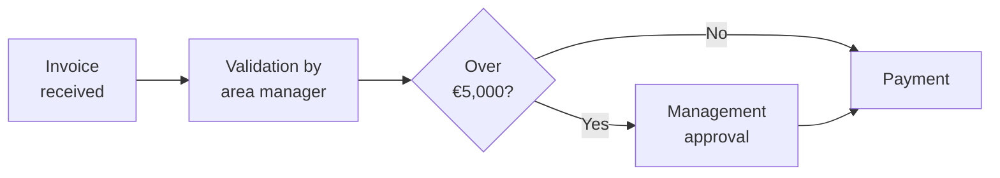
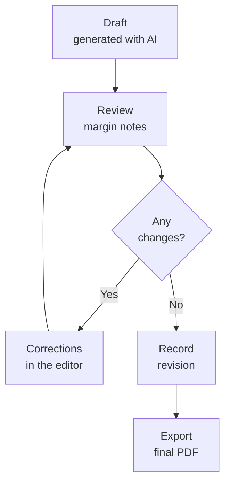

<!-- justify -->
> You do not need to know how to program, and you do not need to install anything. If you can write an email and ask Copilot for things, you can use **MinervA4**.

<!-- justify -->
The tool is called **MinervA4**, after the Minerva press that every small print shop used to have: you fed it paper and it came out printed. Throughout this guide it is also called "the template", which is what it is.

<!-- justify -->
# What problem it solves

<!-- justify -->
Writing a report that looks good takes time, and most of that time does not go into thinking: it goes into placing things. Adjusting margins, keeping the table from splitting, making the headings the same size, putting the logo where it belongs, making sure the footer carries the right number.

<!-- justify -->
The template takes care of that part. You write the content as plain text, it lays it out with your company's identity and leaves it ready to save as a PDF.

<!-- justify -->
It is a single file that you open with a double click in your browser, like a web page. Nothing is installed, no connection is needed and nothing is sent anywhere.

<!-- justify -->
## Layout does not cost tokens

<!-- justify -->
It is worth separating two things that often get confused. You ask the AI for **the content**, once. The **layout** —cover, table of contents, numbering, page breaks, tables in your brand colours, diagrams, footers— is done by this file in your browser, instantly and without consuming anything.

<!-- justify -->
The difference shows up in repetition. Correcting a figure and exporting again costs nothing: you change the text and the PDF rebuilds itself. Changing the entire brand of a forty-page document costs nothing: you load a different style file. Producing the same report in six languages costs whatever the translation costs, and not one token more of layout.

<!-- justify -->
If instead you asked an assistant to hand you the document already composed, every tweak —a margin, a colour, a table that splits— would be another request, with its own cost and its own wait. Here the tweaking cycle is local and immediate, which is exactly the part of the work that gets repeated most often.

<!-- justify -->
## The three pieces

<!-- justify -->
You will see three names throughout this guide. I explain them here in one sentence each, and then at leisure.

<!-- justify -->
**Markdown** is the content: your text, with a few minimal marks to say what is a heading and what is a table.

<!-- justify -->
**YAML** is the style: your company's colours and fonts, written down once.

<!-- justify -->
**Mermaid** is for the diagrams: you describe them by writing, instead of drawing them.

<!-- justify -->
All three are ordinary text. They are not programs or exotic formats: they are files you can open in Notepad. And the important part for you is that **you do not need to learn any of them**: Copilot writes them for you if you ask properly. In this guide I give you the exact text to paste.

<!-- justify -->
## Nothing to install

<!-- justify -->
The template is **a single file** that opens with a double click, like a web page. Nothing is installed, it does not ask for administrator rights, there is no account to register and it does not depend on IT approving anything. If you can open a PDF on your machine, you can use this.

<!-- justify -->
It does not need a connection either. Everything it needs is inside the file, fonts included, so it works the same on a laptop with no network, on a train or in a room with no wifi.

<!-- justify -->
## Your documents do not leave the company

<!-- justify -->
This is what usually worries people, and it is worth saying precisely.

<!-- justify -->
**The template does not send anything anywhere.** There is no server behind it. When you load your Markdown, your images or your logo, the files are read on your own machine to show them on screen; they are not uploaded. You can check it the simplest way there is: disconnect the network and you will see that it still works completely.

<!-- justify -->
**What it remembers stays in your browser.** When you open it again you find your last document, the style and the logo. That is saved in the browser's local storage, on your disk, and it does not travel to any cloud or sync with other machines.

<!-- justify -->
**The PDF is generated by your own browser.** The save button opens the system print dialogue; it does not go through any external service.

<!-- justify -->
Now the honest part: **the AI assistant is a different matter**. When you ask Copilot to draft the content, that text does leave your machine and goes to Microsoft's services, under whatever terms your company has contracted. The template changes none of that, for better or worse. If a document is especially sensitive, the rule is the same as with any AI tool: write the content yourself and use the template only to lay it out, which is the part that never leaves your machine.

<!-- justify -->
# Markdown: writing without formatting

<!-- justify -->
In Word you mark a heading by selecting it and picking a style. In Markdown you mark it by writing a symbol in front of it. That is all.

<!-- justify -->
```text
# This is a section heading
## This is a subheading
This is a normal paragraph.
**This comes out bold** and *this in italics*.
- This is a bullet in a list
```

<!-- justify -->
The advantage is not convenience, it is something else: because the content carries no formatting inside it, the template can apply your company's formatting without fighting anything. That is why the same text can come out with one brand's identity today and another's tomorrow, without touching it.

<!-- justify -->
The disadvantage is that you have to learn those symbols. And this is where Copilot comes in: do not learn them, ask for them.

<!-- justify -->
## If you already wrote it in Word

<!-- justify -->
There is no need to write it again. The **Document** field also accepts a `.docx`: you drop it in just like an `.md` and the template converts it.

<!-- justify -->
From Word it brings across the **content and the structure**: headings, bold and italics, bulleted and numbered lists, tables, links and embedded images. The `.docx` also gives up the title, the author and the date that Word stores inside the file, and that fills in the cover on its own.

<!-- justify -->
What it does **not** bring across is the design: colours, fonts, margins and text boxes are discarded. This is not a shortcoming, it is the usual deal: the document says what it says and the style guide says how it looks. If we copied Word's layout, the YAML would count for nothing and the result would still carry the identity of whoever wrote it.

<!-- justify -->
When it finishes you are told what came in and what was left out —"12 paragraphs, 1 table, 1 image · discarded colours, text boxes and margins"— so that the change in appearance reads as what it is and not as an error.

<!-- justify -->
A PowerPoint slide does not go in: a slide is a canvas with boxes placed by hand, not a document with structure, and rebuilding it by guessing which box is the title gives a worse result than copying the text.

<!-- justify -->
## The instruction generator

<!-- justify -->
You do not have to write the prompt. The template drafts it for you: press **Ask an AI for the document**, on the start page or above the editor.

<!-- justify -->
You describe the document in four fields —type, what it is about, **output language** and length—, you tick whether you want tables, diagrams, formulas or figures from your data sheet, and the instructions write themselves in the panel next to it. You copy them with a button, paste them into Copilot, and the answer goes back into step 3 of that same window, which cleans it up on its own: it removes the code block wrapping it and the polite phrases.

<!-- justify -->
If you have a data source loaded, the summary table is not asked for by hand: the instructions ask for a `datos` block pointing at your sheet, so the table arrives already linked and redoes itself when the figures change. When the answer is laid out, any table whose header matches one of your sheets is turned into that block; that is the **Link the tables to my data** tick box, under the paste area. And for a table that is already written, put the cursor on it and open the data picker: the button to link it appears at the top.

<!-- justify -->
The language field is independent of the interface language: you can work in Spanish and ask for the document in German. And the instructions never carry your cover data, so no names or figures leak into a third-party chat.

<!-- justify -->
## The basic prompt, if you prefer it by hand

<!-- justify -->
This is the text you can paste into Copilot when you want it to hand you something ready for the template. Change only the last line.

<!-- justify -->
```text
Give me the answer in Markdown format, with these rules:
- Use # for the main sections and ## for the parts inside each one.
- Do not number the headings: the numbering is added automatically.
- Use Markdown tables when you compare things.
- Do not use emojis or decorative characters.
- Give me only the Markdown, with no explanations before or after.

The document is: a first-quarter results report for the management committee.
```

<!-- justify -->
When Copilot answers, copy the result and paste it into the template's editor. That is it: that is the whole workflow.

<!-- justify -->
# A worked example, step by step

<!-- justify -->
We are going to make a complete report from scratch. If you follow these six steps you will have a PDF with your company's identity in a few minutes.

<!-- justify -->
## Step 1 · Ask Copilot for the content

<!-- justify -->
Open Copilot and paste the basic prompt from above, changing the last line to whatever you need. For example:

<!-- justify -->
```text
The document is: a report for the management committee on the rollout
of the new incident management system. It should have an introduction, a
results section with a before/after comparison table, a section on
risks and another on next steps. Approximate length: two pages.
```

<!-- justify -->
Copilot will give you back something like this, and this is exactly how it should look:

<!-- justify -->
```text
# Introduction
The new system went live in January...

# Results
## Response times
The table compares the three months before with the three after.

| Indicator | Before | After |
|---|---|---|
| Average time | 4.2 h | 1.8 h |
```

<!-- justify -->
## Step 2 · Add the cover

<!-- justify -->
The cover data can be typed by hand in the "Describe the document" section of the panel, but it is easier to ask Copilot for it too. Add this at the end of your prompt:

<!-- justify -->
```text
Start the answer with a front-matter block delimited by three dashes
above and below, with these keys in English: company, department, document_type,
reference, title, subtitle, author, role, email, phone, date, tagline.
```

<!-- justify -->
It will give you back something like this, which the template will use to compose the cover:

<!-- justify -->
```text
company: Your company name
document_type: Report
reference: OPS-2026-014
title: Incident system rollout
subtitle: First-quarter results
author: Operations Management
role: Project manager
date: 26 August 2026
```

<!-- justify -->
The labels are in English on purpose, even when the content is in whatever language. They are the same everywhere, so a colleague from any country can open the file and know what each thing is. The template also understands the labels in Spanish, in case an old file reaches you.

<!-- justify -->
If you do not ask for it, no problem: you fill in those fields in the "Describe the document" section of the panel.

<!-- justify -->
## Step 3 · Open the template and paste

<!-- justify -->
Double-click the template file. It opens in the browser with a start page offering three routes: open a file —an `.md` or a `.docx`—, see an example, or ask an AI for the document.

<!-- justify -->
On the left there is a column with the work areas, grouped into two phases. **Prepare** gathers what you bring in from outside: *Files* (the .md, the image folder and the data source) and *Brand* (the style, the logo and the fonts). **Work** gathers what you do with the document in front of you: *Properties* (which pages are composed and what the cover says), *Appearance* and *Editor*.

<!-- justify -->
Open one area and the others fold away: there are never two things covering each other. The laid-out document always takes up what is left, on the right.

<!-- justify -->
Press **Editor** to write. A panel opens on the left: paste the text Copilot gave you there.

<!-- justify -->
The document appears laid out on the right as you type. If you make a mistake, you correct it and it rebuilds itself.

<!-- justify -->
## Step 4 · Give it your company's identity

<!-- justify -->
This is where the YAML comes in. It is a small file holding your brand's colours and fonts. Normally someone on your team already has it prepared and all you have to do is load it into the **Style .yaml** field, inside the **Brand** area.

<!-- justify -->
If nobody has one yet, you can ask Copilot for it using the details from your corporate manual:

<!-- justify -->
```text
Generate a YAML style guide file for documents, with this structure:
brand with name and tagline; palette with primary, accent, surface, on_surface,
band_bg, band_fg and muted; typography with display, heading, subheading, body,
caption and mono, each one with family, weight and size_pt; layout with page_size A4
and margin_mm; components with table, band and divider.

My company's colours are: corporate blue #003366 as the primary and
orange #FF6B00 as the accent colour. The typeface is Arial.
Give me only the YAML, with no explanations.
```

<!-- justify -->
Copy what it gives you and paste it into "Paste the style guide", inside **Brand**. Press *Apply style* and the document changes appearance instantly.

<!-- justify -->
The style guide decides more than the colours: it also decides **the shape of the page**. With `layout: orientation: horizontal` the document opens already in landscape, and with `mode: presentation` already as slides, so whoever loads it does not have to remember to press anything. When you switch to a different guide, the page goes back to portrait and to document mode unless the new one says otherwise; applying the same guide again touches nothing, which is what you need when you are tweaking a colour with the page already rotated by hand.

<!-- justify -->
And the **paper background**. `layout: page_background` accepts any background, from a flat colour to a gradient, and `page_texture` puts a very faint layer on top: `hatch`, `vignette`, `grain` or `none`. They are drawn with gradients, so there is nothing to download and they come out the same in the PDF.

<!-- justify -->
One warning that saves grief: **a dark background does not change the colour of the text**. That is changed by `palette: on_surface` and the `components` colours, and they have to be raised at the same time. If the contrast comes out low, the template warns you before you discover it in the PDF. And when printing you have to turn on "background graphics" in the browser dialogue, or the page comes out white.


<!-- justify -->
## Step 5 · Add the logo

<!-- justify -->
In the **Logo** field, also in **Brand**, you pick your brand's image file. It appears at the bottom left of the cover and stays embedded in the document, so the PDF keeps it.

<!-- justify -->
## Step 6 · Save the PDF

<!-- justify -->
If the document is in landscape, choose the orientation first in **Appearance · Page**. Then press **Save as PDF** at the top right. The browser's print dialogue opens. There are three settings there that matter:

<!-- justify -->
- Margins: **None**. The template already reserves its own.
- Scale: **100 %**.
- Background graphics: **on**, so the colours come out.

<!-- justify -->
Save, and you have your document.

<!-- justify -->
<!-- pagebreak -->

<!-- justify -->
# The toolbar

<!-- justify -->
Above the box where you write there is a row of buttons. They work the same way as in Word: you select some text and press the button. If you select nothing, the button writes an example and leaves it selected so you can type over it.

<!-- justify -->
They come in seven groups, split by a vertical line, and run from the small to the large:

- **Text** — bold, italics, highlighter and inline code: what happens to a few words.
- **Paragraph** — section heading, subheading, list, numbered list and pull quote: what happens to a whole line.
- **Alignment** — left, centre, right, justified, and the cross that removes them.
- **Insert** — link, image, table, **data**, formula, code block and emojis: whatever brings something new.
- **Boxes** — the column block and the three traffic-light ones: boxes that wrap text.
- **Page** — break and turn to landscape.
- **Tools** — margin note and search: for working, they leave nothing printed.

<!-- justify -->
When the bar does not fit across, it breaks between groups and never inside one.

<!-- justify -->
The four alignment buttons write a marker above the paragraph. The fifth, the cross, removes them: with text selected it clears the selection, and **with nothing selected it clears the whole document** and tells you how many markers it removed. It is undone with `Ctrl+Z` like any other edit.

<!-- justify -->
With this you do not need to remember any marker. And if something is not on the bar, the button "How do I write this? Open the help", just above it, takes you to the panel where it is explained.

<!-- justify -->
## Callout boxes

<!-- justify -->
Three coloured buttons —green, amber and red— wrap whatever you have selected in a callout box. With nothing selected, they leave the box open with the cursor inside.

<!-- justify -->
```text
:::risk Contract not signed
The supplier has **not** returned the annex.
:::
```

<!-- justify -->
The title on the first line is optional. They are the same three levels that apply to the boxes in a diagram, so that green means the same thing throughout the document; that is why their colour does not come from the style guide, and why they always carry dark text, including on a dark page background, where the box has to stand out.

<!-- justify -->
## Columns

<!-- justify -->
Sometimes the text does not run on: it goes in cards, as on a features page or in a head-to-head. That is what the column block is for.

<!-- justify -->
```text
:::columns
### Load your document
An .md or a Word document.

### Add the data sheet
An .xlsx, .csv or .json with the figures.
:::
```

<!-- justify -->
And this is how that same block comes out:

:::columns
### Load your document
A `.md` file or a Word document. The template reads it, lays it out and
leaves the text in the editor for you to carry on with.

### Add the data sheet
An `.xlsx`, `.csv` or `.json` with the figures. From then on the fields in
the document fill themselves in every time you swap the file.
:::

<!-- justify -->
With no titles, and dashes between the cells, the same block gives you a
side-by-side. Three cells here, with `:::columns 3`:

:::columns 3
**Before.** Every report was laid out by hand. Copy, paste, square up the
margins and start again the following month.

---

**Now.** The text is written once. The figures come from the sheet and the
styling from the brand guide.

---

**After.** Swap the data source and the same document comes out again,
with the new quarter's figures.
:::

<!-- justify -->
Each `###` opens a cell and gives it a title. Inside the cell the same Markdown works as outside —bold, lists, links, images—, because it is composed with the same engine. With `:::columns 3` you get three, and it takes up to four. If you do not put titles in, a line of three dashes also separates cells.

<!-- justify -->
It is written by the two-bars button on the toolbar, so there is no syntax to remember.

<!-- justify -->
And one design warning: **a column block does not split across two pages**. It is a visual unit and splitting it destroys it, so if it does not fit you get a warning with the line number so you can divide it into two blocks. That is the difference from doing it with a borderless table: a table gets cut in half without warning, on top of forcing you into a header row that serves no purpose and making you strip the rules from every table in the document.

<!-- justify -->
## Find and replace

<!-- justify -->
The magnifying glass on the bar, or `Ctrl+F`, opens a search that works on the text you are writing. The browser's `Ctrl+F` is no use here: it cannot see inside the editing box.

<!-- justify -->
It highlights every match, tells you which one you are on —"3 / 12"— and lets you replace one or all of them at once. When you jump to a result, the preview on the right moves to that same area, so it also works for navigating long documents.

<!-- justify -->
## Emojis

<!-- justify -->
The last button on the bar opens a gallery of some two hundred and fifty emojis grouped by theme: status, arrows, office, data, work, people, mood and objects.

<!-- justify -->
They are useful above all in tracking tables, where a status mark is read at a glance more easily than the word "completed". They are drawn with the system font, so on Windows and macOS they come out in colour in the PDF too.

<!-- justify -->
Two warnings about headings. The numbering is added by the template: do not write "1." in front, because it would come out twice. And section headings are what make up the table of contents, so it is worth making them say something concrete.

<!-- justify -->
# Everyday use cases

<!-- justify -->
These are the uses where the template saves the most time. In all of them the workflow is the same: you ask Copilot, you paste, you export.

<!-- justify -->
## The report that comes round every month

<!-- justify -->
This is the case that pays off most. You write the prompt once and reuse it, changing the data.

<!-- justify -->
```text
Draft the department's monthly activity report in Markdown, with
these sections: summary, the month's indicators in a table, notable
incidents and the forecast for the following month. The data is: [paste your data here].
Do not number the headings. Give me only the Markdown.
```

<!-- justify -->
Save the file with "Download .md". The following month you load it again, change the figures and export. The cover, the table of contents and the formatting are already done.

<!-- justify -->
## The meeting minutes

<!-- justify -->
Copilot summarises well if you give it the raw notes. Ask it for a fixed structure so that all the minutes look alike.

<!-- justify -->
```text
Turn these notes into minutes in Markdown with: attendees, agenda,
decisions in a numbered list and outstanding tasks in a table with the columns
task, owner and date. Notes: [paste your notes here].
```

<!-- justify -->
Emojis are useful here: a status mark in the task column is read at a glance.

<!-- justify -->
## The process manual

<!-- justify -->
This is where the diagram comes in. A process described in text alone is hard to follow; with a diagram beside it, it is understood first time.

<!-- justify -->
Ask for the text first and the diagram afterwards, in two separate messages. Paste the diagram right after the section that explains it, and rotate that page if it comes out cramped.

<!-- justify -->
## The proposal to a client

<!-- justify -->
What matters here is presentation. Load the logo, turn on the cover and the table of contents, and check it with "Clean view" before exporting.

<!-- justify -->
If your company has a brand manual, ask Copilot for the YAML once with the official colours and save it: from then on every proposal comes out identical.

<!-- justify -->
## The data sheet or the data annex

<!-- justify -->
When the table has many columns, rotate the page to landscape instead of shrinking it until it is unreadable. It is one of those things that is hard work in Word and is one button here.

<!-- justify -->
## The document with formulas

<!-- justify -->
If you work with calculations, budgets or indicators, you can write real formulas, not screenshots. Ask Copilot for them like this:

<!-- justify -->
```text
Write the net present value formula in LaTeX, to insert it between
dollar signs in a document. Give me only the formula.
```

<!-- justify -->
And you paste it between dollar signs wherever you want it to appear. With one dollar sign on each side it comes out inside the sentence; with two, centred on its own line.

<!-- justify -->
This is how it looks in practice. Inside the text: the break-even point is reached when $I \cdot t = C_f + C_v \cdot t$, that is, when accumulated income equals costs. And centred, the net present value formula:

<!-- justify -->
$$
NPV = \sum_{t=0}^{n} \frac{F_t}{(1 + k)^t} - I_0
$$

<!-- justify -->
The symbols are properly typeset: the fraction, the summation and the subscripts are not a pasted image, so the PDF keeps them sharp at any size and they can be corrected by typing.

<!-- justify -->
They cover what you come across in a management report. The variance against budget, with its percentage:

<!-- justify -->
$$
\Delta\% = \frac{R_{actual} - R_{budget}}{R_{budget}} \times 100
$$

<!-- justify -->
Or the compound annual growth rate, the one everyone quotes and almost nobody writes down:

<!-- justify -->
$$
CAGR = \left( \frac{V_f}{V_i} \right)^{\frac{1}{n}} - 1
$$

<!-- justify -->
And inside a sentence, without breaking the paragraph: if the margin is $m = \frac{P}{S}$ and sales fall by $10\%$, profit falls more than proportionally when fixed costs weigh heavily.

<!-- justify -->
# Figures that update themselves

There is a kind of document that comes round every month with the same shape and different numbers: the sales report, the incident log, the project summary. Copying figures by hand from a spreadsheet into a document is where nearly all the errors creep in, and on top of that it has to be redone every time.

The **Data source** field accepts `.xlsx`, `.csv` and `.json`. From then on, the document does not carry written figures: it cites them. You drop in next month's sheet and the whole report rebuilds itself.

<!-- justify -->
Sources add up just like folders: the budget workbook, the CRM's JSON and a costs CSV can all be loaded at once, each with its tag and its cross. If two files bring a set with the same name, the second becomes `set_file` and a notice says so, so nothing is ever overwritten behind your back.

## How a data field is named

The first word is the set: in Excel, the sheet name; in CSV, the file name; in JSON, the key. If it is a table, the row number comes next, **starting at zero**, and the column name at the end.

```text
Region {{ventas.0.region}} billed {{ventas.0.importe | thousands}} euros.
```

It works the same way in the front-matter, so the project reference can reach the cover without you writing it.

A field that does not exist does not disappear: it stays visible and shows up in the editor's warnings. A silent gap in a report is worse than one in plain sight.

<!-- justify -->
## Putting them in without writing them

<!-- justify -->
Everything above can be written by hand, but you do not have to. With a sheet loaded, the **cylinder button** on the editor bar turns green: it is the only one with colour, so you find it without looking.

<!-- justify -->
When you open it you see your sheet exactly as it is, grouped by sections, and **under each field the value from the first row**. That value is what makes it understandable: you do not read "importe", you read "importe / 1200". You press it and it is written at the cursor. If there are dozens of fields —a project JSON has them—, the search box at the top filters by name or by value.

<!-- justify -->
The list is split by file: every loaded source gets its own block with the file name on top, so you can see where each set comes from. Inside, single values are grouped together and each table has its own box, with the count in words — “table · 12 rows × 4 columns” —, the values from its first row and its two buttons.

<!-- justify -->
The list distinguishes three things, according to what can be done with each field:

- **a value** is inserted as it is: `{{ventas.0.importe}}`;
- **a yes/no** writes the whole conditional section, with the cursor already inside: this way a section of the document appears or disappears according to what the sheet says;
- **a set of rows** offers two buttons: *Whole table*, which draws the table with its header, and *One line per row*, which writes the repeated block **with the first column already filled in**, so that it composes something as soon as you drop it. An empty block teaches nothing; one that works teaches the syntax in one go.

<!-- justify -->
The same list is in the **Data source** field, behind the *Insert a data field into the document* button: you have just loaded the sheet and the route to using it is right there.

<!-- justify -->
And a placeholder that cannot find its data is flagged **in red inside the document**, not in a dropdown that nobody opens; hovering over it tells you which fields do exist.


## Filters

After a vertical bar you format the value: `thousands`, `round(1)`, `percent(1)`, `upper`, `lower`, `capital`, `length` and `default("n/a")`.

```text
{{ventas.0.variacion | percent(1)}} · {{ventas.0.beneficio | default("not recorded")}}
```

The thousands separator follows the document's language, not the interface's: a report in Spanish carries 1.240.000 even if you have the template in English.

## A whole sheet as a table

````text
```data
from: ventas
columns: region, importe
headers: Zone, Revenue (€)
rows: 10
```
````

Only `from:` is required. The table comes out in your brand colours, like any other in the document.

<!-- justify -->
### One specific range of the sheet

<!-- justify -->
All of the above assumes the sheet **is** a table: headers in row 1, data below. A real working workbook almost never is — a stray title in A1, a date in A2, the actual table starting at B4 and a note in column F. That is what `range` is for, written as in Excel:

````text
```datos
from: Budget
range: B4:D9
```
````

<!-- justify -->
The first row of the range is the header. If the range is data only, `headers_row: no` names the columns by their letter — B, C, D — or by whatever you put in `headers:`. Leaving the last row without a number, `range: B4:D`, reaches as far as there is anything.

<!-- justify -->
And `rows:` takes a stretch as well as a cap: `rows: 5-12` takes the fifth to the twelfth. The range only works on `.xlsx` sheets — a `.csv` or a `.json` has no grid — and if you ask for one on those, it says so.

## Conditions and repetitions

Here is what really changes the result: the text can react to the data. The syntax is Jinja's, so if you know it, it works as it is.

```text

The first region tops the thousand mark and carries the quarter.

The first region stays in line with the period average.

The first region comes in below forecast.



- **{{r.region}}**: {{r.importe | thousands}} € — up — down


{# this is a comment for the team and does not come out in the document #}
```

Inside a loop you have `loop.index`, which counts from one, `loop.first`, `loop.last` and `loop.length`.

What is **not** allowed is function calls or free expressions, and that is deliberate: an `.md` can reach you from anyone, and it must not be able to run code in the browser of whoever opens it.

## Asking Copilot for it

The practical thing is not to write the placeholders yourself. Give it the structure of your sheet and ask for the Markdown already parameterised:

```text
Write a report in Markdown. The data is NOT written out:
it is cited with {{sheet.row.column}}, with the row starting at 0.

My Excel file has the sheet "ventas" with the columns region, importe
and variacion, and the sheet "costes" with concepto and importe.

Use:
- {{ventas.0.importe | thousands}} to format numbers
- a `data` block with "from: ventas" for the complete table
- … to run through the rows
- /// for the comment
  that changes depending on whether the target is met

Do not invent figures: if you do not know a value, cite it anyway.
```

The difference from asking it for the report with the figures already in place is important: this way you write the `.md` once and only the data changes. If you ask for the whole document every month, you have to check that nothing else has changed along the way.

<!-- justify -->
## Identifying the document

<!-- justify -->
Under **Properties** there are five values that keep the file in order even though not all of them are printed: the **country** of the office producing it, the **department**, the **reference**, the **language** it is written in, and an **internal reference** of your own.

<!-- justify -->
Country and language are different things and it is worth keeping them apart: the Spanish office publishes in Spanish and in English, and so does the German one. The language says what it is written in; the country, who made it. The language also decides everything the template writes inside the document — the contents title, the revision table, the thousands separator and the date format — ahead of the brand's language. A report in German comes out with “Inhalt” and “Versionsverlauf” even if your interface is in English: the interface belongs to whoever lays the document out, the document to whoever reads it.

<!-- justify -->
The reference completes itself. With the country and the department chosen, you type just the number and get `ES-MKT-001`. **Three digits on purpose:** listings sort as text, and without leading zeros `MKT-9` comes after `MKT-10`, so from the ninth document on the order stops being useful. The country goes first because it is what makes the reference unique: Marketing 001 from Spain and from Germany are two different documents.

<!-- justify -->
Department codes are three letters —`MKT`, `SAL`, `HR`, `FIN`, `OPS`, `LOG`, `PUR`, `IT`, `TEC`, `LEG`, `QA`, `GM`— and they come from the style guide, so each company sets its own under `brand: departments`.

<!-- justify -->
Both references appear in the **footer**, after the company, the department and the type:

```text
Acme Iberia · MKT · Report · ES-MKT-017 · MK-2026-0042 — 3
```

<!-- justify -->
That is where codes are read, in small type and on every page. The cover does not repeat them: its display line, which in some brands runs past 45 points, is for the document type and little else.

<!-- justify -->
The **internal reference** is your own numbering. Besides appearing in the footer, it travels inside the `.md`, so you can trace the document with a text search across the folder. If you would rather not print it, leave the field empty: the footer only writes what is there.

<!-- justify -->
The **Second footer line** field does not replace that footer: it adds a line below it, which is where a confidentiality notice, the project name or whatever your brand requires will fit.

<!-- justify -->
## How the files are named

<!-- justify -->
The `.md` you download and the PDF you save get **the same name**, built from the document's properties:

<!-- justify -->
```text
ES-MKT-001_informe_2026-10-07_v2.0_en.md
```

<!-- justify -->
It reads as it is: made in Spain, a report, dated 7 October, version 2.0, written in English. The date is in **ISO 8601** because it sorts chronologically on its own in any listing and is not ambiguous — "10/09/2026" is two different days depending on the country. The **Date** field under Properties keeps that same shape: type `10/09/2026` or "10 September 2026" and it converts itself when you leave the field. On the cover, though, it is spelled out in the document's language, which is how a cover is read.

<!-- justify -->
The name is rebuilt from the properties every time, not appended to the previous one, so it can never pile up. A missing value disappears without leaving a gap, and a date that cannot be read is not replaced by today's: the segment goes, because an invented date in a document's name is worse than none.

<!-- justify -->
The pattern is set from the style guide, with `layout: filename`, so each brand or department fixes its own without touching the tool. The available tokens are `reference`, `country`, `department`, `type`, `company`, `title`, `author`, `date`, `version`, `lang` and `local`.

# Reviewing without messing up the document

<!-- justify -->
When somebody reviews a report, you usually end up with comments buried inside the text that then have to be deleted one by one. Here they go separately.

<!-- justify -->
## Margin notes

<!-- justify -->
Select what bothers you and press the note button. An annotation is created with that text as its title, signed with your name and the date, and a numbered mark appears in the document's margin.

<!-- justify -->
Notes **are not printed**: they are for reviewing, not for the deliverable. They are edited and deleted from the panel on the right, and they stay attached to their paragraph even if you write further up and the document repaginates.

<!-- justify -->
If you want them on the record in the document, "Add the notes to the .md" dumps them at the end as an annex. From then on they are content and they do get printed.

<!-- justify -->
## Version control

<!-- justify -->
In **Properties**, the last block records who reviewed what and when. You write the version and the summary of changes, press *Record revision*, and the row is added with your name and today's date to a table that takes up its own page, between the cover and the table of contents. The *Revisions* checkbox, at the top of that same panel, shows it or hides it.

<!-- justify -->
That table lives in the file itself, so it travels with the document. At the beginning of this guide you can see how it is written: three lines under the `revisions` key, each one with version, date, reviewer and changes separated by vertical bars.

<!-- justify -->
## Highlighting in the document

<!-- justify -->
The highlighter button marks the selection with a tint of your brand colour. Unlike notes, this highlight **does come out in the PDF**: it is for drawing attention to a figure or a conclusion, not for flagging something outstanding.

<!-- justify -->
An example: ==gross margin fell three points over the quarter==, which is the conclusion you do not want the committee to skip.

<!-- justify -->
## Find and replace

<!-- justify -->
The magnifying glass, or `Ctrl+F`, searches inside the text you are writing. The browser's `Ctrl+F` is no use here, because it cannot see inside the editing box.

<!-- justify -->
It highlights every match, tells you which one you are on and lets you replace one or all of them at once. When you jump to a result, the preview moves to that area, so it also works for navigating long documents.

<!-- justify -->
# Tables and lists

<!-- justify -->
Tables are what benefit most from this system, because placing them by hand is the most tedious job of all. You ask Copilot to compare something in table form and it writes it; the template gives it a coloured header, alternating rows and your brand's border.

<!-- justify -->
| What you ask Copilot for | What the template does |
|---|---|
| A comparison table | Applies your brand colours to it |
| A bulleted list | Composes it with the right indentation |
| A section heading | Numbers it and puts it in the table of contents |
| A pull quote | Turns it into a highlighted band |

<!-- justify -->
If a table does not fit in what is left of the page, it splits by itself and repeats the header at the top, so that it still makes sense.

<!-- justify -->
# Diagrams without drawing

<!-- justify -->
Mermaid is a way of describing a diagram by writing, instead of drawing it with the mouse. You write which boxes there are and which arrows join them, and the drawing appears on its own.

<!-- justify -->
You do not have to learn to write it. Ask Copilot for it like this:

<!-- justify -->
```text
Give me a diagram in Mermaid format, flowchart LR type, representing
the approval circuit for an invoice: receipt, validation by the
area manager, management approval if it exceeds 5,000 euros, and payment.
Give me only the Mermaid code block, with no explanations.
```

<!-- justify -->
Paste the result into the editor and the diagram appears drawn. If something does not convince you, you tell Copilot in plain language —"add a step for returning it to the supplier"— and you paste the new version.

<!-- justify -->
This is an example of the result:

<!-- justify -->


<!-- justify -->
The advantage over pasting an image is that the diagram is still text: in six months' time, when the circuit changes, you correct a line instead of redoing the drawing.

<!-- justify -->
Another example, this time of the review circuit for a document, which is exactly what the next section describes:

<!-- justify -->


<!-- justify -->
## The colours of a diagram

<!-- justify -->
Notice that the two diagrams above carry no written colour and still come out in your brand's. That is the normal case: the template re-tints them with a scale derived from your primary and accent colours, with the text contrast checked box by box. The start and the end are filled in, the decisions —the diamonds— in the warning tone, and the intermediate steps in the soft one.

<!-- justify -->
There are three rules, from weakest to strongest:

<!-- justify -->
1. **The style guide.** This is what happens by default, even if the Markdown brings colours written by hand: the brand wins.
2. **`%% a4: custom`** as the first line of the block. That diagram, and only that one, keeps its colours. `%% a4: brand` forces the opposite.
3. **`:::ok`, `:::warning`, `:::risk`** at the end of a box's line. Always wins, in any mode.

<!-- justify -->
You do not have to write the last two: when you put the cursor inside a diagram, a bar appears below the formatting bar, with *brand* / *custom* for the whole diagram and *ok* / *warning* / *risk* for the box you are on. What those buttons do is write those same markers into the Markdown, so the setting travels inside the file and you can still write it by hand.

<!-- justify -->
Rounded corners are applied to every diagram, whatever the mode: the shape of the box belongs to the document, the colour belongs to the diagram.

<!-- justify -->
# Images

<!-- justify -->
To include a photo or a screenshot, first save all the document's images in one folder. Then, in the template, press the green button in the **Image folder** field and pick that folder. There is no path to type.

<!-- justify -->
After that, in the text, you cite them by their file name. The image button on the toolbar writes the line for you; all you have to do is change the name.

It is written like this, with the alternative text in square brackets and the file name in parentheses:

```text
{width=85%}
```

And this is the result, using the sample image that comes with this guide:

{width=85%}

<!-- justify -->
To see it, pick the `images/` folder of this same playground in the **Image folder** field. If you do not, you will see a red gap instead, naming the missing file and saying what to do.

<!-- pagebreak -->

<!-- justify -->
Two things that save you trips. If an image lives in another folder, **drag it anywhere on the page**: it goes in as a figure of the document, not as a logo, provided the Markdown names it. And picking a second folder does not erase the first: folders add up, and you can have the logo folder, the corporate images and the project's at once. Each is a tag with its own cross, and the upload button becomes a **+**.

<!-- justify -->
The text in square brackets is not decorative. It is what someone with a screen reader will hear, and what appears in the gap if the file is missing, so it is worth describing the image instead of repeating its name. And if an image does not appear, it is almost always because the name does not match the file's exactly.

<!-- justify -->
Images do not travel inside the content file: if you pass your document to someone else, pass the image folder too, or share the PDF.

<!-- justify -->
# Controlling the pages

<!-- justify -->
The template distributes the text on its own and tries to make it look right: it does not leave a heading alone at the bottom of a page and it does not split a section if it fits whole on the next one.

<!-- justify -->
When you want to decide yourself, there are two instructions that are written on a line of their own. The editor's toolbar has buttons that write them, so there is nothing to remember.

<!-- justify -->
**The break button** writes `<!-- pagebreak -->` and forces what follows to start on a new page. Useful for making each chapter start at the top.

<!-- justify -->
**The rotation button** writes `<!-- landscape -->` or `<!-- portrait -->` and turns the page to landscape, so that a wide table or a big diagram fits; the same button turns it back to portrait. The next page of this guide is rotated as a demonstration.

<!-- justify -->
That is the rotation of one particular page. The **starting** orientation of the whole document is chosen in **Appearance · Page**, just above the margins.

<!-- justify -->
## Presentation mode

<!-- justify -->
**Appearance** starts with a single question: what you are making. A **document to be read** or a **presentation to be projected**. Everything else hangs off that answer, because these are not two sibling settings: the second one rules the first. A document picks portrait or landscape; a presentation is landscape without asking —there is nothing else— and picks a **light or dark theme** instead.

<!-- justify -->
In presentation, each `##` starts on its own page and whatever is on it is centred vertically; the footer keeps only the number. That is what turns a landscape A4 into something that reads like slides, without changing a line of the Markdown.

<!-- justify -->
The type size is not set by the mode, it is set by the style guide. A mode that also changed the scale would make the same guide look two different ways, and then the guide would no longer be in charge.

<!-- justify -->
The **dark theme** is not another style guide. It is computed from the one you have loaded: paper and ink are swapped, while the accent, the band and the typefaces stay as they are, so the document is still your brand's. It works with any guide, including one just written, and a guide that already comes with a dark background is left untouched.


<!-- justify -->
<!-- landscape -->

<!-- justify -->
# A rotated page

<!-- justify -->
This page is in landscape while the rest of the document stays in portrait. That way tables fit that would otherwise have to be split or shrunk until they were unreadable.

<!-- justify -->
| Situation | What you ask Copilot for | What you do in the template | Result |
|---|---|---|---|
| Monthly report | The content in Markdown with tables | Paste and save as PDF | Document with your brand in minutes |
| Meeting minutes | Summary with decisions in a list | Paste, review and export | Uniform minutes every week |
| Process manual | Text plus a Mermaid diagram | Paste and rotate the diagram's page | Process documented and editable |
| Supplier comparison | A table with criteria and scores | Paste and rotate the page | Wide table, readable |
| Client proposal | Structure with cover and table of contents | Load the logo and export | Presentable proposal |
| Product data sheet | Short text plus an image | Pick the image folder | Data sheet with photo and figures |

<!-- justify -->
Remember that per-page rotation when printing works in Chrome and in Edge. In other browsers the whole PDF comes out in the initial orientation.

<!-- justify -->
<!-- portrait -->

<!-- justify -->
# Why not just do it in Word

<!-- justify -->
It is a fair question: if Copilot can draft inside Word, what is this for? The short answer is that Copilot solves the drafting, and what is solved here is the **layout and the uniformity**, which is a different problem and the one that eats the most time.

<!-- justify -->
## The formatting stops depending on people

<!-- justify -->
In Word, the appearance lives inside each file. Copilot writes the text, but the margins, the cover, the type sizes and the colours are set by whoever is drafting, and everyone does it slightly differently. After three revisions, a document ends up with four typefaces and two heading sizes.

<!-- justify -->
Here the appearance lives in a separate file, the style one, which is the same for the whole team. Nobody decides margins because there is nowhere to decide them. And if the corporate colour changes tomorrow, you change it in one place and regenerate every document, instead of opening fifty files one by one.

<!-- justify -->
## Licences

<!-- justify -->
Here it is worth being precise, because two things get confused.

<!-- justify -->
To draft you need an AI assistant, and that does not change: Copilot in the browser, or whichever one you use. What you do **not** need is the add-on that puts Copilot inside Word, Excel and PowerPoint, which is contracted separately and paid per person per month.

<!-- justify -->
The annual cost of that add-on follows this shape:

<!-- justify -->
$$
C_{annual} = n_{users} \times p_{monthly} \times 12
$$

<!-- justify -->
What matters is not the price, which changes, but that it **multiplies by the number of people**. On a team where only five people draft but thirty review and read, the difference between paying for five or for thirty is the real financial decision. With this workflow, someone who only reads or comments needs no licence: they open a PDF.

<!-- justify -->
The template itself has no cost and does not expire: it is a file.

<!-- justify -->
## What else you gain

<!-- justify -->
**The content can be compared and versioned.** An `.md` is plain text: you can see exactly what changed between two revisions, line by line. With a `.docx` that only comes from track changes, and only while nobody accepts them.

<!-- justify -->
**The result is reproducible.** The same content and the same style give the same PDF today and in two years' time. A Word document depends on the version, the installed fonts and the machine it is opened on.

<!-- justify -->
**Diagrams stay editable.** In Word, a diagram usually ends up as a pasted image that has to be redone in another tool. Here it is text you correct by typing.

<!-- justify -->
**Formulas are properly typeset**, they are not screenshots, and they are corrected just like the rest of the text.

<!-- justify -->
**There is nothing to install** and no permissions to ask for, and it works offline.

<!-- justify -->
## And what you lose

<!-- justify -->
It would be dishonest not to say it, because there are cases where Word is the right answer.

<!-- justify -->
**Simultaneous editing.** Several people writing at once in the same document is something Word in the cloud does and this does not.

<!-- justify -->
**Track changes with several reviewers.** Comments, suggestions, accept and reject: it is still the best review tool there is. This template's notes cover one person's review, not five people negotiating.

<!-- justify -->
**What everybody already knows how to use.** Training a team has a cost, even if it is low here.

<!-- justify -->
**Complex layouts**: multiple columns, footnotes, cross-references, automatic bibliography. This template makes documents with a linear structure, and it makes them well; it does not claim to be a professional typesetter.

<!-- justify -->
## So, when do you use which?

<!-- justify -->
| Situation | Tool |
|---|---|
| Document that comes round with the same shape | This template |
| External deliverable with brand identity | This template |
| Text drafted by five people at once | Word in the cloud |
| Formal review with track changes | Word |
| Half-page internal note | An email |
| Manual with diagrams that change | This template |
| Thesis, book, document with a bibliography | Word or a typesetting tool |

<!-- justify -->
And they are not mutually exclusive: drafting in the cloud with several hands and then, once the text is closed, bringing it here for the final layout is a perfectly reasonable workflow.

<!-- justify -->
# Check before exporting

<!-- justify -->
Before saving the PDF it is worth looking at two things.

<!-- justify -->
The first: that no page is marked in red. If one is, there is something taller than the page, usually a big diagram or a very long table. It is fixed by lowering the text size a little in **Appearance · Text**, or by splitting the content in two.

<!-- justify -->
The second: the **automatic layout adjustments**. Above the editor there is a dropdown with what the template has done on its own —headings moved whole so as not to split them, diagrams reduced to the page width, manual numbering removed from headings—. They do not usually need any action, but it is worth reading them the first time.

<!-- justify -->
The **Clean view** button also helps: it hides all the controls and leaves only the document, so you can review it as whoever receives it will see it.

<!-- justify -->
# What is saved and what is not

<!-- justify -->
The template remembers your last document, the style, the logo and the fonts. When you open it again you find everything as you left it. That is saved in your browser, on your machine, not on the internet.

<!-- justify -->
What is not saved on its own is your work in a separate file. That is what **Download .md** in the editor is for: it saves the content in a file you can keep, send by email or upload to the team's shared folder. Loading it again reproduces the whole document, cover included.

<!-- justify -->
It is worth doing even if you do not think you need it: if you change machines tomorrow, or somebody has to pick up your report, that file is all it takes.

<!-- justify -->
<!-- pagebreak -->

# The report you write once

<!-- justify -->
Everything from here to the end of this chapter **is live**. The figures are
not typed in: they are read from whichever data file you have loaded. Change
the file and the whole document changes with it, including the sentences that
judge the numbers and the coloured note at the top.

<!-- justify -->
To see it, drag `data/en/figures-Q3-2026.json` onto this page. Once it is in
front of you, drag `data/en/figures-Q4-2026.json` on top. Do not touch a
single letter of the text: watch it rewrite itself.

:::warning
If you have not loaded a data file yet, you will see the placeholders raw
—`{{like this}}`— and the template will tell you so in the left-hand panel.
That is part of the demonstration too: a missing figure shows, it is never
invented.
:::

## What the figures say

<!-- justify -->
Revenue for {{period.quarter}} closed at **{{summary.revenue | miles}} €**,
{{summary.revenue_change | porciento(1)}} against the same quarter last year,
with a gross margin of {{summary.gross_margin | porciento(1)}} across
{{summary.headcount}} people. The average order came to
{{summary.average_order | moneda(period.currency)}}.


:::ok
The quarter came in **above target**. Revenue grew
{{summary.revenue_change | porciento(1)}} and the order book still holds
{{summary.order_book_weeks}} weeks of cover, so the next quarter opens with
room to manoeuvre.
:::

:::risk
The quarter came in **below target**, with revenue
{{summary.revenue_change | porciento(1)}} on the same period last year. The
order book is down to {{summary.order_book_weeks}} weeks of cover: anything
under four leaves no margin for a late supplier.
:::



:::warning
On-time delivery stands at {{summary.on_time_delivery | porciento(1)}}, below
the 95 % we commit to. Every region is affected, so this is a network problem
and not a depot problem.
:::


## A whole sheet, as a table

<!-- justify -->
The block below is not written by hand: you declare where the figures come
from, which columns you want and in what format, and it fills itself in.

```data
from: regions
columns: region, revenue, change, margin, on_time
headers: Region, Revenue (€), Change, Margin, On time
format: revenue=miles, change=porciento(1), margin=porciento(1), on_time=porciento(1)
```

<!-- justify -->
The strongest region is {{regions.0.region}}, at
{{regions.0.revenue | miles}} € and {{regions.0.change | porciento(1)}}.


{{regions.3.region}} is the one to watch: it closed
{{regions.3.change | porciento(1)}} with a margin of
{{regions.3.margin | porciento(1)}}, the lowest of the four.


## Repeat for every row

<!-- justify -->
The block below is written **once** and repeats itself for every row of the
sheet. It is the same data as the table above, said as prose instead of as a
grid: useful for a catalogue, a set of cards, or a summary someone reads
aloud rather than scans.


- **{{row.region}}** — {{row.revenue | miles}} € ({{row.change | porciento(1)}}), margin {{row.margin | porciento(1)}}, on time {{row.on_time | porciento(1)}}


## Where the money went

```data
from: costs
columns: concept, amount, change
headers: Concept, Amount (€), Change
format: amount=miles, change=porciento(1)
```

<!-- justify -->
Transport moved {{costs.0.change | porciento(1)}} on the quarter. Personnel,
the largest line at {{costs.1.amount | miles}} €, stayed within
{{costs.1.change | porciento(1)}}.

<!-- pagebreak -->

# Images, at whatever size you want

<!-- justify -->
An image alone in its own paragraph becomes a figure and comes out centred.
Say nothing and it prints at its natural size, never wider than the text
column. Want something else, you say so behind it, in braces.

The easiest way is not to type it: insert the image with the toolbar button
and pick the size in the bar that appears **under the editor**, with the
document in front of you. What that bar writes is exactly this:

```
{width=60%}
{width=320px}
{width=80mm height=40mm}
```

<!-- justify -->
Percentages —of the text column width—, pixels and millimetres are all
accepted. Here is the same image three times, without touching the file:

{width=50%}

{width=25%}

{width=40mm}

:::ok
The size you write **wins over the template**. In the slide layouts, where an
image stretches by itself to cover the page, a declared size still wins: what
the author says weighs more than what the template assumes.
:::

## Every format it understands

<!-- justify -->
The seven image formats a browser can draw all go in, and each one tests
something different in the layout engine: that a vector scales without
pixelating, that a PNG with transparency lets the page background through,
that a small seal is not stretched, that a large BMP does not blow up the
file.

:::columns
### Vector

{width=100%}

An SVG scales without losing definition: in the PDF it prints at the
printer's resolution, not the screen's.

### Photograph

{width=100%}

A JPG keeps the resolution it came with. If it is going to fill half a page,
it wants at least a thousand pixels across.
:::

{width=70%}

{width=70%}

:::columns
### Seal
{width=45mm}

### Fleet
{width=45mm}
:::

{width=85%}

{width=85%}

## What is left to do

<!-- justify -->
Lists and quotations come out in the brand's colours, not the interface's:
they are content of the document.

1. Close the quarter and publish the figures
2. Review the transport contract before it renews
3. Renew the quality certificate
4. Replace the two remaining vehicles

> A pull quote is written with an angle bracket in front. It comes out as a
> band in the brand colour, not as a block of code.

# Frequently asked questions

<!-- justify -->
**Do I need to install anything?** No, and you do not need administrator rights. One file and a double click.

<!-- justify -->
**Do I need the internet?** No. It works offline, fonts included.

<!-- justify -->
**Are my documents sent anywhere?** The template sends nothing. What you ask Copilot for does leave your machine, as with any AI assistant.

<!-- justify -->
**Can somebody else see it from my machine?** What the template remembers is saved in your browser and in your user profile. Another person with their own session does not see it.

<!-- justify -->
**Do I have to learn Markdown?** It is not essential. Copilot writes it for you with the prompts in this guide. With use you will start recognising the symbols.

<!-- justify -->
**What if Copilot gives me the text with odd formatting?** Ask again, adding: "Give me only the Markdown, with no explanations, no emojis and no numbered headings".

<!-- justify -->
**Can I use it with long documents?** Yes. The numbering, the table of contents and the page breaks adjust themselves however many pages it has.

<!-- justify -->
**What languages is the template in?** Spanish, English, French, German, Italian and Polish. You change it in the selector on the top bar and it affects everything: menus, help, warnings and the instruction generator. Five words are deliberately not translated, because they are also written inside the Markdown and have to say the same thing in any language: `brand`, `custom`, `ok`, `warning` and `risk`.

<!-- justify -->
**What if I do not have my company's YAML?** You can work without it: the document comes out with a correct, neutral style. When you get hold of it, you load it in and the same text updates.
