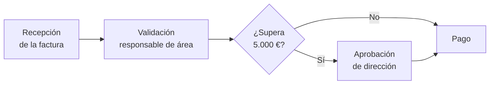
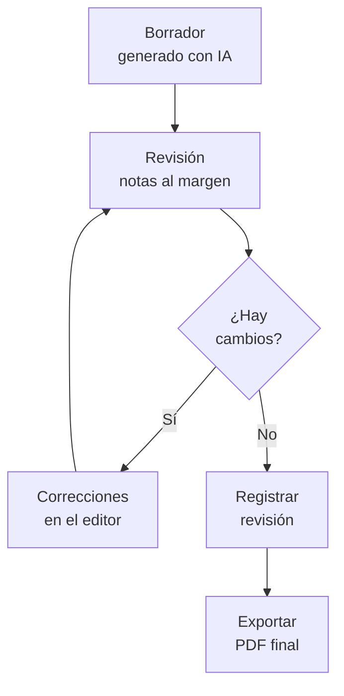

<!-- justify -->
> No hace falta saber programar ni instalar nada. Si sabes escribir un correo y pedirle cosas a Copilot, sabes usar **MinervA4**.

<!-- justify -->
La herramienta se llama **MinervA4**, por la prensa Minerva que había en todas las imprentas pequeñas: se le echaba el papel y salía impreso. A lo largo de esta guía se la llama también «la plantilla», que es lo que es.

<!-- justify -->
# Qué problema resuelve

<!-- justify -->
Escribir un informe con buena presencia lleva tiempo, y la mayor parte no se va en pensar: se va en colocar. Ajustar márgenes, que la tabla no se parta, que los títulos tengan el mismo tamaño, que el logotipo esté donde toca, que el pie de página lleve el número correcto.

<!-- justify -->
Esta plantilla se encarga de esa parte. Tú escribes el contenido en texto normal, ella lo maqueta con la imagen de tu empresa y te lo deja listo para guardar en PDF.

<!-- justify -->
Es un único archivo que se abre con doble clic en el navegador, como una página web. No se instala, no necesita conexión y no envía nada a ningún sitio.

<!-- justify -->
## Maquetar no cuesta tokens

<!-- justify -->
Conviene separar dos cosas que se confunden. A la IA se le pide **el contenido**, una vez. La **maquetación** —portada, índice, numeración, reparto en páginas, tablas con los colores de tu marca, diagramas, pies de página— la hace este archivo en tu navegador, al instante y sin consumir nada.

<!-- justify -->
La diferencia se nota en la repetición. Corregir una cifra y volver a exportar cuesta cero: cambias el texto y el PDF se rehace solo. Cambiar la marca entera de un documento de cuarenta páginas cuesta cero: cargas otro archivo de estilo. Sacar el mismo informe en seis idiomas cuesta lo que cueste traducir el contenido, y ni un token más de maquetación.

<!-- justify -->
Si en lugar de esto le pidieras a un asistente que te devolviera el documento ya compuesto, cada retoque —un margen, un color, una tabla que se parte— sería otra petición, con su coste y su espera. Aquí el ciclo de retoque es local e inmediato, que es justo la parte del trabajo que más veces se repite.

<!-- justify -->
## Las tres piezas

<!-- justify -->
Verás tres nombres a lo largo de esta guía. Los explico ahora en una frase cada uno y luego con calma.

<!-- justify -->
**Markdown** es el contenido: tu texto, con unas marcas mínimas para indicar qué es un título y qué es una tabla.

<!-- justify -->
**YAML** es el estilo: los colores y las tipografías de tu empresa, escritos una sola vez.

<!-- justify -->
**Mermaid** es para los diagramas: se describen escribiendo, en lugar de dibujarlos.

<!-- justify -->
Los tres son texto corriente. No son programas ni formatos raros: son archivos que se abren con el Bloc de notas. Y lo importante para ti es que **no hace falta que aprendas ninguno**: Copilot los escribe por ti si se lo pides bien. En esta guía te doy los textos exactos que tienes que pegarle.

<!-- justify -->
## Sin instalar nada

<!-- justify -->
La plantilla es **un solo archivo** que se abre con doble clic, como una página web. No se instala, no pide permisos de administrador, no hay que dar de alta ninguna cuenta y no depende de que informática apruebe nada. Si puedes abrir un PDF en tu equipo, puedes usar esto.

<!-- justify -->
Tampoco necesita conexión. Todo lo que hace falta va dentro del archivo, incluidas las tipografías, así que funciona igual en un portátil sin red, en un tren o en una sala sin wifi.

<!-- justify -->
## Tus documentos no salen de la empresa

<!-- justify -->
Esto es lo que suele preocupar, y conviene decirlo con precisión.

<!-- justify -->
**La plantilla no envía nada a ningún sitio.** No hay servidor detrás. Cuando cargas tu Markdown, tus imágenes o tu logotipo, los archivos se leen en tu propio equipo para mostrarlos en pantalla; no se suben. Puedes comprobarlo de la forma más simple: desconecta la red y verás que sigue funcionando entera.

<!-- justify -->
**Lo que recuerda se queda en tu navegador.** Al volver a abrirla encuentras tu último documento, el estilo y el logotipo. Eso se guarda en el almacenamiento local del navegador, en tu disco, y no viaja a ninguna nube ni se sincroniza con otros equipos.

<!-- justify -->
**El PDF lo genera tu propio navegador.** El botón de guardar abre el diálogo de impresión del sistema; no pasa por ningún servicio externo.

<!-- justify -->
Ahora la parte honesta: **el asistente de IA es otra cosa**. Cuando le pides a Copilot que te redacte el contenido, ese texto sí sale de tu equipo y va a los servicios de Microsoft, con las condiciones que tenga contratadas tu empresa. La plantilla no cambia eso ni para bien ni para mal. Si un documento es especialmente sensible, la regla es la misma que con cualquier herramienta de IA: escribe tú el contenido y usa la plantilla solo para maquetarlo, que es la parte que no sale de tu equipo.

<!-- justify -->
# Markdown: escribir sin formatear

<!-- justify -->
En Word marcas un título seleccionándolo y eligiendo un estilo. En Markdown lo marcas escribiendo un símbolo delante. Eso es todo.

<!-- justify -->
```text
# Esto es un título de sección
## Esto es un subtítulo
Esto es un párrafo normal.
**Esto sale en negrita** y *esto en cursiva*.
- Esto es un punto de una lista
```

<!-- justify -->
La ventaja no es la comodidad, es otra: como el contenido no lleva formato dentro, la plantilla puede aplicarle el de tu empresa sin pelearse con nada. Por eso un mismo texto puede salir con la imagen de una marca hoy y con otra mañana, sin tocarlo.

<!-- justify -->
La desventaja es que hay que aprenderse esos símbolos. Y aquí es donde entra Copilot: no te los aprendas, pídeselos.

<!-- justify -->
## Si ya lo tienes escrito en Word

<!-- justify -->
No hace falta volver a escribirlo. La casilla **Documento** acepta también un `.docx`: lo sueltas igual que un `.md` y la plantilla lo convierte.

<!-- justify -->
De Word se trae el **contenido y la estructura**: los títulos, la negrita y la cursiva, las listas con viñeta y numeradas, las tablas, los enlaces y las imágenes incrustadas. Del `.docx` salen además el título, el autor y la fecha que Word guarda dentro del archivo, y con eso se rellena la portada sola.

<!-- justify -->
Lo que **no** se trae es el diseño: colores, tipografías, márgenes y cuadros de texto se descartan. No es una carencia, es el trato de siempre: el documento pone lo que dice y la guía de estilo pone cómo se ve. Si copiásemos la maqueta de Word, el YAML no pintaría nada y el resultado seguiría teniendo la imagen de quien lo escribió.

<!-- justify -->
Al terminar se te dice qué ha entrado y qué se ha quedado fuera —«12 párrafos, 1 tabla, 1 imagen · descartados colores, cuadros de texto y márgenes»—, para que el cambio de aspecto se lea como lo que es y no como un error.

<!-- justify -->
Una diapositiva de PowerPoint no entra: una diapositiva es un lienzo con cajas colocadas a mano, no un documento con estructura, y reconstruirla adivinando qué caja es el título da peor resultado que copiar el texto.

<!-- justify -->
## El generador de instrucciones

<!-- justify -->
No hace falta que escribas el prompt. La plantilla lo redacta por ti: pulsa **Pedirle el documento a una IA**, en la página de inicio o encima del editor.

<!-- justify -->
Describes el documento en cuatro campos —tipo, de qué trata, **idioma de salida** y extensión—, marcas si quieres tablas, diagramas, fórmulas o cifras de tu hoja de datos, y las instrucciones se escriben solas en el panel de al lado. Se copian con un botón, se pegan en Copilot, y la respuesta vuelve al paso 3 de esa misma ventana, que la limpia sola: quita el bloque de código que la envuelve y las frases de cortesía.

<!-- justify -->
Si tienes un origen de datos cargado, la tabla de resumen no se pide escrita a mano: las instrucciones reclaman un bloque `datos` que apunte a tu hoja, de modo que la tabla llega ya enlazada y se rehace sola cuando cambien las cifras. Al maquetar la respuesta, además, cualquier tabla cuya cabecera coincida con una hoja tuya se convierte en ese bloque; lo hace la casilla **Enlazar las tablas con mis datos**, debajo del cuadro de pegar. Y para una tabla que ya esté escrita, pon el cursor encima y abre el selector de datos: arriba aparece el botón de enlazarla.

<!-- justify -->
El campo de idioma es independiente del idioma de la interfaz: puedes trabajar en español y pedir el documento en alemán. Y las instrucciones nunca llevan los datos de tu portada, para no filtrar nombres ni cifras a un chat de terceros.

<!-- justify -->
## El prompt básico, si lo prefieres a mano

<!-- justify -->
Este es el texto que puedes pegarle a Copilot cuando quieras que te devuelva algo listo para la plantilla. Cámbiale solo la última línea.

<!-- justify -->
```text
Devuélveme la respuesta en formato Markdown, con estas reglas:
- Usa # para las secciones principales y ## para los apartados dentro de cada una.
- No numeres los títulos: la numeración se pone sola.
- Usa tablas de Markdown cuando compare cosas.
- No uses emojis ni caracteres decorativos.
- Dame solo el Markdown, sin explicaciones antes ni después.

El documento es: un informe de resultados del primer trimestre para el comité de dirección.
```

<!-- justify -->
Cuando Copilot responda, copia el resultado y pégalo en el editor de la plantilla. Ya está: eso es todo el flujo.

<!-- justify -->
# Caso práctico, paso a paso

<!-- justify -->
Vamos a hacer un informe completo desde cero. Si sigues estos seis pasos tendrás un PDF con la imagen de tu empresa en unos minutos.

<!-- justify -->
## Paso 1 · Pídele el contenido a Copilot

<!-- justify -->
Abre Copilot y pégale el prompt básico de arriba, cambiando la última línea por lo que necesites. Por ejemplo:

<!-- justify -->
```text
El documento es: un informe para el comité de dirección sobre la implantación
del nuevo sistema de gestión de incidencias. Debe tener una introducción, una
sección de resultados con una tabla comparativa antes/después, una sección de
riesgos y otra de próximos pasos. Extensión aproximada: dos páginas.
```

<!-- justify -->
Copilot te devolverá algo parecido a esto, y así es exactamente como debe verse:

<!-- justify -->
```text
# Introducción
El nuevo sistema entró en servicio en enero...

# Resultados
## Tiempos de respuesta
La tabla compara los tres meses previos con los tres posteriores.

| Indicador | Antes | Después |
|---|---|---|
| Tiempo medio | 4,2 h | 1,8 h |
```

<!-- justify -->
## Paso 2 · Añade la portada

<!-- justify -->
Los datos de portada se pueden escribir a mano en el apartado «Describir el documento» del panel, pero es más cómodo pedírselos también a Copilot. Añade esto al final de tu prompt:

<!-- justify -->
```text
Empieza la respuesta con un bloque de front-matter delimitado por tres guiones
arriba y abajo, con estas claves en inglés: company, department, document_type,
reference, title, subtitle, author, role, email, phone, date, tagline.
```

<!-- justify -->
Te devolverá algo así, que la plantilla usará para componer la portada:

<!-- justify -->
```text
company: Nombre de tu empresa
document_type: Informe
reference: OPS-2026-014
title: Implantación del sistema de incidencias
subtitle: Resultados del primer trimestre
author: Dirección de Operaciones
role: Responsable de proyecto
date: 26 de agosto de 2026
```

<!-- justify -->
Las etiquetas van en inglés a propósito, aunque el contenido esté en el idioma que sea. Son las mismas en todas partes, así que un compañero de cualquier país puede abrir el archivo y saber qué es cada cosa. La plantilla también entiende las etiquetas en español, por si te llega un archivo antiguo.

<!-- justify -->
Si no lo pides, no pasa nada: rellenas esos campos en el apartado «Describir el documento» del panel.

<!-- justify -->
## Paso 3 · Abre la plantilla y pega

<!-- justify -->
Haz doble clic en el archivo de la plantilla. Se abre en el navegador con una página de inicio que ofrece tres caminos: abrir un archivo —un `.md` o un `.docx`—, ver un ejemplo, o pedirle el documento a una IA.

<!-- justify -->
A la izquierda hay una columna con las zonas de trabajo, agrupadas en dos fases. **Preparar** reúne lo que traes de fuera: *Archivos* (el .md, la carpeta de imágenes y el origen de datos) y *Marca* (el estilo, el logotipo y las tipografías). **Trabajar** reúne lo que se hace con el documento delante: *Propiedades* (qué páginas se componen y qué dice la portada), *Apariencia* y *Editor*.

<!-- justify -->
Abre una zona y las demás se pliegan: nunca hay dos cosas tapándose. El documento maquetado ocupa siempre lo que sobra, a la derecha.

<!-- justify -->
Pulsa **Editor** para escribir. Se abre un panel a la izquierda: pega ahí el texto que te dio Copilot.

<!-- justify -->
El documento aparece maquetado a la derecha mientras escribes. Si te equivocas, corriges y se rehace solo.

<!-- justify -->
## Paso 4 · Ponle la imagen de tu empresa

<!-- justify -->
Aquí entra el YAML. Es un archivo pequeño donde están los colores y las tipografías de tu marca. Lo normal es que alguien de tu equipo ya lo tenga preparado y solo tengas que cargarlo en la casilla **Estilo .yaml**, dentro de la zona **Marca**.

<!-- justify -->
Si nadie lo tiene todavía, puedes pedírselo a Copilot con los datos de tu manual corporativo:

<!-- justify -->
```text
Genera un archivo YAML de guía de estilo para documentos, con esta estructura:
brand con name y tagline; palette con primary, accent, surface, on_surface,
band_bg, band_fg y muted; typography con display, heading, subheading, body,
caption y mono, cada una con family, weight y size_pt; layout con page_size A4
y margin_mm; components con table, band y divider.

Los colores de mi empresa son: azul corporativo #003366 como principal y
naranja #FF6B00 como color de acento. La tipografía es Arial.
Dame solo el YAML, sin explicaciones.
```

<!-- justify -->
Copia lo que te devuelva y pégalo en «Pegar la guía de estilo», dentro de **Marca**. Pulsa *Aplicar estilo* y el documento cambia de aspecto al instante.

<!-- justify -->
La guía de estilo decide algo más que los colores: también **la forma de la hoja**. Con `layout: orientation: horizontal` el documento se abre ya apaisado, y con `mode: presentacion` ya en diapositivas, de modo que quien la carga no tiene que acordarse de pulsar nada. Al cambiar a otra guía, la hoja vuelve a vertical y a documento salvo que la nueva diga otra cosa; volver a aplicar la misma guía no toca nada, que es lo que hace falta cuando estás retocando un color con la hoja ya girada a mano.

<!-- justify -->
Y el **fondo del papel**. `layout: page_background` admite cualquier fondo, desde un color plano hasta un degradado, y `page_texture` pone encima una capa muy tenue: `trama`, `viñeta`, `grano` o `ninguna`. Se dibujan con gradientes, así que no hay nada que descargar y salen igual en el PDF.

<!-- justify -->
Una advertencia que ahorra un disgusto: **un fondo oscuro no cambia el color del texto**. Eso lo cambian `palette: on_surface` y los colores de `components`, y hay que subirlos a la vez. Si el contraste queda bajo, la plantilla lo avisa antes de que lo descubras en el PDF. Y al imprimir hay que activar «gráficos de fondo» en el diálogo del navegador, o la hoja sale blanca.


<!-- justify -->
## Paso 5 · Añade el logotipo

<!-- justify -->
En la casilla **Logotipo**, también en **Marca**, eliges el archivo de imagen de tu marca. Aparece abajo a la izquierda de la portada y queda incrustado en el documento, así que el PDF lo conserva.

<!-- justify -->
## Paso 6 · Guarda el PDF

<!-- justify -->
Si el documento va en horizontal, elige antes la orientación en **Apariencia · Página**. Después pulsa **Guardar como PDF** arriba a la derecha. Se abre el diálogo de impresión del navegador. Ahí hay tres ajustes que importan:

<!-- justify -->
- Márgenes: **Ninguno**. La plantilla ya reserva los suyos.
- Escala: **100 %**.
- Gráficos de fondo: **activados**, para que salgan los colores.

<!-- justify -->
Guarda, y ya tienes el documento.

<!-- justify -->
<!-- pagebreak -->

<!-- justify -->
# La barra de herramientas

<!-- justify -->
Sobre el recuadro donde escribes hay una fila de botones. Sirven para lo mismo que en Word: seleccionas un texto y pulsas el botón. Si no seleccionas nada, el botón escribe un ejemplo y lo deja marcado para que escribas encima.

<!-- justify -->
Están repartidos en siete grupos, separados por una línea vertical, y van de lo pequeño a lo grande:

- **Texto** — negrita, cursiva, rotulador y código en línea: lo que le pasa a unas palabras.
- **Párrafo** — título de sección, de apartado, lista, lista numerada y cita destacada: lo que le pasa a una línea entera.
- **Alineación** — izquierda, centro, derecha, justificado, y el aspa que las quita.
- **Insertar** — enlace, imagen, tabla, **datos**, fórmula, bloque de código y emojis: lo que trae algo nuevo.
- **Cajas** — el bloque en columnas y las tres del semáforo: cajas que envuelven texto.
- **Página** — salto y giro a horizontal.
- **Herramientas** — nota al margen y buscador: para trabajar, no dejan nada impreso.

<!-- justify -->
Cuando la barra no cabe de ancho, se parte entre grupos y nunca por dentro de uno.

<!-- justify -->
Los cuatro de alineación escriben una marca sobre el párrafo. El quinto, el de la aspa, las retira: con texto seleccionado limpia lo seleccionado, y **sin seleccionar nada limpia el documento entero** y te dice cuántas marcas ha quitado. Se deshace con `Ctrl+Z` como cualquier otra edición.

<!-- justify -->
Con esto no necesitas recordar ninguna marca. Y si algo no está en la barra, el botón «¿Cómo se escribe? Abrir la ayuda», justo encima, lleva al panel donde se explica.

<!-- justify -->
## Cajas de aviso

<!-- justify -->
Tres botones de colores —verde, ámbar y rojo— envuelven lo que tengas seleccionado en una caja de aviso. Sin seleccionar nada, dejan la caja abierta con el cursor dentro.

<!-- justify -->
```text
:::riesgo Contrato sin firmar
El proveedor **no** ha devuelto el anexo.
:::
```

<!-- justify -->
El título de la primera línea es opcional. Son los mismos tres niveles que se aplican a las cajas de un diagrama, para que el verde signifique lo mismo en todo el documento; por eso su color no sale de la guía de estilo, y por eso llevan siempre texto oscuro, también sobre una página de fondo oscuro, donde la caja tiene que destacar.

<!-- justify -->
## Columnas

<!-- justify -->
A veces el texto no va seguido: va en tarjetas, como en una portada de características o en un cara a cara. Para eso hay un bloque de columnas.

<!-- justify -->
```text
:::columnas
### Carga tu documento
Un .md o un documento de Word.

### Añade la hoja de datos
Un .xlsx, .csv o .json con las cifras.
:::
```

<!-- justify -->
Y así es como queda compuesto ese mismo bloque:

:::columnas
### Carga tu documento
Un `.md` o un documento de Word. La plantilla lo lee, lo maqueta y te
deja el texto en el editor para seguir trabajándolo.

### Añade la hoja de datos
Un `.xlsx`, `.csv` o `.json` con las cifras. A partir de ahí, los campos
del documento se rellenan solos cada vez que cambies de archivo.
:::

<!-- justify -->
Sin títulos y con líneas de guiones, el mismo bloque sirve para un cara a
cara. Aquí en tres celdas, con `:::columnas 3`:

:::columnas 3
**Antes.** Cada informe se maquetaba a mano. Copiar, pegar, cuadrar los
márgenes y volver a empezar al mes siguiente.

---

**Ahora.** El texto se escribe una vez. Las cifras vienen de la hoja y el
estilo, de la guía de marca.

---

**Después.** Cambia el origen de datos y el mismo documento vuelve a
salir, con las cifras del trimestre nuevo.
:::

<!-- justify -->
Cada `###` abre una celda y le pone título. Dentro de la celda vale el mismo Markdown que fuera —negrita, listas, enlaces, imágenes—, porque se compone con el mismo motor. Con `:::columnas 3` salen tres, y admite hasta cuatro. Si no pones títulos, una línea de tres guiones también separa celdas.

<!-- justify -->
Lo escribe el botón de las dos barras de la barra de herramientas, así que no hay que recordar la sintaxis.

<!-- justify -->
Y una advertencia de diseño: **un bloque de columnas no se parte entre dos páginas**. Es una unidad visual y partirla la destruye, así que si no cabe se avisa con el número de línea para que lo dividas en dos bloques. Es la diferencia con hacerlo a base de una tabla sin bordes: una tabla se corta por la mitad sin avisar, además de obligarte a una fila de cabecera que no pinta nada y a quitarle los filetes a todas las tablas del documento.

<!-- justify -->
## Buscar y reemplazar

<!-- justify -->
La lupa de la barra, o `Ctrl+F`, abre un buscador que trabaja sobre el texto que estás escribiendo. El `Ctrl+F` del navegador no sirve aquí: no ve dentro del recuadro de edición.

<!-- justify -->
Resalta todas las coincidencias, indica en cuál estás —«3 / 12»— y permite reemplazar una o todas de golpe. Al saltar a un resultado, la vista previa de la derecha se mueve a esa misma zona, así que sirve también para navegar por documentos largos.

<!-- justify -->
## Emojis

<!-- justify -->
El último botón de la barra abre una galería de unos doscientos cincuenta emojis agrupados por tema: estados, flechas, oficina, datos, trabajo, personas, ánimo y objetos.

<!-- justify -->
Son útiles sobre todo en tablas de seguimiento, donde una marca de estado se lee de un vistazo mejor que la palabra «completado». Se dibujan con la tipografía del sistema, así que en Windows y macOS salen en color también en el PDF.

<!-- justify -->
Dos avisos sobre los títulos. La numeración la pone la plantilla: no escribas «1.» delante, porque saldría doble. Y los títulos de sección son los que forman el índice, así que conviene que digan algo concreto.

<!-- justify -->
# Casos de uso del día a día

<!-- justify -->
Estos son los usos donde la plantilla ahorra más tiempo. En todos, el flujo es el mismo: se lo pides a Copilot, lo pegas, lo exportas.

<!-- justify -->
## El informe que se repite cada mes

<!-- justify -->
Es el caso que más compensa. Escribes el prompt una vez y lo reutilizas cambiando los datos.

<!-- justify -->
```text
Redacta el informe mensual de actividad del departamento en Markdown, con
estas secciones: resumen, indicadores del mes en una tabla, incidencias
destacadas y previsión para el mes siguiente. Los datos son: [pega aquí tus datos].
No numeres los títulos. Dame solo el Markdown.
```

<!-- justify -->
Guarda el archivo con «Descargar .md». El mes siguiente lo vuelves a cargar, cambias las cifras y exportas. La portada, el índice y el formato ya están hechos.

<!-- justify -->
## El acta de reunión

<!-- justify -->
Copilot resume bien si le das las notas en bruto. Pídele estructura fija para que todas las actas se parezcan.

<!-- justify -->
```text
Convierte estas notas en un acta en Markdown con: asistentes, orden del día,
acuerdos en lista numerada y tareas pendientes en una tabla con columnas
tarea, responsable y fecha. Notas: [pega aquí tus notas].
```

<!-- justify -->
Los emojis son útiles aquí: una marca de estado en la columna de tareas se lee de un vistazo.

<!-- justify -->
## El manual de un proceso

<!-- justify -->
Aquí es donde entra el diagrama. Un proceso descrito solo con texto cuesta de seguir; con un diagrama al lado se entiende a la primera.

<!-- justify -->
Pide primero el texto y después el diagrama, en dos mensajes separados. Pega el diagrama justo después de la sección que lo explica, y gira esa página si queda estrecho.

<!-- justify -->
## La propuesta a un cliente

<!-- justify -->
Lo que importa aquí es la presencia. Carga el logotipo, activa la portada y el índice, y revisa con «Vista limpia» antes de exportar.

<!-- justify -->
Si tu empresa tiene manual de marca, pídele el YAML a Copilot una vez con los colores oficiales y guárdalo: a partir de ahí todas las propuestas salen iguales.

<!-- justify -->
## La ficha o el anexo de datos

<!-- justify -->
Cuando la tabla tiene muchas columnas, gira la página a horizontal en lugar de encogerla hasta hacerla ilegible. Es una de las cosas que en Word cuesta y aquí es un botón.

<!-- justify -->
## El documento con fórmulas

<!-- justify -->
Si trabajas con cálculos, presupuestos o indicadores, puedes escribir fórmulas de verdad, no capturas de pantalla. Pídeselas a Copilot así:

<!-- justify -->
```text
Escribe la fórmula del valor actual neto en LaTeX, para insertarla entre
símbolos de dólar en un documento. Dame solo la fórmula.
```

<!-- justify -->
Y la pegas entre dólares donde quieras que aparezca. Con un dólar a cada lado sale dentro de la frase; con dos, centrada en su propia línea.

<!-- justify -->
Así se ve en la práctica. Dentro del texto: el umbral de rentabilidad se alcanza cuando $I \cdot t = C_f + C_v \cdot t$, es decir, cuando los ingresos acumulados igualan a los costes. Y centrada, la fórmula del valor actual neto:

<!-- justify -->
$$
VAN = \sum_{t=0}^{n} \frac{F_t}{(1 + k)^t} - I_0
$$

<!-- justify -->
Los símbolos se componen de verdad: la fracción, el sumatorio y los subíndices no son una imagen pegada, así que el PDF los conserva nítidos a cualquier tamaño y se pueden corregir escribiendo.

<!-- justify -->
Sirven para lo que uno se encuentra en un informe de gestión. La desviación respecto al presupuesto, con su porcentaje:

<!-- justify -->
$$
\Delta\% = \frac{R_{real} - R_{previsto}}{R_{previsto}} \times 100
$$

<!-- justify -->
O la tasa de crecimiento anual compuesto, esa que todo el mundo cita y casi nadie escribe:

<!-- justify -->
$$
CAGR = \left( \frac{V_f}{V_i} \right)^{\frac{1}{n}} - 1
$$

<!-- justify -->
Y dentro de una frase, sin romper el párrafo: si el margen es $m = \frac{B}{V}$ y las ventas caen un $10\%$, el beneficio cae más que proporcionalmente cuando los costes fijos pesan.

<!-- justify -->
# Cifras que se actualizan solas

Hay un tipo de documento que se repite cada mes con la misma forma y distintos números: el informe de ventas, el parte de incidencias, el resumen de proyecto. Copiar cifras a mano de una hoja de cálculo a un documento es donde se cuelan casi todos los errores, y además hay que rehacerlo cada vez.

La casilla **Origen de datos** acepta `.xlsx`, `.csv` y `.json`. A partir de ahí, el documento no lleva cifras escritas: las cita. Sueltas la hoja del mes siguiente y todo el informe se rehace solo.

<!-- justify -->
Los orígenes se suman igual que las carpetas: el libro del presupuesto, el JSON del CRM y un CSV de costes pueden estar cargados a la vez, cada uno con su etiqueta y su equis. Si dos archivos traen un conjunto que se llama igual, el segundo pasa a llamarse `conjunto_archivo` y sale un aviso diciéndolo, así que nunca se pisan sin que te enteres.

## Cómo se nombra un dato

La primera palabra es el conjunto: en Excel, el nombre de la hoja; en CSV, el del archivo; en JSON, la clave. Si es una tabla, va después el número de fila **empezando por cero**, y al final el nombre de la columna.

```text
La región {{ventas.0.region}} facturó {{ventas.0.importe | miles}} euros.
```

Funciona igual en el front-matter, así que la referencia del proyecto puede llegar a la portada sin que la escribas.

Un dato que no exista no desaparece: se queda visible y aparece en los avisos del editor. Un hueco silencioso en un informe es peor que uno a la vista.

<!-- justify -->
## Ponerlos sin escribirlos

<!-- justify -->
Todo lo anterior se puede escribir a mano, pero no hace falta. Con una hoja cargada, el **botón del cilindro** de la barra del editor se pone verde: es el único con color, así que se encuentra sin buscarlo.

<!-- justify -->
Al abrirlo ves tu hoja tal cual está, agrupada por secciones, y **debajo de cada campo el valor de la primera fila**. Ese valor es lo que lo hace entendible: no lees «importe», lees «importe / 1200». Pulsas y se escribe en el cursor. Si son decenas de campos —un JSON de proyecto los tiene—, el buscador de arriba filtra por nombre o por valor.

<!-- justify -->
La lista se reparte por archivos: cada origen cargado tiene su bloque, con el nombre del archivo encima, así que se ve de cuál sale cada conjunto. Dentro, los valores sueltos van agrupados y cada tabla tiene su propia caja, con el recuento en palabras —«tabla · 12 filas × 4 columnas»—, los datos de su primera fila y sus dos botones.

<!-- justify -->
La lista distingue tres cosas, según lo que se pueda hacer con cada campo:

- **un valor** se inserta tal cual: `{{ventas.0.importe}}`;
- **un sí/no** escribe la sección condicional entera, con el cursor ya dentro: así una sección del documento aparece o desaparece según lo que diga la hoja;
- **un conjunto de filas** ofrece dos botones: *Tabla completa*, que dibuja la tabla con su cabecera, y *Una línea por fila*, que escribe el bloque repetido **con la primera columna ya puesta**, de modo que al soltarlo ya compone algo. Un bloque vacío no enseña nada; uno que funciona enseña la sintaxis de una vez.

<!-- justify -->
La misma lista está en la casilla **Origen de datos**, detrás del botón *Insertar un dato en el documento*: acabas de cargar la hoja y el camino para usarla está ahí mismo.

<!-- justify -->
Y un marcador que no encuentre su dato se señala **en rojo dentro del documento**, no en un desplegable que nadie abre; al pasar el ratón dice qué campos sí existen.


## Filtros

Detrás de una barra vertical se da formato al valor: `miles`, `redondea(1)`, `porciento(1)`, `mayus`, `minus`, `capital`, `longitud` y `por_defecto("n/d")`.

```text
{{ventas.0.variacion | porciento(1)}} · {{ventas.0.beneficio | por_defecto("no consta")}}
```

El separador de miles sigue el idioma del documento, no el de la interfaz: un informe en español lleva 1.240.000 aunque tengas la plantilla en inglés.

## Una hoja entera como tabla

````text
```datos
de: ventas
columns: region, importe
titulos: Zona, Facturación (€)
filas: 10
```
````

Solo `de:` es obligatorio. La tabla sale con los colores de tu marca, como cualquier otra del documento.

<!-- justify -->
### Un rango concreto de la hoja

<!-- justify -->
Lo anterior da por hecho que la hoja **es** una tabla: encabezados en la fila 1 y datos debajo. Un libro de trabajo real casi nunca es así — un título suelto en A1, una fecha en A2, la tabla de verdad empezando en B4 y una nota en la columna F. Para eso está `rango`, que se escribe como en Excel:

````text
```datos
de: Presupuesto
rango: B4:D9
```
````

<!-- justify -->
La primera fila del rango son los encabezados. Si el rango es solo de datos, `cabecera: no` y las columnas se llaman por su letra —B, C, D—, o por lo que digas en `titulos:`. Dejando la última fila sin número, `rango: B4:D`, llega hasta donde haya algo.

<!-- justify -->
Y `filas:` admite un tramo además de un tope: `filas: 5-12` toma de la quinta a la duodécima. El rango solo funciona con hojas de `.xlsx` —un `.csv` o un `.json` no tienen cuadrícula—, y si lo pides sobre uno, se avisa.

## Condiciones y repeticiones

Aquí está lo que de verdad cambia el resultado: el texto puede reaccionar a los datos. La sintaxis es la de Jinja, así que si la conoces te vale tal cual.

```text

La primera región supera el millar y arrastra el trimestre.

La primera región se mantiene en la media del periodo.

La primera región queda por debajo de lo previsto.



- **{{r.region}}**: {{r.importe | miles}} € — sube — baja


{# esto es un comentario para el equipo y no sale en el documento #}
```

Dentro de un bucle hay `loop.index`, que cuenta desde uno, `loop.first`, `loop.last` y `loop.length`.

Lo que **no** se admite son llamadas a funciones ni expresiones libres, y es deliberado: un `.md` puede llegarte de cualquiera, y no debe poder ejecutar código en el navegador de quien lo abra.

## Pedírselo a Copilot

Lo práctico es no escribir tú los marcadores. Dale la estructura de tu hoja y pídele el Markdown ya parametrizado:

```text
Escribe un informe en Markdown. Los datos NO van escritos:
se citan con {{hoja.fila.columna}}, empezando la fila en 0.

Mi Excel tiene la hoja «ventas» con las columnas region, importe
y variacion, y la hoja «costes» con concepto e importe.

Usa:
- {{ventas.0.importe | miles}} para formatear números
- un bloque de tipo `datos` con «de: ventas» para la tabla completa
- … para recorrer las filas
- /// para el comentario
  que cambia según si se supera el objetivo

No inventes cifras: si no sabes un valor, cítalo igualmente.
```

La diferencia con pedirle el informe con las cifras ya puestas es importante: así el `.md` lo escribes una vez y solo cambian los datos. Si le pides el documento entero cada mes, tienes que revisar que no haya cambiado nada más por el camino.

<!-- justify -->
## Identificar el documento

<!-- justify -->
En **Propiedades** hay cinco datos que ordenan el archivo aunque no todos se impriman: el **país** de la oficina que lo produce, el **departamento**, la **referencia**, el **idioma** en que está escrito y una **referencia interna** tuya.

<!-- justify -->
País e idioma son cosas distintas y conviene no mezclarlas: la oficina española publica en español y en inglés, y la alemana también. El idioma dice en qué está escrito; el país, quién lo hizo. Además, el idioma decide todo lo que la plantilla escribe dentro del documento —el título del índice, la tabla de revisiones, el separador de miles y el formato de fecha—, por delante del idioma de la marca. Un informe en alemán sale con «Inhalt» y «Versionsverlauf» aunque tú tengas la plantilla en español: la interfaz es de quien maqueta, el documento es de quien lo lee.

<!-- justify -->
La referencia se completa sola. Con el país y el departamento elegidos, escribes solo el número y queda `ES-MKT-001`. **Tres cifras a propósito:** los listados ordenan como texto, y sin ceros delante `MKT-9` sale después de `MKT-10`, de modo que a partir del noveno documento el orden deja de servir. El país va primero porque es lo que hace única la referencia: el 001 de Marketing de España y el de Alemania son dos documentos distintos.

<!-- justify -->
Los códigos de departamento son de tres letras —`MKT`, `SAL`, `HR`, `FIN`, `OPS`, `LOG`, `PUR`, `IT`, `TEC`, `LEG`, `QA`, `GM`— y salen de la guía de estilo, así que cada empresa ajusta la suya en `brand: departments`.

<!-- justify -->
Las dos referencias salen en el **pie de página**, detrás de la empresa, el departamento y el tipo:

```text
Acme Iberia · MKT · Informe · ES-MKT-017 · MK-2026-0042 — 3
```

<!-- justify -->
Ahí es donde se leen los códigos, en letra pequeña y en todas las páginas. La portada no los repite: su renglón destacado, que en algunas marcas pasa de 45 puntos, es para el tipo de documento y poco más.

<!-- justify -->
La **referencia interna** es tu propia numeración. Además de salir en el pie, viaja dentro del `.md`, así que puedes rastrear el documento con una búsqueda de texto por la carpeta. Si prefieres no imprimirla, deja el campo vacío: el pie solo escribe lo que hay.

<!-- justify -->
El campo **Segunda línea del pie de página** no sustituye a ese pie: añade una línea debajo, que es donde caben un aviso de confidencialidad, el nombre del proyecto o lo que ponga tu marca.

<!-- justify -->
## Cómo se llaman los archivos

<!-- justify -->
El `.md` que descargas y el PDF que guardas reciben **el mismo nombre**, construido con las propiedades del documento:

<!-- justify -->
```text
ES-MKT-001_informe_2026-10-07_v2.0_en.md
```

<!-- justify -->
Se lee como es: hecho en España, un informe, del 7 de octubre, versión 2.0, escrito en inglés. La fecha va en **ISO 8601** porque ordena cronológicamente sola en cualquier listado y no es ambigua — «10/09/2026» son dos días distintos según el país. El campo **Fecha** de Propiedades guarda esa misma forma: si escribes `10/09/2026` o «10 de septiembre de 2026», se convierte sola al salir del campo. En la portada, en cambio, sale con todas las letras y en el idioma del documento, que es como se lee una portada.

<!-- justify -->
El nombre se rehace desde las propiedades cada vez, no añadiendo al anterior, así que no puede acumularse. Un dato que falte desaparece sin dejar hueco, y una fecha que no se pueda leer no se sustituye por la de hoy: el segmento se va, porque una fecha inventada en el nombre de un documento es peor que ninguna.

<!-- justify -->
El patrón se cambia desde la guía de estilo, con `layout: filename`, así que cada marca o cada departamento fija el suyo sin tocar la herramienta. Las fichas disponibles son `reference`, `country`, `department`, `type`, `company`, `title`, `author`, `date`, `version`, `lang` y `local`.

# Revisar sin ensuciar el documento

<!-- justify -->
Cuando alguien revisa un informe, lo normal es acabar con comentarios metidos dentro del texto que luego hay que ir borrando uno a uno. Aquí van aparte.

<!-- justify -->
## Notas al margen

<!-- justify -->
Selecciona lo que te chirría y pulsa el botón de la nota. Se crea una anotación con ese texto como título, firmada con tu nombre y la fecha, y aparece una marca numerada en el margen del documento.

<!-- justify -->
Las notas **no se imprimen**: son para revisar, no para el entregable. Se editan y se borran desde el panel de la derecha, y siguen pegadas a su párrafo aunque escribas más arriba y el documento se repagine.

<!-- justify -->
Si quieres que consten en el documento, «Añadir las notas al .md» las vuelca al final como un anexo. A partir de ahí ya son contenido y sí se imprimen.

<!-- justify -->
## Control de versiones

<!-- justify -->
En **Propiedades**, el último bloque registra quién revisó qué y cuándo. Escribes la versión y el resumen de cambios, pulsas *Registrar revisión*, y la fila se añade con tu nombre y la fecha de hoy a una tabla que ocupa su propia página, entre la portada y el índice. La casilla *Revisiones*, arriba en ese mismo panel, la muestra o la oculta.

<!-- justify -->
Esa tabla vive en el propio archivo, así que viaja con el documento. Al principio de esta guía puedes ver cómo se escribe: las líneas que pongas bajo la clave `revisions`, cada una con versión, fecha, revisor y cambios separados por barras verticales.

<!-- justify -->
## Resaltar en el documento

<!-- justify -->
El botón del rotulador marca lo seleccionado con un tinte de tu color de marca. A diferencia de las notas, este resaltado **sí sale en el PDF**: sirve para destacar una cifra o una conclusión, no para señalar algo pendiente.

<!-- justify -->
Un ejemplo: ==el margen bruto cayó tres puntos en el trimestre==, que es la conclusión que quieres que el comité no se salte.

<!-- justify -->
## Buscar y reemplazar

<!-- justify -->
La lupa, o `Ctrl+F`, busca dentro del texto que estás escribiendo. El `Ctrl+F` del navegador no sirve aquí, porque no ve dentro del recuadro de edición.

<!-- justify -->
Resalta todas las coincidencias, indica en cuál estás y permite reemplazar una o todas de golpe. Al saltar a un resultado, la vista previa se mueve a esa zona, así que también sirve para navegar por documentos largos.

<!-- justify -->
# Tablas y listas

<!-- justify -->
Las tablas son lo que más agradece este sistema, porque colocarlas a mano es lo más tedioso. Le pides a Copilot que compare algo en forma de tabla y él la escribe; la plantilla le pone la cabecera en color, las filas alternas y el borde de tu marca.

<!-- justify -->
| Lo que pides a Copilot | Lo que hace la plantilla |
|---|---|
| Una tabla comparativa | Le aplica los colores de tu marca |
| Una lista de puntos | La compone con el sangrado correcto |
| Un título de sección | Lo numera y lo mete en el índice |
| Una cita destacada | La convierte en banda resaltada |

<!-- justify -->
Si una tabla no cabe en lo que queda de página, se parte sola y repite la cabecera arriba, para que se siga entendiendo.

<!-- justify -->
# Diagramas sin dibujar

<!-- justify -->
Mermaid es una forma de describir un diagrama escribiendo, en lugar de dibujarlo con el ratón. Se escribe qué cajas hay y qué flechas las unen, y el dibujo aparece solo.

<!-- justify -->
Tú no tienes que aprender a escribirlo. Pídeselo a Copilot así:

<!-- justify -->
```text
Dame un diagrama en formato Mermaid, tipo flowchart LR, que represente
el circuito de aprobación de una factura: recepción, validación por el
responsable de área, aprobación de dirección si supera 5.000 euros, y pago.
Dame solo el bloque de código Mermaid, sin explicaciones.
```

<!-- justify -->
Pega el resultado en el editor y el diagrama aparece dibujado. Si algo no te convence, se lo dices a Copilot en lenguaje normal —«añade un paso de devolución al proveedor»— y pegas la versión nueva.

<!-- justify -->
Este es un ejemplo del resultado:

<!-- justify -->


<!-- justify -->
La ventaja frente a pegar una imagen es que el diagrama sigue siendo texto: dentro de seis meses, cuando cambie el circuito, se corrige una línea en vez de rehacer el dibujo.

<!-- justify -->
Otro ejemplo, esta vez del circuito de revisión de un documento, que es justo lo que describe el apartado siguiente:

<!-- justify -->


<!-- justify -->
## Los colores de un diagrama

<!-- justify -->
Fíjate en que los dos diagramas de arriba no llevan ningún color escrito y aun así salen con los de tu marca. Es lo normal: la plantilla los retiñe con una escala derivada de tu color primario y del de acento, con el contraste del texto comprobado caja por caja. El principio y el final van llenos, las decisiones —los rombos— en el tono de aviso, y los pasos intermedios en el suave.

<!-- justify -->
Hay tres reglas, de menos a más fuerte:

<!-- justify -->
1. **La guía de estilo.** Es lo que pasa por defecto, aunque el Markdown traiga colores escritos a mano: la marca gana.
2. **`%% a4: custom`** como primera línea del bloque. Ese diagrama, y solo ese, conserva sus colores. `%% a4: brand` fuerza lo contrario.
3. **`:::ok`, `:::warning`, `:::risk`** al final de la línea de una caja. Gana siempre, en cualquier modo.

<!-- justify -->
Las dos últimas no hay que escribirlas: al poner el cursor dentro de un diagrama aparece una barra debajo de la de formato, con *brand* / *custom* para el diagrama entero y *ok* / *warning* / *risk* para la caja donde estés. Lo que hacen esos botones es escribir esas mismas marcas en el Markdown, así que el ajuste viaja dentro del archivo y se puede seguir escribiendo a mano.

<!-- justify -->
Las esquinas redondeadas se aplican a todos los diagramas, sea cual sea el modo: la forma de la caja es del documento, el color es del diagrama.

<!-- justify -->
# Imágenes

<!-- justify -->
Para incluir una foto o una captura, primero guarda todas las imágenes del documento en una misma carpeta. Luego, en la plantilla, pulsa el botón verde de la casilla **Carpeta de imágenes** y elige esa carpeta. No hay que escribir ninguna ruta.

<!-- justify -->
Después, en el texto, se citan por su nombre de archivo. El botón de imagen de la barra de herramientas escribe la línea por ti; solo tienes que cambiar el nombre.

Se escribe así, con el texto alternativo entre corchetes y el nombre del archivo entre paréntesis:

```text
{width=85%}
```

Y este es el resultado, usando la imagen de muestra que acompaña a esta guía:

{width=85%}

<!-- justify -->
Para verla, elige la carpeta `images/` de este mismo playground en la casilla **Carpeta de imágenes**. Si no lo haces, en su lugar verás un hueco rojo que nombra el archivo que falta y dice qué hacer.

<!-- pagebreak -->

<!-- justify -->
Dos cosas que ahorran vueltas. Si una imagen vive en otra carpeta, **arrástrala a cualquier punto de la página**: entra como figura del documento, no como logotipo, siempre que el Markdown la nombre. Y elegir una segunda carpeta no borra la primera: las carpetas se suman, y puedes tener a la vez la de logotipos, la de imágenes corporativas y la del proyecto. Cada una es una etiqueta con su equis, y el botón de subir se vuelve un **+**.

<!-- justify -->
El texto entre corchetes no es decorativo. Es lo que leerá alguien con un lector de pantalla, y lo que aparece en el hueco si el archivo no está, así que conviene describir la imagen en lugar de repetir su nombre.

<!-- justify -->
Si una imagen no aparece, casi siempre es que el nombre no coincide exactamente con el del archivo.

<!-- justify -->
Una advertencia útil: las imágenes no viajan dentro del archivo de contenido. Si le pasas tu documento a otra persona, tendrás que pasarle también la carpeta de imágenes, o compartir directamente el PDF.

<!-- justify -->
# Controlar las páginas

<!-- justify -->
La plantilla reparte el texto sola y procura que quede bien: no deja un título solo al final de una página y no parte un apartado si cabe entero en la siguiente.

<!-- justify -->
Cuando quieras decidir tú, hay dos instrucciones que se escriben en una línea aparte. La barra de herramientas del editor tiene botones que las escriben, así que no hace falta recordarlas.

<!-- justify -->
**El botón de salto** escribe `<!-- pagebreak -->` y obliga a que lo siguiente empiece en una página nueva. Útil para que cada capítulo arranque arriba.

<!-- justify -->
**El botón de giro** escribe `<!-- landscape -->` o `<!-- portrait -->` y gira la página a apaisado, para que quepa una tabla ancha o un diagrama grande; el mismo botón la devuelve a vertical. La página siguiente de esta guía está girada como demostración.

<!-- justify -->
Eso es el giro de una página concreta. La orientación **de partida** del documento entero se elige en **Apariencia**, bajo «Qué estás haciendo → Documento».

<!-- justify -->
## Modo presentación

<!-- justify -->
**Apariencia** empieza por una sola pregunta: qué estás haciendo. Un **documento para leer** o una **presentación para proyectar**. De esa respuesta cuelga lo demás, porque no son dos ajustes hermanos: el segundo manda sobre el primero. Un documento elige orientación vertical u horizontal; una presentación es apaisada sin preguntar —no existe otra cosa— y elige a cambio **tema claro u oscuro**.

<!-- justify -->
En presentación, cada `##` empieza en su propia página y lo que hay en ella se centra en vertical; el pie se queda solo con el número. Eso es lo que convierte un A4 apaisado en algo que se lee como diapositivas, sin cambiar una línea del Markdown.

<!-- justify -->
El tamaño de letra no lo pone el modo, lo pone la guía de estilo. Un modo que además cambiara la escala haría que la misma guía se viera de dos maneras, y entonces la guía dejaría de mandar.

<!-- justify -->
El **tema oscuro** no es otra guía de estilo. Se calcula con la que tengas cargada: se le da la vuelta al papel y a la tinta, y el acento, la banda y las tipografías se quedan como están, de modo que el documento sigue siendo de tu marca. Sirve igual con cualquier guía, también con una recién escrita, y una que ya venga con el fondo oscuro se respeta sin tocarla.


<!-- justify -->
<!-- landscape -->

<!-- justify -->
# Una página girada

<!-- justify -->
Esta hoja está en horizontal mientras el resto del documento sigue en vertical. Así caben tablas que de otro modo habría que partir o encoger hasta hacerlas ilegibles.

<!-- justify -->
| Situación | Qué le pides a Copilot | Qué haces en la plantilla | Resultado |
|---|---|---|---|
| Informe mensual | El contenido en Markdown con tablas | Pegar y guardar PDF | Documento con tu marca en minutos |
| Acta de reunión | Resumen con acuerdos en lista | Pegar, revisar y exportar | Acta uniforme cada semana |
| Manual de proceso | Texto más diagrama Mermaid | Pegar y girar la página del diagrama | Proceso documentado y editable |
| Comparativa de proveedores | Una tabla con criterios y puntuación | Pegar y girar la página | Tabla ancha legible |
| Propuesta a cliente | Estructura con portada e índice | Cargar logotipo y exportar | Propuesta presentable |
| Ficha de producto | Texto breve más imagen | Elegir la carpeta de imágenes | Ficha con foto y datos |

<!-- justify -->
Recuerda que el giro por página al imprimir funciona en Chrome y en Edge. En otros navegadores el PDF sale entero en la orientación inicial.

<!-- justify -->
<!-- portrait -->

<!-- justify -->
# Por qué no hacerlo directamente en Word

<!-- justify -->
La pregunta es razonable: si Copilot puede redactar dentro de Word, ¿para qué esto? La respuesta corta es que Copilot resuelve la redacción, y lo que aquí se resuelve es la **maquetación y la uniformidad**, que es un problema distinto y el que más tiempo consume.

<!-- justify -->
## El formato deja de depender de las personas

<!-- justify -->
En Word, el aspecto vive dentro de cada archivo. Copilot escribe el texto, pero los márgenes, la portada, los tamaños de letra y los colores los pone quien redacta, y cada uno lo hace un poco distinto. A las tres revisiones, un documento acaba con cuatro tipografías y dos tamaños de título.

<!-- justify -->
Aquí el aspecto vive en un archivo aparte, el de estilo, que es el mismo para todo el equipo. Nadie decide márgenes porque no hay dónde decidirlos. Y si mañana cambia el color corporativo, se cambia en un sitio y se regeneran todos los documentos, en lugar de abrir cincuenta archivos uno por uno.

<!-- justify -->
## Las licencias

<!-- justify -->
Aquí conviene ser preciso, porque se confunden dos cosas.

<!-- justify -->
Para redactar necesitas un asistente de IA, y eso no cambia: Copilot en el navegador, o el que uses. Lo que **no** hace falta es el complemento que mete a Copilot dentro de Word, Excel y PowerPoint, que se contrata aparte y se paga por persona y mes.

<!-- justify -->
El coste anual de ese complemento sigue esta forma:

<!-- justify -->
$$
C_{anual} = n_{usuarios} \times p_{mensual} \times 12
$$

<!-- justify -->
Lo relevante no es el precio, que cambia, sino que **multiplica por el número de personas**. En un equipo donde solo cinco redactan pero treinta revisan y leen, la diferencia entre pagar por cinco o por treinta es la decisión económica de verdad. Con este flujo, quien solo lee o comenta no necesita ninguna licencia: abre un PDF.

<!-- justify -->
La plantilla en sí no tiene coste ni caduca: es un archivo.

<!-- justify -->
## Lo que se gana además

<!-- justify -->
**El contenido se puede comparar y versionar.** Un `.md` es texto plano: se ve exactamente qué cambió entre dos revisiones, línea a línea. Con un `.docx` eso solo lo da el control de cambios, y solo mientras nadie lo acepte.

<!-- justify -->
**El resultado es reproducible.** El mismo contenido y el mismo estilo dan el mismo PDF hoy y dentro de dos años. Un documento de Word depende de la versión, las fuentes instaladas y el equipo donde se abra.

<!-- justify -->
**Los diagramas siguen siendo editables.** En Word, un diagrama suele acabar siendo una imagen pegada que hay que rehacer en otra herramienta. Aquí es texto que se corrige escribiendo.

<!-- justify -->
**Las fórmulas se componen de verdad**, no son capturas de pantalla, y se corrigen igual que el resto del texto.

<!-- justify -->
**No hay que instalar nada** ni pedir permisos, y funciona sin conexión.

<!-- justify -->
## Y lo que se pierde

<!-- justify -->
Sería deshonesto no decirlo, porque hay casos en los que Word es la respuesta correcta.

<!-- justify -->
**La edición simultánea.** Varias personas escribiendo a la vez en el mismo documento es algo que Word en la nube hace y esto no.

<!-- justify -->
**El control de cambios con varios revisores.** Comentarios, sugerencias, aceptar y rechazar: sigue siendo la mejor herramienta de revisión que existe. Las notas de esta plantilla cubren la revisión de una persona, no la negociación de cinco.

<!-- justify -->
**Lo que todo el mundo ya sabe usar.** Formar a un equipo tiene un coste, aunque aquí sea bajo.

<!-- justify -->
**Maquetaciones complejas**: varias columnas, notas al pie, referencias cruzadas, bibliografía automática. Esta plantilla hace documentos de estructura lineal, y los hace bien; no pretende ser un maquetador profesional.

<!-- justify -->
## Entonces, ¿cuándo cada uno?

<!-- justify -->
| Situación | Herramienta |
|---|---|
| Documento que se repite con la misma forma | Esta plantilla |
| Entregable externo con imagen de marca | Esta plantilla |
| Texto que redactan cinco personas a la vez | Word en la nube |
| Revisión formal con control de cambios | Word |
| Nota interna de media página | Un correo |
| Manual con diagramas que cambian | Esta plantilla |
| Tesis, libro, documento con bibliografía | Word o una herramienta de maquetación |

<!-- justify -->
Y no son excluyentes: redactar en la nube a varias manos y, cuando el texto esté cerrado, pasarlo aquí para la maquetación final es un flujo perfectamente razonable.

<!-- justify -->
# Revisar antes de exportar

<!-- justify -->
Antes de guardar el PDF conviene mirar dos cosas.

<!-- justify -->
La primera: que ninguna hoja aparezca marcada en rojo. Si lo está, hay algo más alto que la página, normalmente un diagrama grande o una tabla muy larga. Se arregla bajando un poco el tamaño del texto en **Apariencia · Texto**, o partiendo el contenido en dos.

<!-- justify -->
La segunda: los **ajustes automáticos de maquetación**. Encima del editor aparece un desplegable con lo que la plantilla ha hecho por su cuenta —epígrafes desplazados enteros para no partirlos, diagramas reducidos al ancho de la página, numeración manual retirada de los títulos—. No suelen requerir acción, pero conviene leerlos la primera vez.

<!-- justify -->
También ayuda el botón **Vista limpia**, que oculta todos los controles y deja solo el documento, para revisarlo como lo verá quien lo reciba.

<!-- justify -->
# Lo que se guarda y lo que no

<!-- justify -->
La plantilla recuerda tu último documento, el estilo, el logotipo y las tipografías. Al volver a abrirla lo encuentras todo como lo dejaste. Eso se guarda en tu navegador, en tu equipo, no en internet.

<!-- justify -->
Lo que no se guarda solo es tu trabajo en un archivo aparte. Para eso está **Descargar .md** en el editor: te guarda el contenido en un archivo que puedes conservar, enviar por correo o subir a la carpeta compartida del equipo. Volver a cargarlo reproduce el documento entero, portada incluida.

<!-- justify -->
Merece la pena hacerlo aunque no lo veas necesario: si mañana cambias de equipo o alguien tiene que retomar tu informe, ese archivo es lo único que hace falta.

<!-- justify -->
<!-- pagebreak -->

# El informe que se escribe una vez

<!-- justify -->
Todo lo que va de aquí al final de este capítulo **está vivo**. Las cifras no
están escritas: se leen del archivo de datos que tengas cargado. Cambia el
archivo y cambia el documento entero, incluidas las frases que juzgan los
números y el aviso de color que sale arriba.

<!-- justify -->
Para verlo, arrastra sobre esta página `data/es/cifras-T3-2026.json`. Cuando
lo tengas delante, arrastra `data/es/cifras-T4-2026.json` encima. No toques
ni una letra del texto: mira cómo cambia solo.

:::warning
Si no has cargado ningún archivo de datos todavía, verás los marcadores en
crudo —`{{así}}`— y la plantilla te avisará en el panel de la izquierda. Eso
también es parte de la demostración: un dato que falta se ve, no se inventa.
:::

## Lo que dicen las cifras

<!-- justify -->
La facturación de {{period.quarter}} cerró en **{{summary.revenue | miles}} €**,
un {{summary.revenue_change | porciento(1)}} contra el mismo trimestre del año
anterior, con un margen bruto del {{summary.gross_margin | porciento(1)}} y
{{summary.headcount}} personas en plantilla. El pedido medio fue de
{{summary.average_order | moneda(period.currency)}}.


:::ok
El trimestre cerró **por encima del objetivo**. La facturación creció un
{{summary.revenue_change | porciento(1)}} y la cartera de pedidos aún cubre
{{summary.order_book_weeks}} semanas, así que el trimestre siguiente empieza
con margen de maniobra.
:::

:::risk
El trimestre cerró **por debajo del objetivo**, con la facturación un
{{summary.revenue_change | porciento(1)}} respecto al mismo periodo del año
anterior. La cartera de pedidos ha bajado a {{summary.order_book_weeks}}
semanas de cobertura: por debajo de cuatro no queda holgura para un proveedor
que se retrase.
:::



:::warning
Las entregas a tiempo están en {{summary.on_time_delivery | porciento(1)}}, por
debajo del 95 % comprometido. Afecta a todas las regiones, así que es un
problema de red y no de un almacén concreto.
:::


## Una hoja entera, como tabla

<!-- justify -->
El bloque de abajo no se escribe a mano: se declara de dónde salen las
cifras, qué columnas se quieren y con qué formato, y se rellena solo.

```data
from: regions
columns: region, revenue, change, margin, on_time
headers: Región, Facturación (€), Variación, Margen, A tiempo
format: revenue=miles, change=porciento(1), margin=porciento(1), on_time=porciento(1)
```

<!-- justify -->
La región más fuerte es {{regions.0.region}}, con
{{regions.0.revenue | miles}} € y un {{regions.0.change | porciento(1)}}.


{{regions.3.region}} es la que hay que vigilar: cerró un
{{regions.3.change | porciento(1)}} con un margen del
{{regions.3.margin | porciento(1)}}, el más bajo de las cuatro.


## Repetir por cada fila

<!-- justify -->
Lo de abajo se escribe **una sola vez** y se repite por cada fila de la hoja.
Son los mismos datos de la tabla anterior, dichos como prosa en vez de como
rejilla: sirve para un catálogo, un juego de fichas o un resumen que alguien
va a leer en voz alta en lugar de mirar.


- **{{fila.region}}** — {{fila.revenue | miles}} € ({{fila.change | porciento(1)}}), margen {{fila.margin | porciento(1)}}, a tiempo {{fila.on_time | porciento(1)}}


## En qué se fue el dinero

```data
from: costs
columns: concept, amount, change
headers: Concepto, Importe (€), Variación
format: amount=miles, change=porciento(1)
```

<!-- justify -->
El transporte se movió un {{costs.0.change | porciento(1)}} en el trimestre.
El personal, que es la partida mayor con {{costs.1.amount | miles}} €, se
quedó en un {{costs.1.change | porciento(1)}}.

<!-- pagebreak -->

# Las imágenes, al tamaño que quieras

<!-- justify -->
Una imagen sola en su párrafo se convierte en figura y sale centrada. Si no
dices nada, sale a su tamaño natural, sin pasar del ancho de la caja de
texto. Y si quieres otra cosa, se lo dices detrás, entre llaves.

La forma más cómoda no es escribirlo: es insertar la imagen con el botón de
la barra y elegir el tamaño en la barra que aparece **debajo del editor**, con
el documento delante. Lo que escribe esa barra es exactamente esto:

```
{width=60%}
{width=320px}
{width=80mm height=40mm}
```

<!-- justify -->
Se admite el porcentaje —del ancho de la caja de texto—, el píxel y el
milímetro. Aquí está la misma imagen tres veces, sin tocar el archivo:

{width=50%}

{width=25%}

{width=40mm}

:::ok
El tamaño que escribes **manda sobre la plantilla**. En los diseños de
diapositiva, donde la imagen se estira sola hasta cubrir la hoja, una medida
declarada gana igualmente: lo que dice el autor pesa más que lo que supone la
plantilla.
:::

## Todos los formatos que entiende

<!-- justify -->
Entran los siete formatos de imagen que un navegador sabe pintar, y cada uno
pone a prueba una cosa distinta del maquetador: que un vectorial escale sin
pixelarse, que un PNG con transparencia deje ver el fondo de la hoja, que un
sello pequeño no se estire, que un BMP grande no reviente el archivo.

:::columns
### Vectorial

{width=100%}

Un SVG escala sin perder definición: en el PDF se imprime a la resolución de
la impresora, no a la de la pantalla.

### Fotografía

{width=100%}

Un JPG se queda con la resolución que trae. Si va a ocupar media página,
conviene que traiga al menos mil píxeles de ancho.
:::

{width=70%}

{width=70%}

:::columns
### Sello
{width=45mm}

### Vehículo
{width=45mm}
:::

{width=85%}

{width=85%}

## Lo que queda por hacer

<!-- justify -->
Las listas y las citas salen con los colores de la marca, no con los de la
interfaz: son contenido del documento.

1. Cerrar el trimestre y publicar las cifras
2. Revisar el contrato de transporte antes de la renovación
3. Renovar el certificado de calidad
4. Reponer los dos vehículos que quedan

> Una cita destacada se escribe con un ángulo delante. Sale como una banda
> con el color de la marca, y no como un bloque de código.

# Preguntas frecuentes

<!-- justify -->
**¿Necesito instalar algo?** No, ni tener permisos de administrador. Un archivo y un doble clic.

<!-- justify -->
**¿Necesito internet?** No. Funciona sin conexión, incluidas las tipografías.

<!-- justify -->
**¿Se envían mis documentos a algún sitio?** La plantilla no envía nada. Lo que le pidas a Copilot sí sale de tu equipo, como con cualquier asistente de IA.

<!-- justify -->
**¿Puede verlo alguien más desde mi equipo?** Lo que la plantilla recuerda se guarda en tu navegador y en tu perfil de usuario. Otra persona con su sesión no lo ve.

<!-- justify -->
**¿Tengo que aprender Markdown?** No es imprescindible. Copilot lo escribe por ti con los prompts de esta guía. Con el uso irás reconociendo los símbolos.

<!-- justify -->
**¿Y si Copilot me devuelve el texto con formato raro?** Vuelve a pedírselo añadiendo: «Dame solo el Markdown, sin explicaciones, sin emojis y sin numerar los títulos».

<!-- justify -->
**¿Puedo usarlo con documentos largos?** Sí. La numeración, el índice y los saltos de página se ajustan solos por muchas páginas que tenga.

<!-- justify -->
**¿En qué idiomas está la plantilla?** En español, inglés, francés, alemán, italiano y polaco. Se cambia en el selector de la barra superior y afecta a todo: menús, ayuda, avisos y el generador de instrucciones. Cinco palabras no se traducen a propósito, porque además se escriben dentro del Markdown y tienen que decir lo mismo en cualquier idioma: `brand`, `custom`, `ok`, `warning` y `risk`.

<!-- justify -->
**¿Y si no tengo el YAML de mi empresa?** Puedes trabajar sin él: el documento sale con un estilo neutro correcto. Cuando lo consigas, se lo cargas y el mismo texto se actualiza.
